# 행성 레퍼런스: 태양계 · 외계행성 (가까운 순)

> **목적:** Focus Astro 항해 목적지·마일스톤·연출에 쓸 행성 레퍼런스(거리 단위 + 이미지)를 한 표로 모은다.  
> **크롤링 날짜:** 2026-11-25  
> **사용 도구:** `aside` CLI(후보 검색), Scrapling 0.5.1 `Fetcher`(데이터 조회·이미지 다운로드)

## 도구별 역할

| 도구 | 한 일 |
| --- | --- |
| **aside CLI** (`aside exec --effort low`) | 유명 외계행성 후보 검색. 참고한 목록 페이지: [NASA Strange New Worlds](https://science.nasa.gov/exoplanets/immersive/strange-new-worlds), [NASA 외계행성 갤러리](https://science.nasa.gov/gallery/exoplanets/), [NASA 30 Years of Exoplanets](https://science.nasa.gov/exoplanets/30-years-of-exoplanets-compilation), [NASA TRAPPIST-1](https://science.nasa.gov/exoplanets/trappist1), [Wikipedia List of exoplanet extremes](https://en.wikipedia.org/wiki/List_of_exoplanet_extremes). Kepler-1649 c, KELT-9 b 등이 이 검색에서 추가됨 |
| **Scrapling** (`Fetcher.get`) | ① [NASA Exoplanet Archive TAP](https://exoplanetarchive.ipac.caltech.edu) `pscomppars` 조회로 모든 외계행성의 **아카이브 등재 여부·논란 플래그(pl_controv_flag)·거리(sy_dist, pc)** 검증 ② Wikipedia `pageimages` API로 각 행성 문서의 대표 이미지 확인 ③ Wikimedia Commons API로 대체 이미지 검색 + 라이선스·저작자 메타데이터 수집 ④ 1280px 썸네일 다운로드(매직 바이트로 JPEG/PNG 검증) |

## 거리 기준

- **태양계 행성:** `|행성의 평균 궤도 반지름 − 지구의 평균 궤도 반지름(1 AU)|`. 즉 두 궤도 사이의 평균 간격이다. 실제 지구-행성 거리는 공전 위치에 따라 계속 바뀌므로, 최근접 거리는 비고에 따로 적었다.
- **외계행성:** 지구(태양계)에서 그 행성의 모항성까지의 거리. NASA Exoplanet Archive `sy_dist`(파섹) × 3.26156 = 광년.
- 1 AU = 149,597,870.7 km, 1 광년 = 63,241 AU. 모든 행에 광년 환산값을 적어 한 열로 비교할 수 있게 했다.
- 앱 규칙(집중 1시간 = 1광년) 기준으로는 **광년 값 = 필요한 집중 시간(시간)**이다. 예: 프록시마 센타우리 b 4.24광년 ≈ 4시간 15분.

## 행성 표

| no | 행성이름 | 거리 | 이미지 | 비고 |
| --- | --- | --- | --- | --- |
| 0 | 지구 (Earth) | 0 AU (0 km) = 0 광년 | 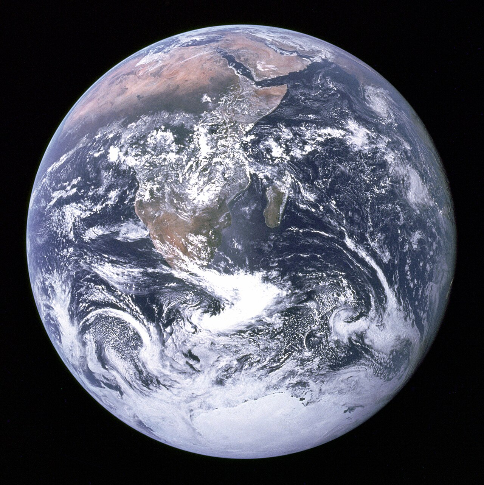 [출처](https://commons.wikimedia.org/wiki/File:The_Earth_seen_from_Apollo_17.jpg) | 태양계 · 출발점(앱 시작 위치) · 실사: 아폴로 17호 '블루 마블' |
| 1 | 금성 (Venus) | 0.277 AU (약 4,139만 km) ≈ 0.0000044 광년 | 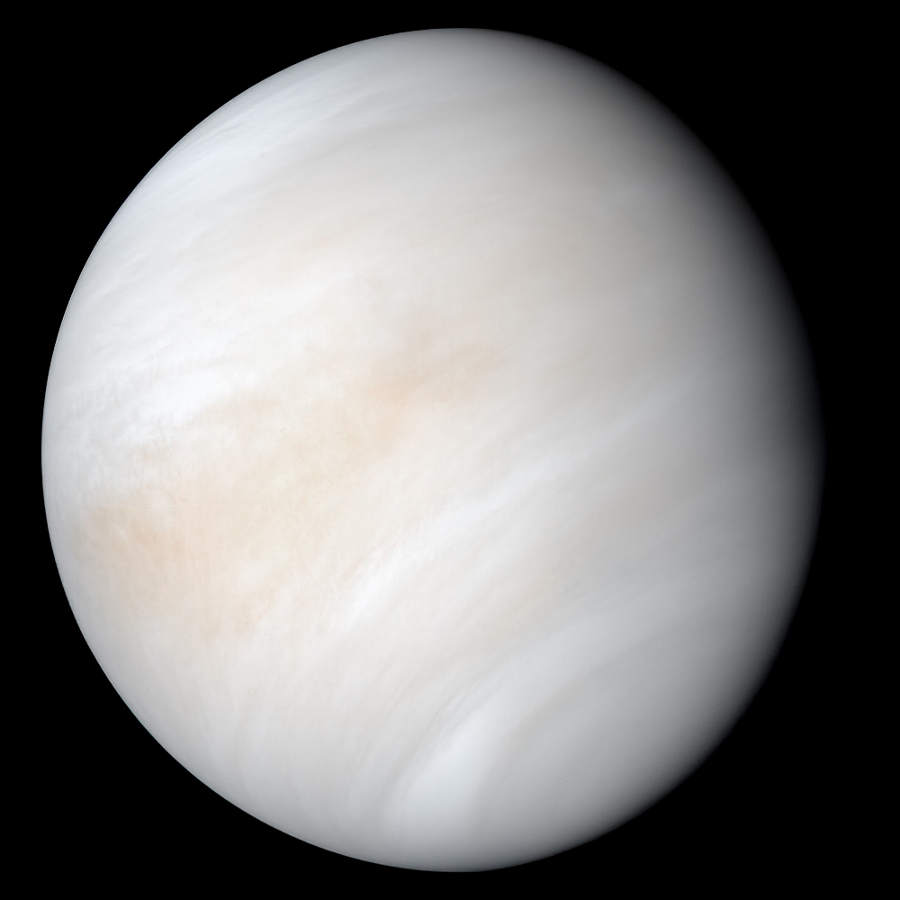 [출처](https://commons.wikimedia.org/wiki/File:Venus_from_Mariner_10.jpg) | 태양계 · 실사(매리너 10호) · 최근접 약 0.26 AU |
| 2 | 화성 (Mars) | 0.524 AU (약 7,834만 km) ≈ 0.0000083 광년 | 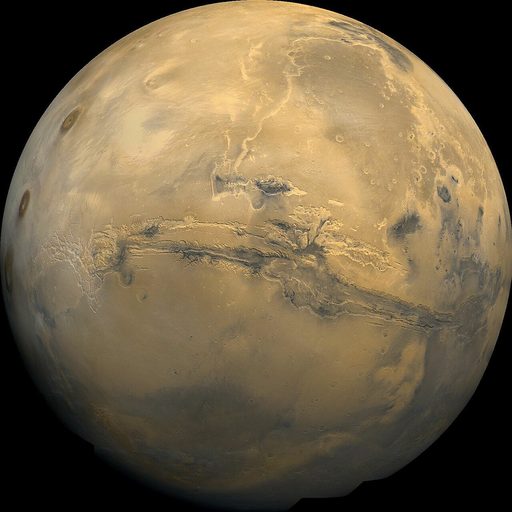 [출처](https://commons.wikimedia.org/wiki/File:Mars_Valles_Marineris.jpeg) | 태양계 · 실사(바이킹 모자이크) · 최근접 약 0.37 AU |
| 3 | 수성 (Mercury) | 0.613 AU (약 9,169만 km) ≈ 0.0000097 광년 | 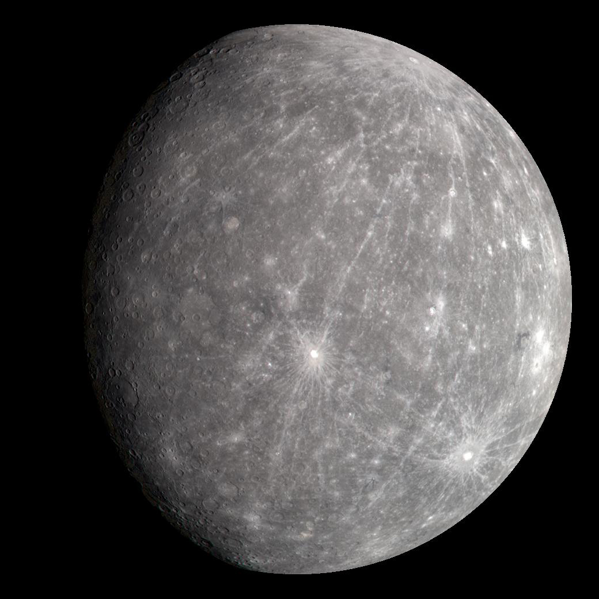 [출처](https://commons.wikimedia.org/wiki/File:Mercury_in_true_color.jpg) | 태양계 · 실사(메신저) · 최근접 약 0.52 AU, 단 시간 평균으로는 지구에 가장 가까운 행성 |
| 4 | 목성 (Jupiter) | 4.203 AU (약 6.29억 km) ≈ 0.000066 광년 | 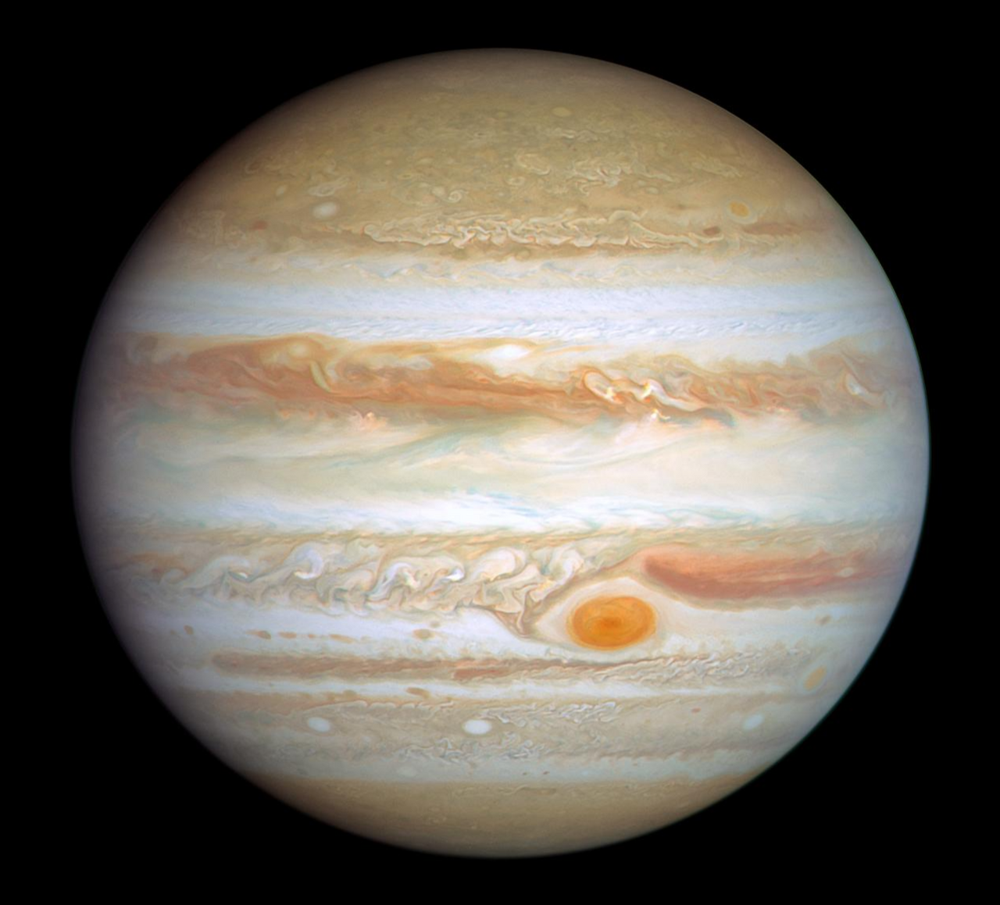 [출처](https://commons.wikimedia.org/wiki/File:Jupiter_OPAL_2024.png) | 태양계 · 실사(허블 OPAL 2024) · 가장 큰 행성 |
| 5 | 토성 (Saturn) | 8.537 AU (약 12.77억 km) ≈ 0.00013 광년 | 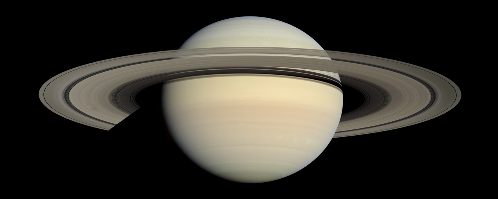 [출처](https://commons.wikimedia.org/wiki/File:Saturn_global_view_from_Cassini,_rings_open_Better_Colour.png) | 태양계 · 실사(카시니) · 고리 |
| 6 | 천왕성 (Uranus) | 18.191 AU (약 27.21억 km) ≈ 0.00029 광년 | 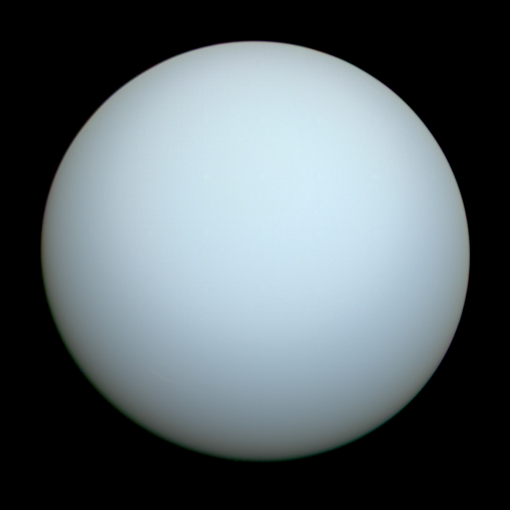 [출처](https://commons.wikimedia.org/wiki/File:Uranus_Voyager2_color_calibrated.png) | 태양계 · 실사(보이저 2호, 색 보정) · 옆으로 누운 자전축 |
| 7 | 해왕성 (Neptune) | 29.069 AU (약 43.49억 km) ≈ 0.00046 광년 | 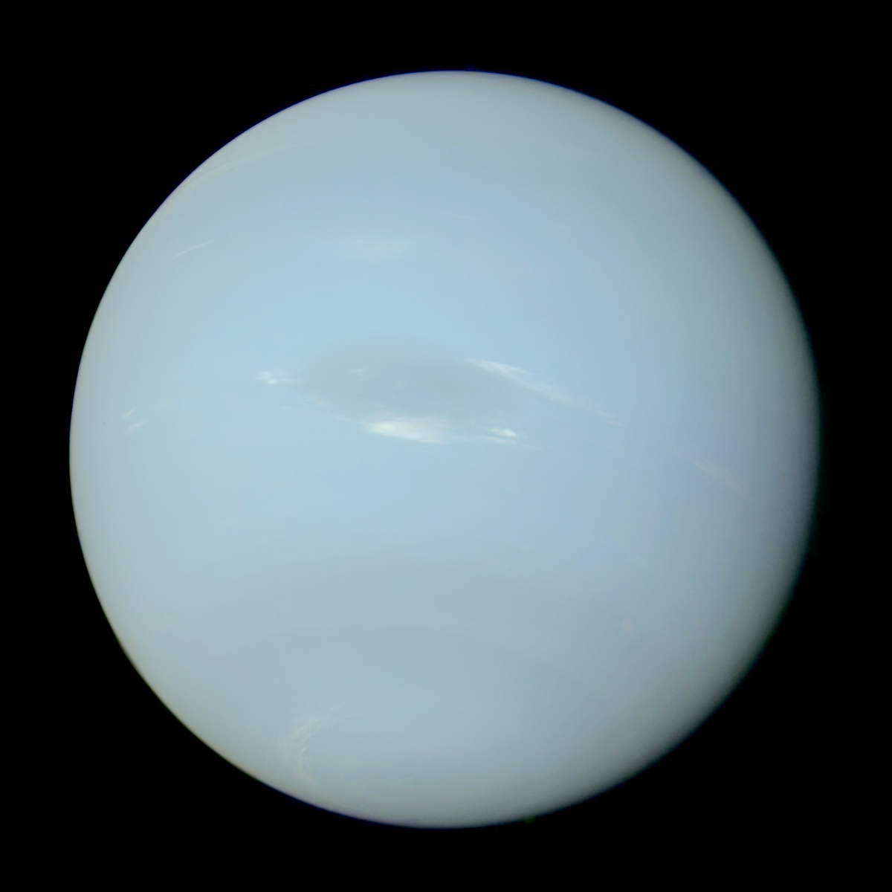 [출처](https://commons.wikimedia.org/wiki/File:Neptune_Voyager2_color_calibrated.png) | 태양계 · 실사(보이저 2호, 색 보정) · 기획서 마일스톤 '해왕성 궤도 통과' |
| 8 | 프록시마 센타우리 b `Proxima Cen b` | 4.24 광년 (1.30 pc) | 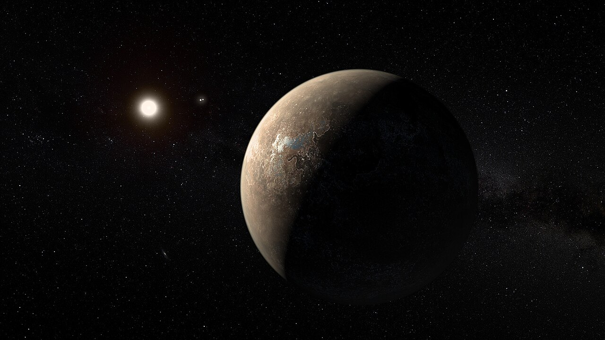 [출처](https://commons.wikimedia.org/wiki/File:Artist%E2%80%99s_impression_of_Proxima_Centauri_b_shown_hypothetically_as_an_arid_rocky_super-earth.jpg) | 상상도 · 가장 가까운 외계행성, 거주가능영역 · 앱의 첫 목적지 별 |
| 9 | 프록시마 센타우리 d `Proxima Cen d` | 4.24 광년 (1.30 pc) | 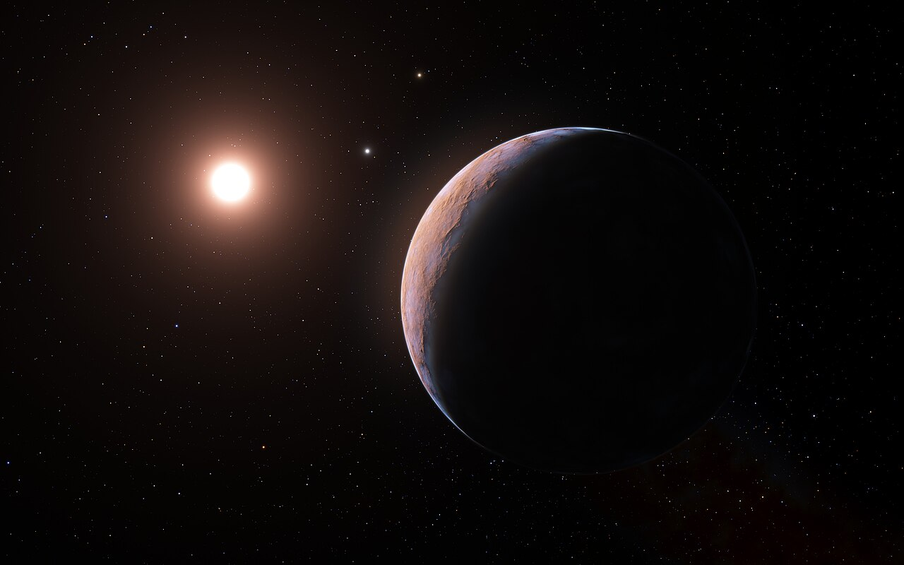 [출처](https://commons.wikimedia.org/wiki/File:Artist%E2%80%99s_impression_of_Proxima_d_(wider_view).jpg) | 상상도 · 지구 질량 약 1/4의 초경량 행성 |
| 10 | 바너드별 b `Barnard b` | 5.96 광년 (1.83 pc) | 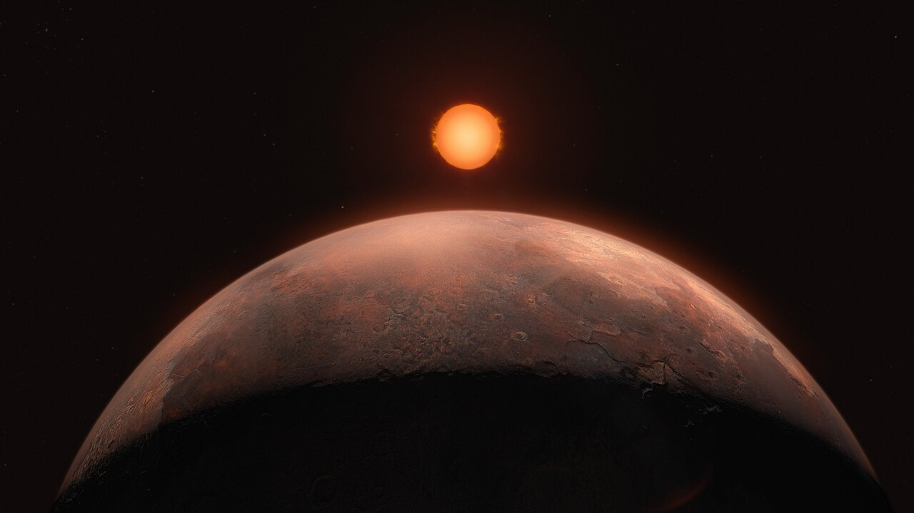 [출처](https://commons.wikimedia.org/wiki/File:Artist%E2%80%99s_impression_of_a_sub-Earth-mass_planet_orbiting_Barnard%E2%80%99s_star_(eso2414a).jpg) | 상상도 · 가장 가까운 단독 별, 2024 발견(이후 c·d·e 추가 확정) |
| 11 | 에리다누스자리 엡실론 b `eps Eri b` | 10.45 광년 (3.20 pc) | 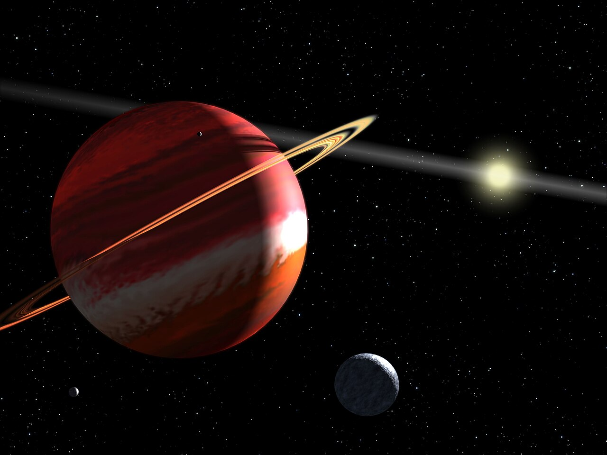 [출처](https://commons.wikimedia.org/wiki/File:Epsilon_Eridani_b.jpg) | 상상도 · 가장 가까운 태양형 별의 목성형 행성 |
| 12 | 로스 128 b `Ross 128 b` | 11.01 광년 (3.37 pc) | 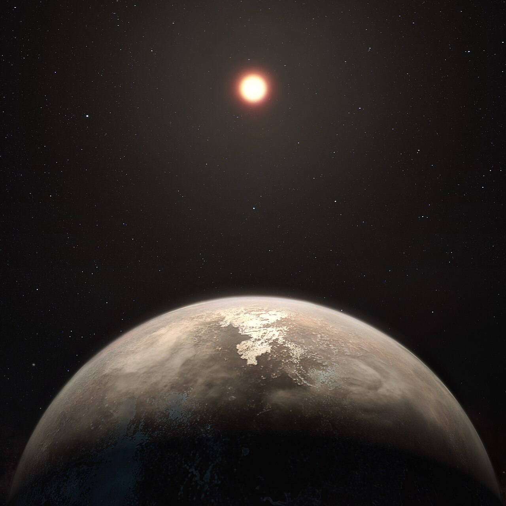 [출처](https://commons.wikimedia.org/wiki/File:Artist%27s_impression_of_the_planet_Ross_128_b.jpg) | 상상도 · 조용한 적색왜성 주위 온대 행성 |
| 13 | 티가든별 b `Teegarden's Star b` | 12.49 광년 (3.83 pc) | 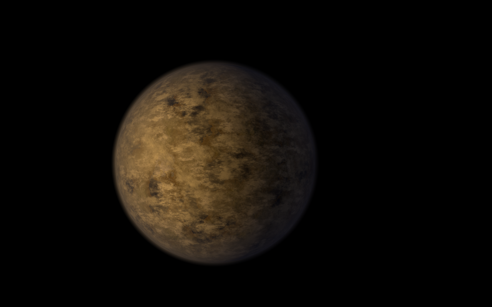 [출처](https://commons.wikimedia.org/wiki/File:Teegarden%27s_Star_B_Artistic_depiction.png) | 상상도 · 지구와 가장 닮은 행성 후보 중 하나 · 이미지는 위키미디어 사용자 상상도(NASA/ESA/ESO 아님) · CC BY-SA: 앱 에셋으로 가공 시 동일 조건(ShareAlike) 배포 의무 — 레퍼런스 전용 권장 |
| 14 | 울프 1061 c `Wolf 1061 c` | 14.04 광년 (4.31 pc) | 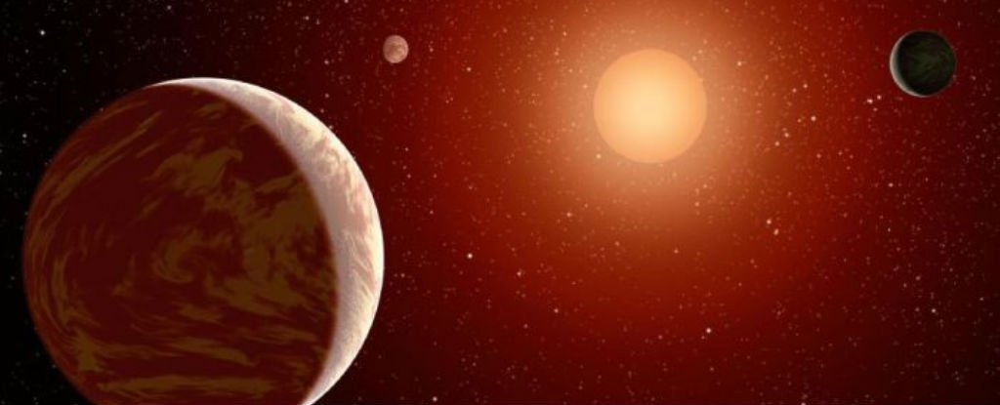 [출처](https://commons.wikimedia.org/wiki/File:Wolf1061Trio-typeSystem-ArtistConcept.jpg) | 상상도(NASA/JPL의 적색왜성 3행성계 일반 상상도 'Planets Under a Red Sun' 크롭, 울프 1061 전용 아님) · 거주가능영역 슈퍼지구 |
| 15 | 글리제 876 b `GJ 876 b` | 15.25 광년 (4.68 pc) | 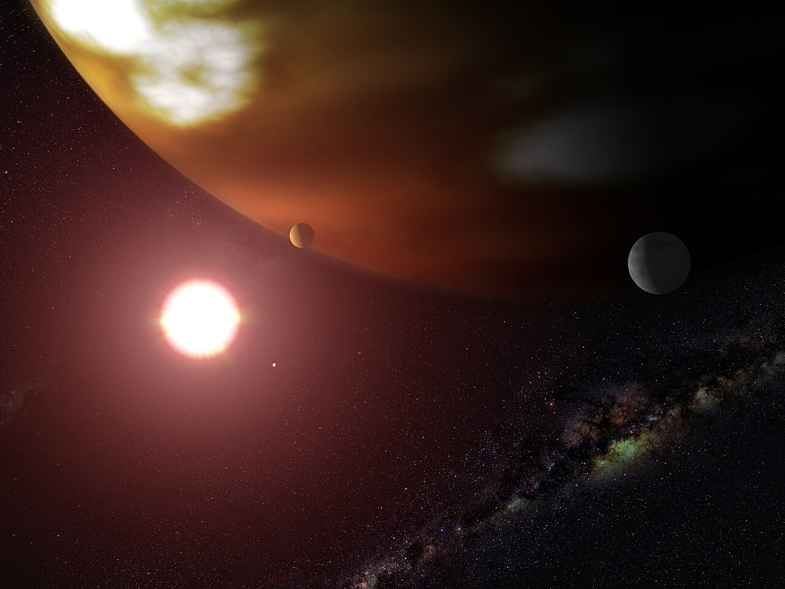 [출처](https://commons.wikimedia.org/wiki/File:Artist%27s_concept_of_Gliese_876_b.jpg) | 상상도 · 적색왜성에서 처음 찾은 행성 중 하나(1998) |
| 16 | 글리제 581 c `GJ 581 c` | 20.54 광년 (6.30 pc) | 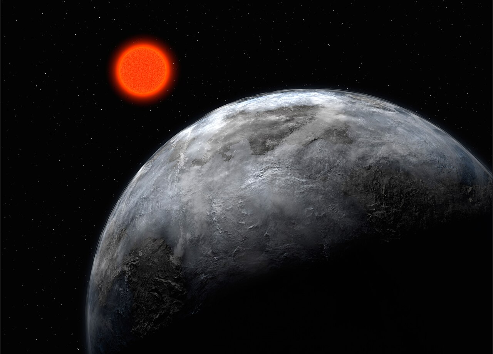 [출처](https://commons.wikimedia.org/wiki/File:Gliese_581_c_-_ESO_Impression.jpg) | 상상도 · 2007년 '첫 거주가능 행성' 후보로 화제 |
| 17 | 글리제 667 Cc `GJ 667 C c` | 23.63 광년 (7.24 pc) | 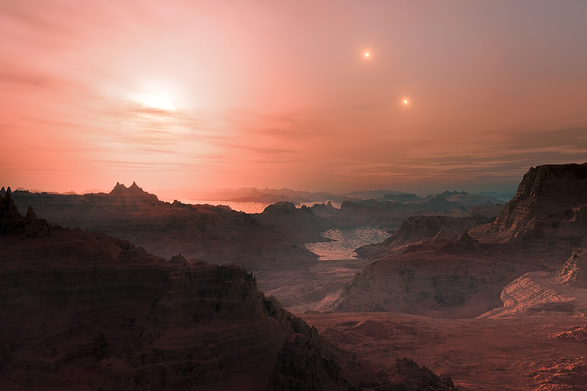 [출처](https://commons.wikimedia.org/wiki/File:Gliese_667_Cc_sunset.jpg) | 상상도 · 삼중성계, 하늘에 해가 3개 |
| 18 | 현미경자리 AU b `AU Mic b` | 31.71 광년 (9.72 pc) | 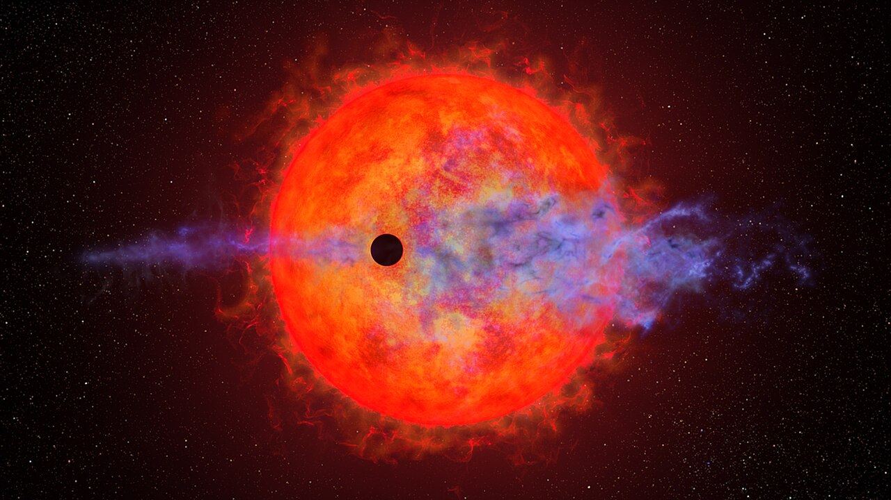 [출처](https://commons.wikimedia.org/wiki/File:Artist%27s_Concept_of_AU_Mic_b_(2023-015).jpg) | 상상도 · 약 2천만 살 젊은 별의 증발하는 행성 |
| 19 | 글리제 12 b `Gliese 12 b` | 39.82 광년 (12.21 pc) | 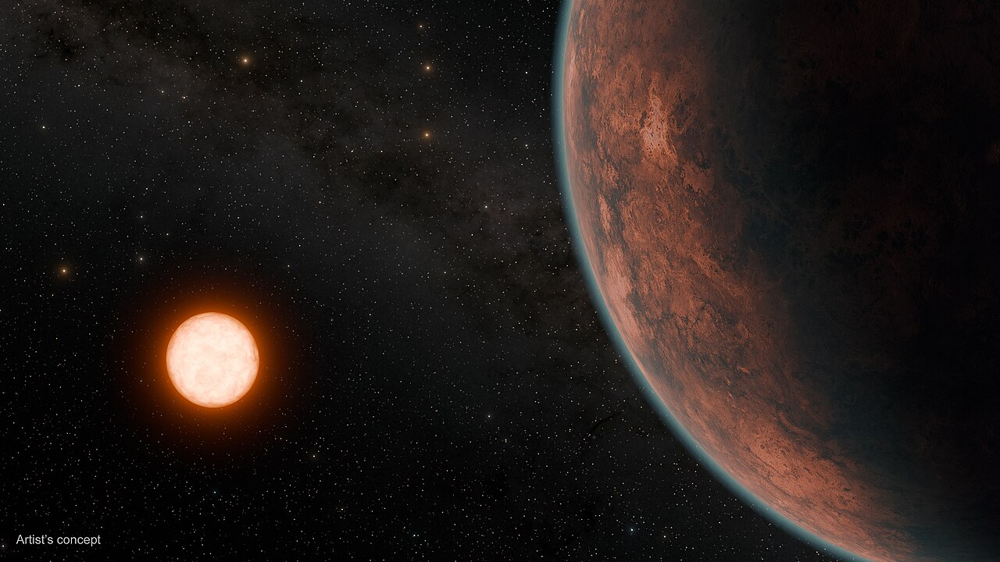 [출처](https://commons.wikimedia.org/wiki/File:Gl12b_Illustration.jpg) | 상상도 · 2024 발견, 지구~금성 크기 온대 행성 |
| 20 | 트라피스트-1 e `TRAPPIST-1 e` | 40.54 광년 (12.43 pc) | 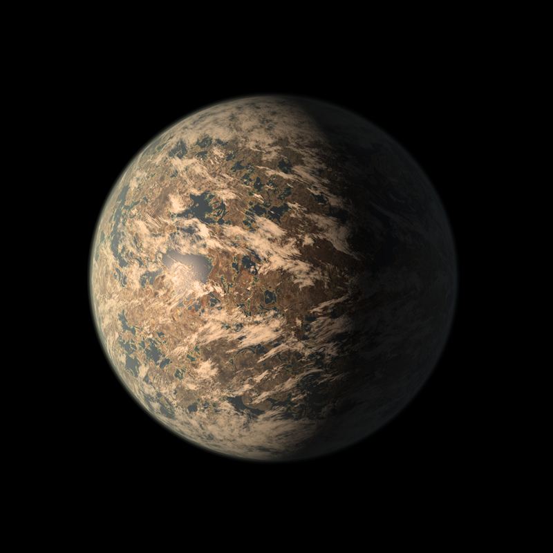 [출처](https://commons.wikimedia.org/wiki/File:TRAPPIST-1e_artist_impression_2018.png) | 상상도 · 7행성계 중 가장 지구형 |
| 21 | 트라피스트-1 f `TRAPPIST-1 f` | 40.54 광년 (12.43 pc) | 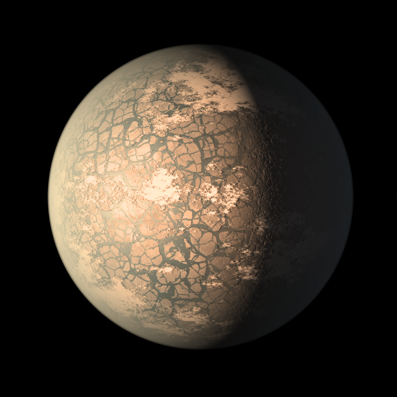 [출처](https://commons.wikimedia.org/wiki/File:TRAPPIST-1f_artist_impression_2018.png) | 상상도 · 7행성계, 물 세계 후보 |
| 22 | 게자리 55 e `55 Cnc e` | 41.05 광년 (12.59 pc) | 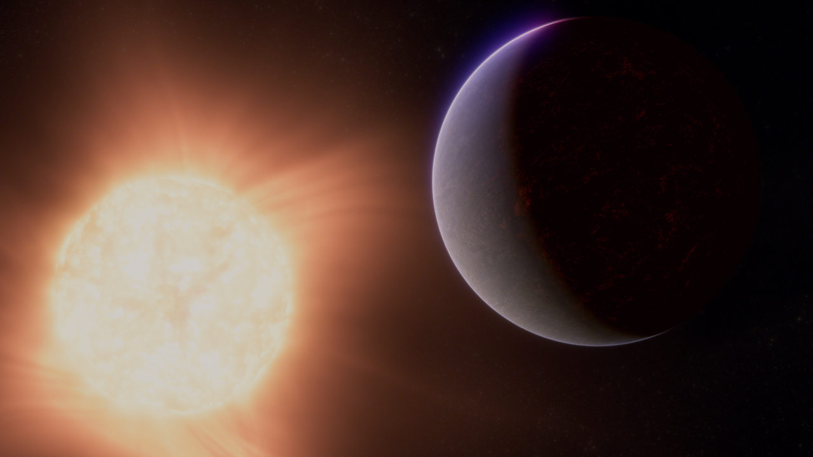 [출처](https://commons.wikimedia.org/wiki/File:Super-Earth_Exoplanet_55_Cancri_e_(Artist%E2%80%99s_Concept)_(2024-102).png) | 상상도 · 용암 바다 슈퍼지구, JWST로 대기 검출 |
| 23 | 글리제 1214 b `GJ 1214 b` | 47.76 광년 (14.64 pc) | 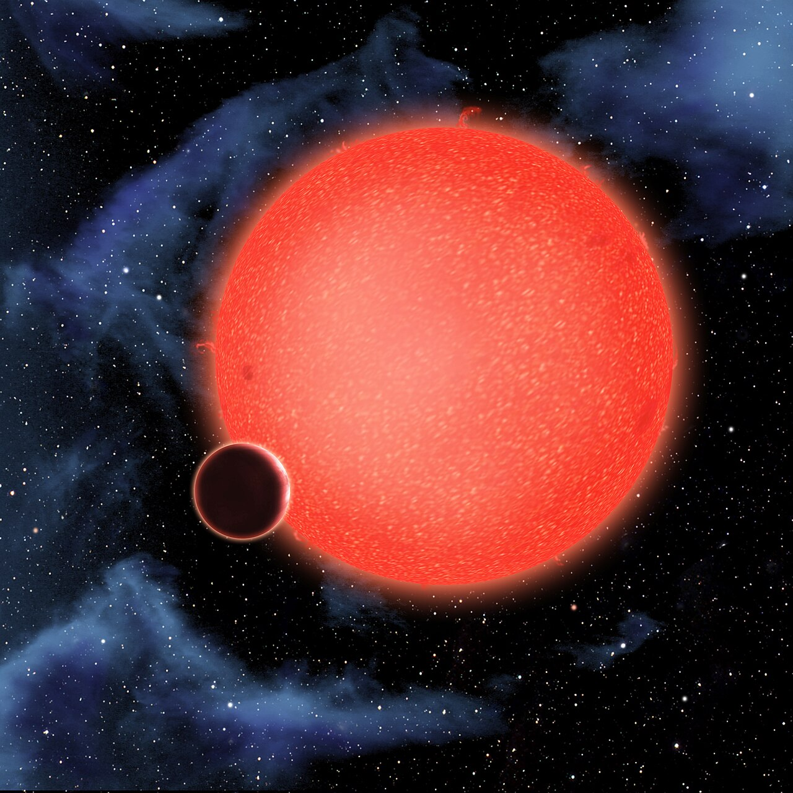 [출처](https://commons.wikimedia.org/wiki/File:GJ_1214_b.jpg) | 상상도 · 안개 낀 '미니 해왕성', 물 세계 후보 |
| 24 | LHS 1140 b `LHS 1140 b` | 48.88 광년 (14.99 pc) | 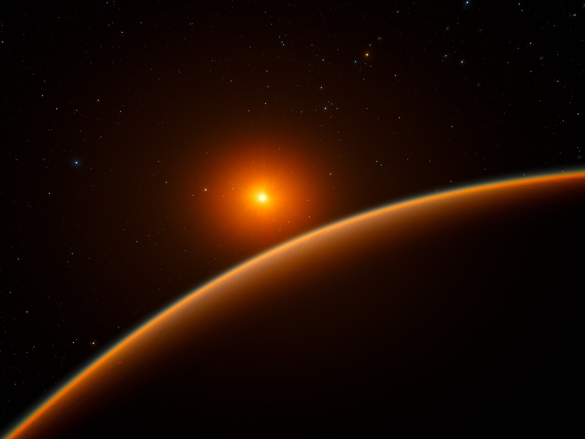 [출처](https://commons.wikimedia.org/wiki/File:Artist%E2%80%99s_impression_of_the_super-Earth_exoplanet_LHS_1140b.jpg) | 상상도 · 물·얼음 세계 후보 슈퍼지구 |
| 25 | 페가수스자리 51 b `51 Peg b` | 50.43 광년 (15.46 pc) | 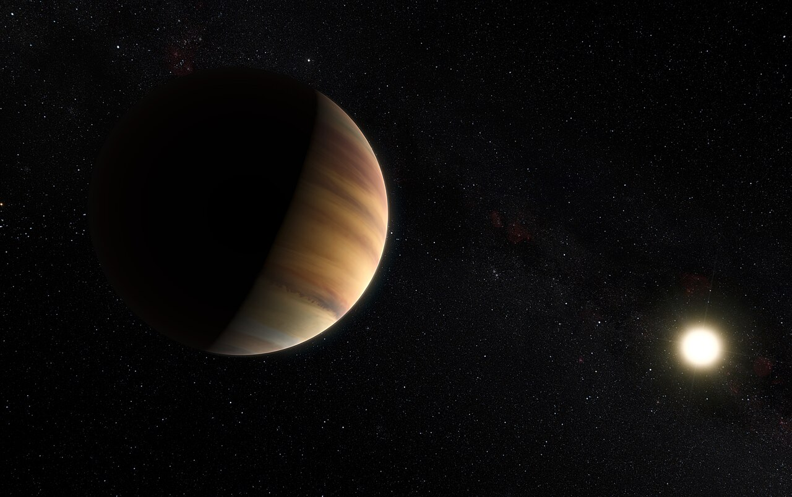 [출처](https://commons.wikimedia.org/wiki/File:Artist_impression_of_the_exoplanet_51_Pegasi_b.jpg) | 상상도 · 태양형 별의 첫 외계행성(1995, 노벨상) |
| 26 | 화가자리 베타 b `bet Pic b` | 64.40 광년 (19.74 pc) | 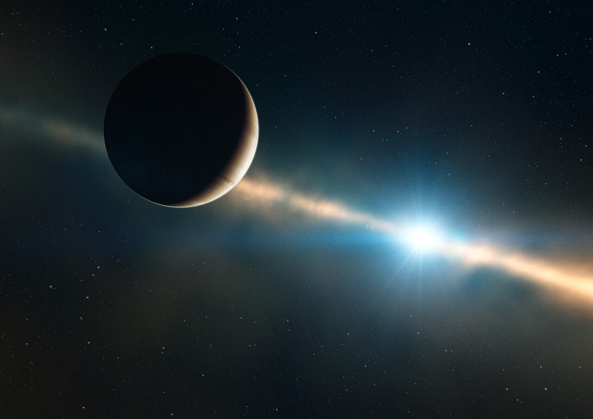 [출처](https://commons.wikimedia.org/wiki/File:Beta_Pictoris_b_(artist%E2%80%99s_impression).jpg) | 상상도 · 직접 촬영된 젊은 거대행성 |
| 27 | HD 189733 b `HD 189733 b` | 64.46 광년 (19.76 pc) | 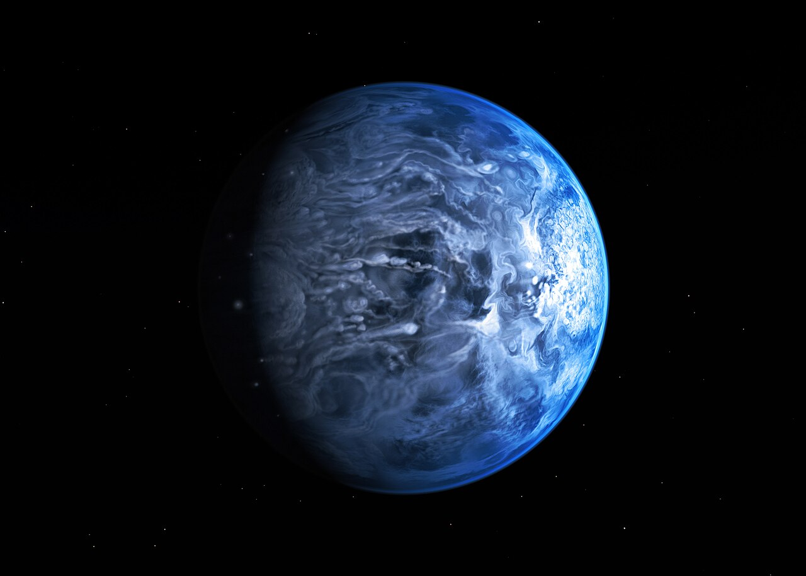 [출처](https://commons.wikimedia.org/wiki/File:Artist%E2%80%99s_impression_of_the_deep_blue_planet_HD_189733b.jpg) | 상상도 · 짙은 파란색, 유리 비가 옆으로 내리는 행성 |
| 28 | TOI-700 d `TOI-700 d` | 101.5 광년 (31.13 pc) | 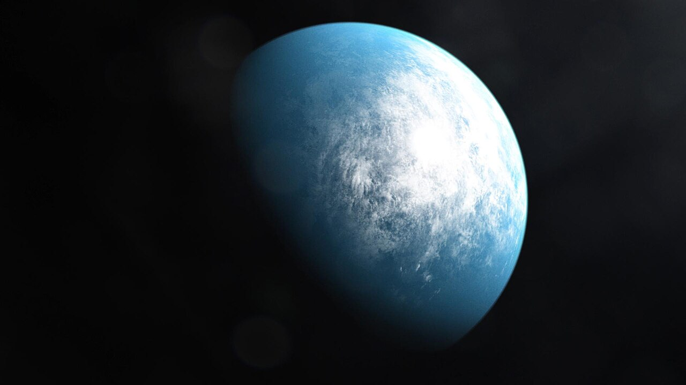 [출처](https://commons.wikimedia.org/wiki/File:PIA23408-Exoplanet-TOI700d-20200106.jpg) | 상상도 · TESS가 찾은 첫 지구 크기 거주가능영역 행성 |
| 29 | K2-18 b `K2-18 b` | 124.0 광년 (38.03 pc) | 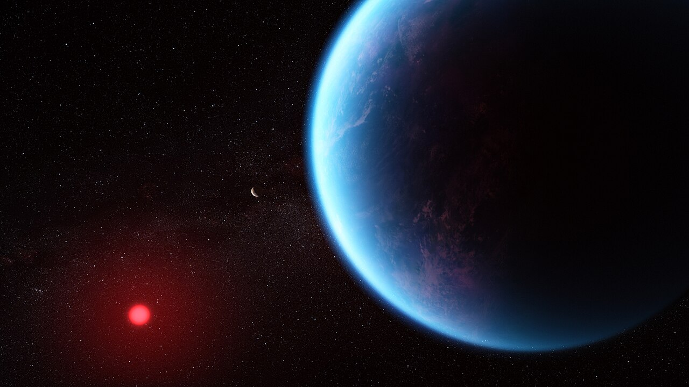 [출처](https://commons.wikimedia.org/wiki/File:Exoplanet_K2-18_b_(Illustration).jpg) | 상상도 · JWST로 메탄·CO₂ 검출, '하이션' 후보 |
| 30 | HR 8799 b `HR 8799 b` | 134.5 광년 (41.24 pc) | 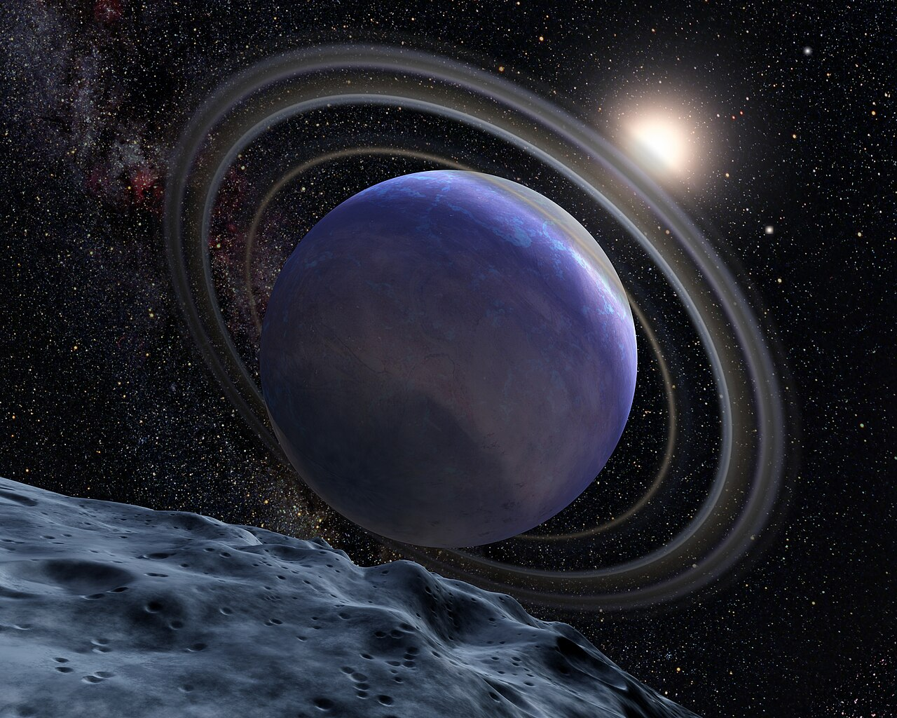 [출처](https://commons.wikimedia.org/wiki/File:Planet_around_HR_8799.jpg) | 상상도 · 행성 4개가 직접 촬영된 계 |
| 31 | HD 209458 b (오시리스) `HD 209458 b` | 157.5 광년 (48.30 pc) | 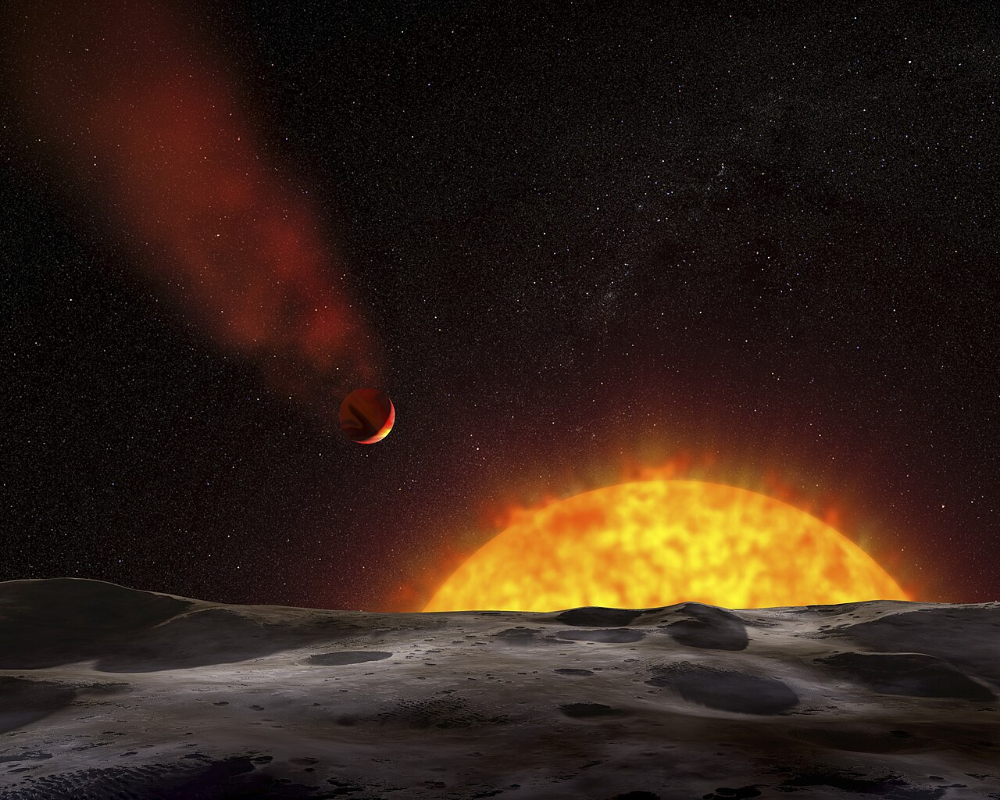 [출처](https://commons.wikimedia.org/wiki/File:Artist%27s_concept_of_exoplanet_with_comet-like_tail_(opo1021a).jpg) | 상상도 · 첫 통과 관측 행성, 대기가 혜성처럼 증발 |
| 32 | 케플러-16 b `Kepler-16 b` | 244.9 광년 (75.09 pc) | 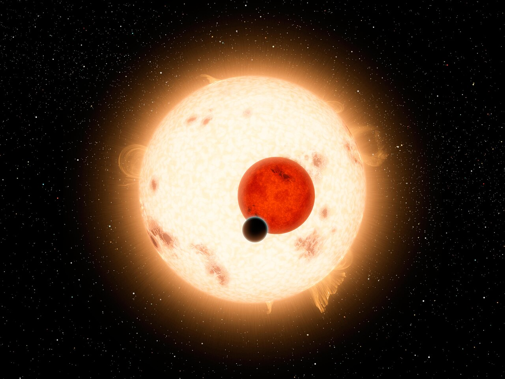 [출처](https://commons.wikimedia.org/wiki/File:Kepler-16.jpg) | 상상도 · 해가 두 개인 '타투인' 행성 |
| 33 | 케플러-1649 c `Kepler-1649 c` | 300.7 광년 (92.19 pc) | 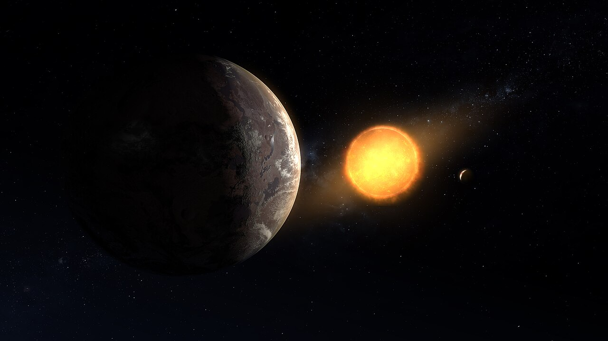 [출처](https://commons.wikimedia.org/wiki/File:PIA23690-Exoplanet-Kepler1649c-20200415.jpg) | 상상도 · 지구 크기 거주가능영역 행성 |
| 34 | 케플러-186 f `Kepler-186 f` | 579.2 광년 (177.59 pc) | 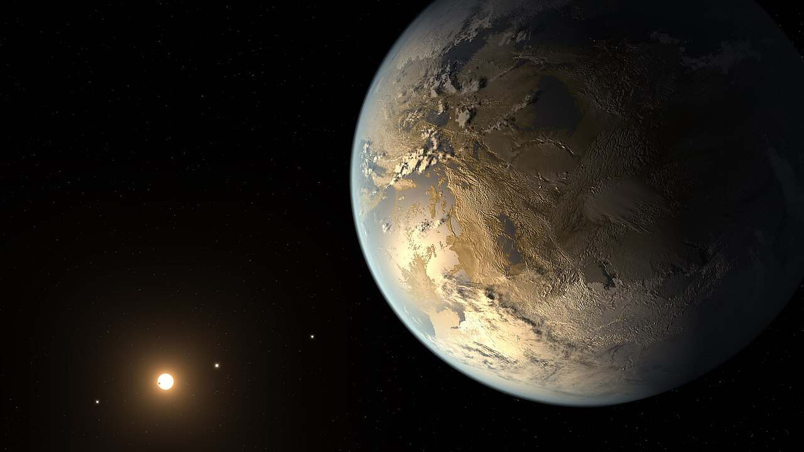 [출처](https://commons.wikimedia.org/wiki/File:Kepler186f-ArtistConcept-20140417.jpg) | 상상도 · 거주가능영역 첫 지구 크기 행성 · ⚠️ 아카이브 논란 플래그(pl_controv_flag=1) |
| 35 | 케플러-22 b `Kepler-22 b` | 634.8 광년 (194.64 pc) | 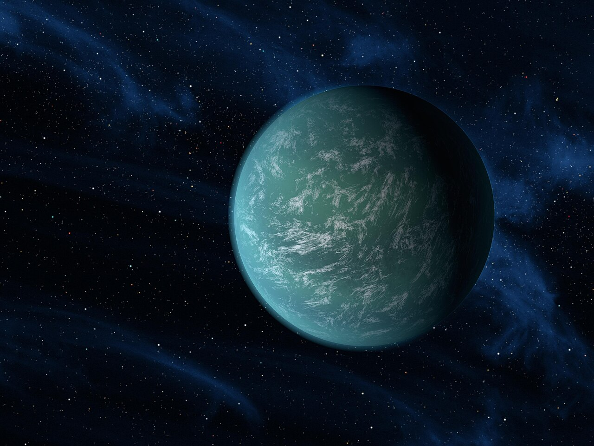 [출처](https://commons.wikimedia.org/wiki/File:Kepler22b-artwork.jpg) | 상상도 · 케플러 망원경의 첫 거주가능영역 행성 |
| 36 | KELT-9 b `KELT-9 b` | 666.8 광년 (204.46 pc) | 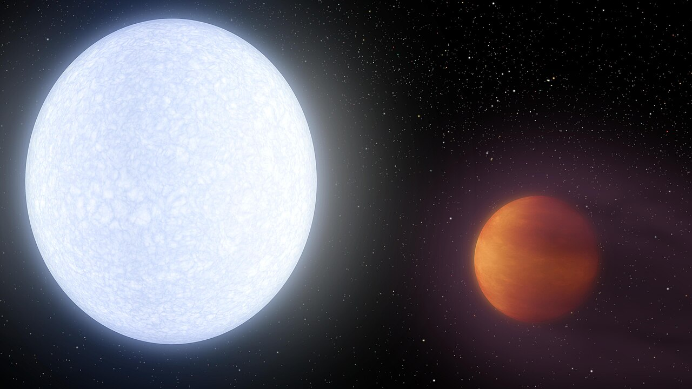 [출처](https://commons.wikimedia.org/wiki/File:Artist%27s_impression_of_KELT-9b_orbiting_KELT-9.jpg) | 상상도 · 가장 뜨거운 행성(낮면 약 4,300℃) |
| 37 | WASP-39 b `WASP-39 b` | 697.9 광년 (213.98 pc) | 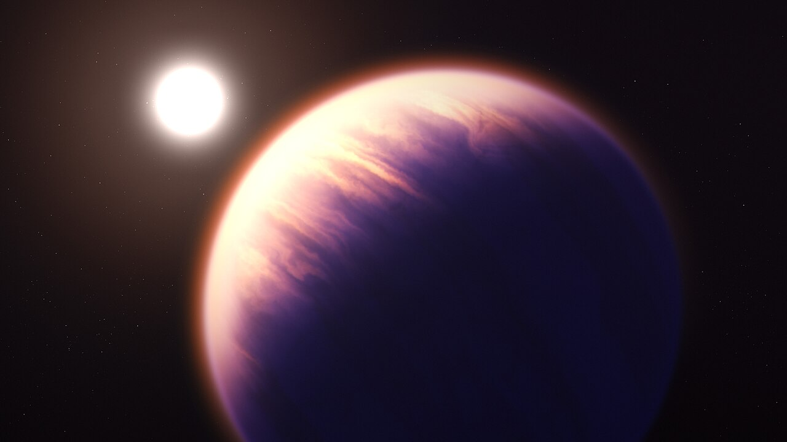 [출처](https://commons.wikimedia.org/wiki/File:Illustration_(Artist%E2%80%99s_Impression)_of_WASP-39_b_and_Its_Star_(weic2221a).jpeg) | 상상도 · JWST가 처음 CO₂를 검출한 행성 |
| 38 | WASP-121 b `WASP-121 b` | 880.3 광년 (269.90 pc) | 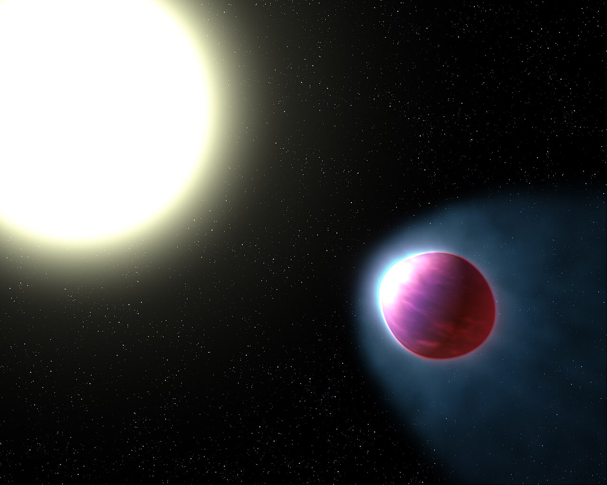 [출처](https://commons.wikimedia.org/wiki/File:WASP-121b_01.jpg) | 상상도 · 금속 증기가 흐르는 초고온 목성 |
| 39 | WASP-12 b `WASP-12 b` | 1,393 광년 (427.25 pc) | 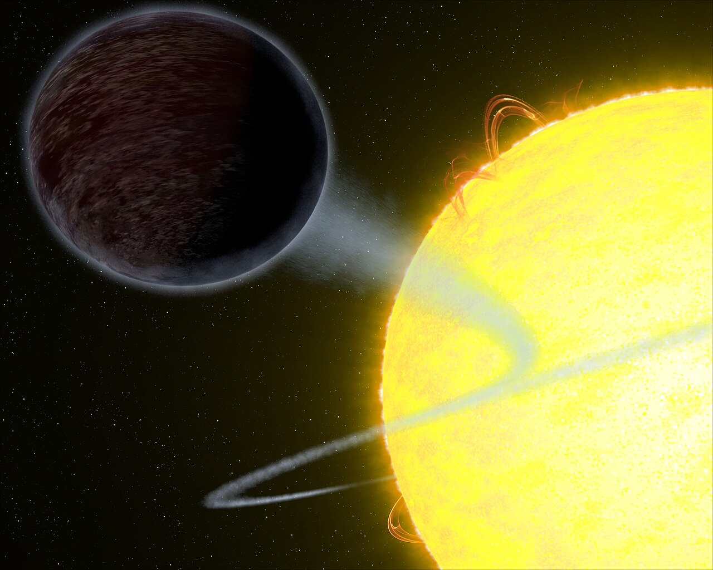 [출처](https://commons.wikimedia.org/wiki/File:The_Pitch-Black_Exoplanet_WASP-12b.jpg) | 상상도 · 아스팔트처럼 새까맣고 별에 먹히는 중 |
| 40 | 케플러-452 b `Kepler-452 b` | 1,799 광년 (551.73 pc) | 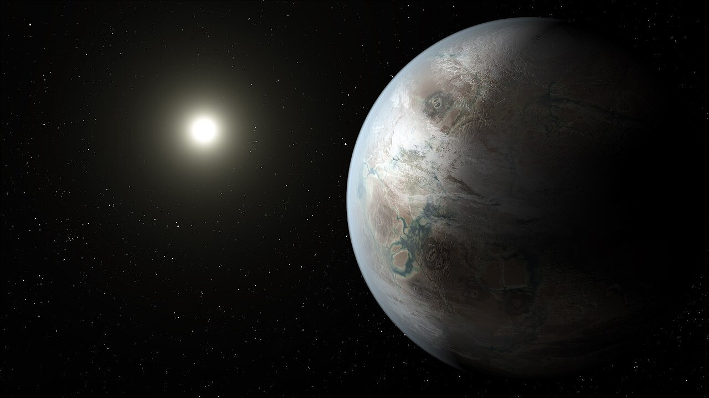 [출처](https://commons.wikimedia.org/wiki/File:Kepler-452b_artist_concept.jpg) | 상상도 · '지구의 사촌', 태양형 별의 거주가능영역 · ⚠️ 아카이브 논란 플래그(pl_controv_flag=1): 통계적 검증에 이견 |
| 41 | PSR B1257+12 c (폴터가이스트, Poltergeist) `PSR B1257+12 c` | 1,957 광년 (600.00 pc) | 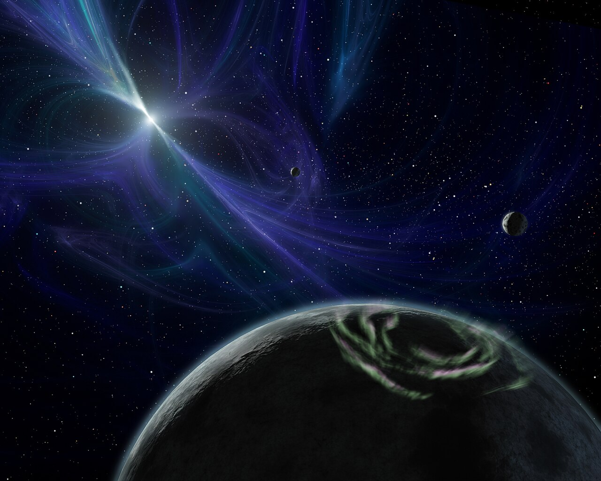 [출처](https://commons.wikimedia.org/wiki/File:Artist%27s_concept_of_PSR_B1257%2B12_system.jpg) | 상상도 · 최초로 확인된 외계행성계(1992), 펄서 주위 |
| 42 | OGLE-2016-BLG-1195L b `OGLE-2016-BLG-1195L b` | 12,753 광년 (3,910.00 pc) | 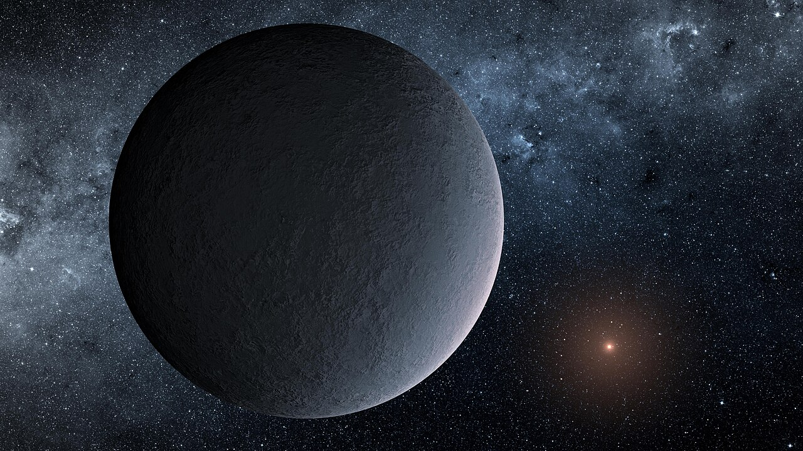 [출처](https://commons.wikimedia.org/wiki/File:PIA21430-Exoplanet-OGLE2016BLG1195Lb-20170426.jpg) | 상상도 · 미세중력렌즈로 찾은 지구 질량급 얼음 행성(2017) |
| 43 | OGLE-2005-BLG-390L b `OGLE-2005-BLG-390L b` | 21,526 광년 (6,600.00 pc) | 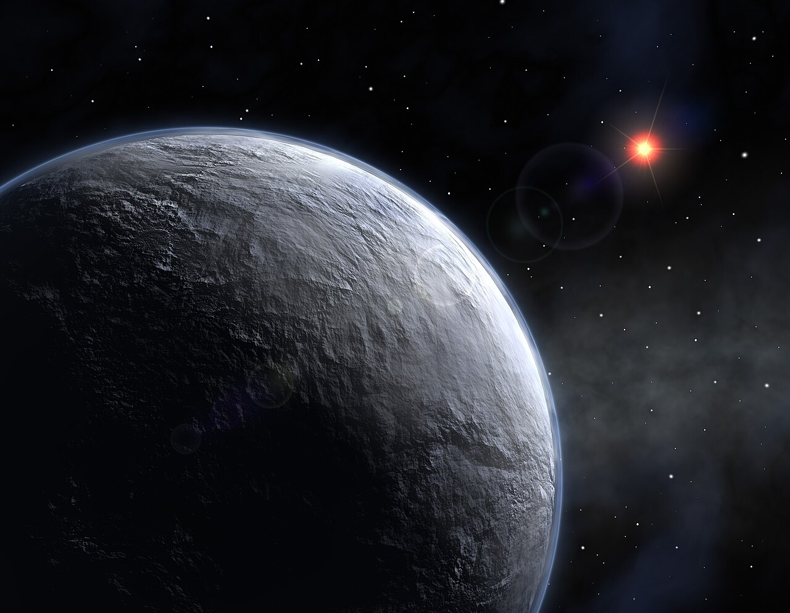 [출처](https://commons.wikimedia.org/wiki/File:ESO_OGLE-2005-BLG-390Lb.jpg) | 상상도 · 미세중력렌즈로 찾은 차가운 슈퍼지구 |
| 44 | SWEEPS-11 b `SWEEPS-11 b` | 27,723 광년 (8,500.00 pc) | - [탐색 영역 실사 사진(링크만)](https://commons.wikimedia.org/wiki/File:Hubble_extrasolar_planet_search_field_in_Sagittarius.jpg) | 공개 라이선스 상상도 없음(링크는 허블 탐색 영역 실사, 행성 자체 아님) · 우리은하 중심부 팽대부의 뜨거운 목성 |

> 외계행성 거리는 모항성까지의 거리라서 같은 항성계 행성끼리 같다(예: 프록시마 b·d, 트라피스트-1 e·f).  
> 외계행성 37개는 모두 NASA Exoplanet Archive `pscomppars`에 등재돼 있다. 단 **케플러-186 f · 케플러-452 b 2개는 아카이브 논란 플래그(`pl_controv_flag=1`)**가 붙어 있어 존재·검증에 이견이 있다(나머지 35개는 0).

## 참고: 왜소행성 (본 표 제외)

| 이름 | 거리(같은 기준: 궤도 반지름 차) | 이미지 | 비고 |
| --- | --- | --- | --- |
| 세레스 | 1.8 AU (약 2.6억 km) | - | 소행성대 최대 천체 |
| 명왕성 | 38.5 AU (약 57.6억 km) | 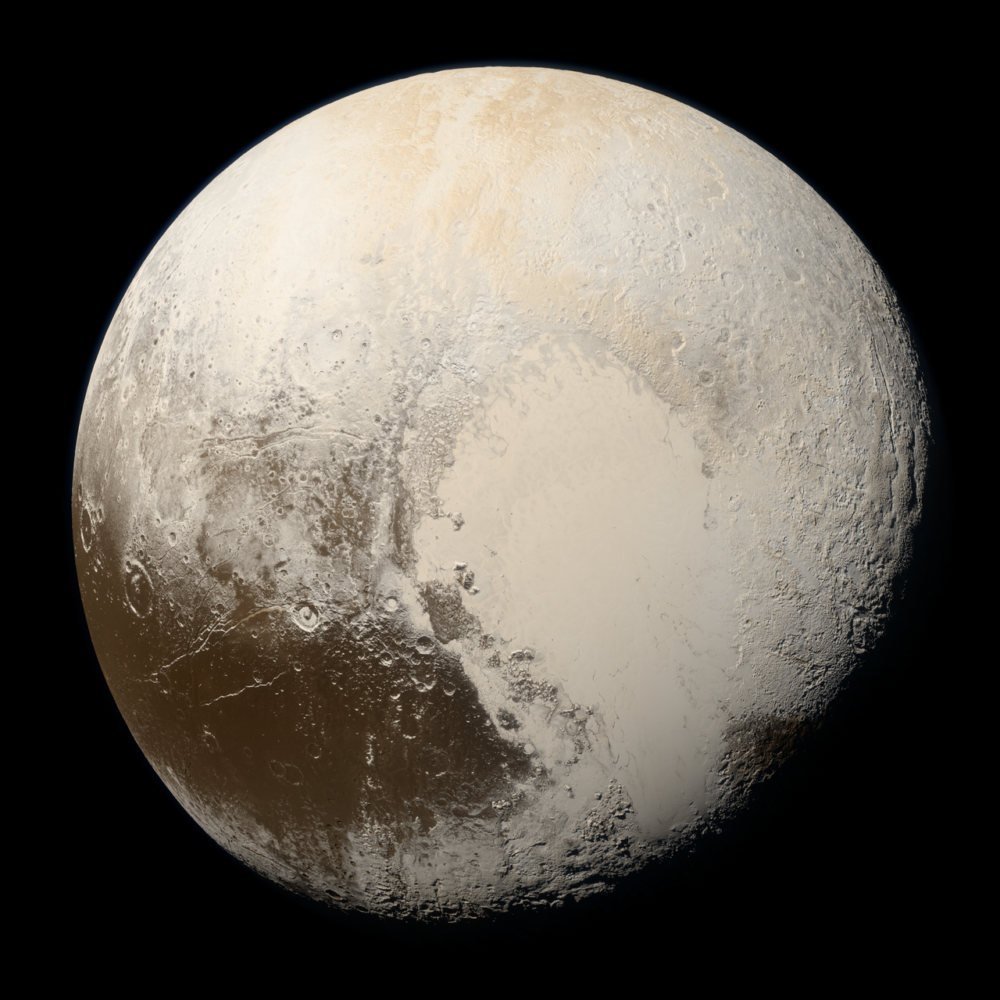 [출처](https://commons.wikimedia.org/wiki/File:Pluto_in_True_Color_-_High-Res.png) | 실사(뉴호라이즌스) · 2006년 왜소행성으로 재분류 |
| 하우메아 | 42.1 AU (약 63.0억 km) | - | 길쭉한 타원체 |
| 마케마케 | 44.4 AU (약 66.4억 km) | - |  |
| 에리스 | 66.9 AU (약 100.1억 km) | - | 명왕성과 비슷한 크기 |

## 제외·보류한 후보

| 후보 | 이유 |
| --- | --- |
| 울프 359 b·c | NASA Exoplanet Archive에 확정 행성으로 등재되지 않음(미확정 후보) |
| 고래자리 타우 e | 아카이브에 없음(아카이브에는 f·g·h만 있음) |
| 고래자리 타우 f (11.75광년) | 아카이브에 등재되었으나 논란 플래그(`pl_controv_flag=1`, g·h도 동일) + 공개 라이선스 상상도 없음 |
| GJ 1061 c·d (11.98광년), 고래자리 YZ b (12.11광년), 라이텐 b `GJ 273 b` (19.31광년), LTT 1445 A b (22.40광년) | 확정 행성이고 거리도 확인했지만, NASA/ESA/ESO의 공개 라이선스 상상도를 찾지 못해 표에서 뺐다. 필요하면 항로 목적지로 추가 가능 |

## 출처/라이선스

모든 이미지는 Wikimedia Commons를 통해 내려받았고, 라이선스·저작자는 Commons 메타데이터 기준이다. 저작권 보호(참고용) 이미지는 없다. CC BY / CC BY-SA 이미지는 사용 시 아래 크레딧 표기가 필요하다.

| 파일 | 크레딧 | 라이선스 | 출처 |
| --- | --- | --- | --- |
| `images/earth.jpg` | NASA/Apollo 17 crew; taken by either Harrison Schmitt or Ron Evans | Public domain | [Commons](https://commons.wikimedia.org/wiki/File:The_Earth_seen_from_Apollo_17.jpg) |
| `images/mercury.jpg` | NASA/Johns Hopkins University Applied Physics Laboratory/Arizona State University/Carnegie Institution of Washington | Public domain | [Commons](https://commons.wikimedia.org/wiki/File:Mercury_in_true_color.jpg) |
| `images/venus.jpg` | NASA/JPL-Caltech | Public domain | [Commons](https://commons.wikimedia.org/wiki/File:Venus_from_Mariner_10.jpg) |
| `images/mars.jpg` | NASA / USGS (see PIA04304 catalog page) | Public domain | [Commons](https://commons.wikimedia.org/wiki/File:Mars_Valles_Marineris.jpeg) |
| `images/jupiter.png` | NASA/STSCI (S.T.A.R.S) | Public domain | [Commons](https://commons.wikimedia.org/wiki/File:Jupiter_OPAL_2024.png) |
| `images/saturn.png` | NASA / JPL-Caltech / SSI / color composite by Gordan Ugarkovic | Public domain | [Commons](https://commons.wikimedia.org/wiki/File:Saturn_global_view_from_Cassini,_rings_open_Better_Colour.png) |
| `images/uranus.png` | Ardenau4 | CC0 | [Commons](https://commons.wikimedia.org/wiki/File:Uranus_Voyager2_color_calibrated.png) |
| `images/neptune.png` | NASA / Voyager 2 / PDS / OPUS / Ardenau4 | CC0 | [Commons](https://commons.wikimedia.org/wiki/File:Neptune_Voyager2_color_calibrated.png) |
| `images/pluto.png` | NASA/Johns Hopkins University Applied Physics Laboratory/Southwest Research Institute/Alex Parker | Public domain | [Commons](https://commons.wikimedia.org/wiki/File:Pluto_in_True_Color_-_High-Res.png) |
| `images/proxima-centauri-b.jpg` | ESO/M. Kornmesser | CC BY 4.0 | [Commons](https://commons.wikimedia.org/wiki/File:Artist%E2%80%99s_impression_of_Proxima_Centauri_b_shown_hypothetically_as_an_arid_rocky_super-earth.jpg) |
| `images/proxima-centauri-d.jpg` | ESO/L. Calçada | CC BY 4.0 | [Commons](https://commons.wikimedia.org/wiki/File:Artist%E2%80%99s_impression_of_Proxima_d_(wider_view).jpg) |
| `images/barnards-star-b.jpg` | ESO/M. Kornmesser | CC BY 4.0 | [Commons](https://commons.wikimedia.org/wiki/File:Artist%E2%80%99s_impression_of_a_sub-Earth-mass_planet_orbiting_Barnard%E2%80%99s_star_(eso2414a).jpg) |
| `images/epsilon-eridani-b.jpg` | NASA, ESA, G. Bacon | Public domain | [Commons](https://commons.wikimedia.org/wiki/File:Epsilon_Eridani_b.jpg) |
| `images/ross-128-b.jpg` | ESO/M. Kornmesser | CC BY 4.0 | [Commons](https://commons.wikimedia.org/wiki/File:Artist%27s_impression_of_the_planet_Ross_128_b.jpg) |
| `images/teegardens-star-b.png` | Bubblesorg (위키미디어 사용자) | CC BY-SA 4.0 (ShareAlike: 가공·재배포 시 동일 라이선스 의무) | [Commons](https://commons.wikimedia.org/wiki/File:Teegarden%27s_Star_B_Artistic_depiction.png) |
| `images/wolf-1061-c.jpg` | NASA/JPL-Caltech (원본 'Planets Under a Red Sun'의 크롭) | Public domain | [Commons](https://commons.wikimedia.org/wiki/File:Wolf1061Trio-typeSystem-ArtistConcept.jpg) |
| `images/gliese-876-b.jpg` | NASA/ESA and G. Bacon (STScI) | Public domain | [Commons](https://commons.wikimedia.org/wiki/File:Artist%27s_concept_of_Gliese_876_b.jpg) |
| `images/gliese-581-c.jpg` | ESO/L. Calçada | CC BY 4.0 | [Commons](https://commons.wikimedia.org/wiki/File:Gliese_581_c_-_ESO_Impression.jpg) |
| `images/gliese-667-cc.jpg` | ESO/L. Calçada | CC BY 4.0 | [Commons](https://commons.wikimedia.org/wiki/File:Gliese_667_Cc_sunset.jpg) |
| `images/au-mic-b.jpg` | Artwork NASA, ESA, Joseph Olmsted (STScI) | Public domain | [Commons](https://commons.wikimedia.org/wiki/File:Artist%27s_Concept_of_AU_Mic_b_(2023-015).jpg) |
| `images/gliese-12-b.jpg` | NASA/JPL-Caltech/R. Hurt (Caltech-IPAC) | Public domain | [Commons](https://commons.wikimedia.org/wiki/File:Gl12b_Illustration.jpg) |
| `images/trappist-1e.png` | NASA/JPL-Caltech | Public domain | [Commons](https://commons.wikimedia.org/wiki/File:TRAPPIST-1e_artist_impression_2018.png) |
| `images/trappist-1f.png` | NASA/JPL-Caltech | Public domain | [Commons](https://commons.wikimedia.org/wiki/File:TRAPPIST-1f_artist_impression_2018.png) |
| `images/55-cancri-e.png` | Illustration NASA, ESA, CSA, Ralf Crawford (STScI) | Public domain | [Commons](https://commons.wikimedia.org/wiki/File:Super-Earth_Exoplanet_55_Cancri_e_(Artist%E2%80%99s_Concept)_(2024-102).png) |
| `images/gj-1214-b.jpg` | NASA, ESA, and D. Aguilar (Harvard-Smithsonian Center for Astrophysics) | CC BY 4.0 | [Commons](https://commons.wikimedia.org/wiki/File:GJ_1214_b.jpg) |
| `images/lhs-1140-b.jpg` | ESO/spaceengine.org | CC BY 4.0 | [Commons](https://commons.wikimedia.org/wiki/File:Artist%E2%80%99s_impression_of_the_super-Earth_exoplanet_LHS_1140b.jpg) |
| `images/51-pegasi-b.jpg` | ESO/M. Kornmesser/Nick Risinger (skysurvey.org) | CC BY 4.0 | [Commons](https://commons.wikimedia.org/wiki/File:Artist_impression_of_the_exoplanet_51_Pegasi_b.jpg) |
| `images/beta-pictoris-b.jpg` | ESO/L. Calçada | CC BY 4.0 | [Commons](https://commons.wikimedia.org/wiki/File:Beta_Pictoris_b_(artist%E2%80%99s_impression).jpg) |
| `images/hd-189733-b.jpg` | NASA, ESA, M. Kornmesser | CC BY 4.0 | [Commons](https://commons.wikimedia.org/wiki/File:Artist%E2%80%99s_impression_of_the_deep_blue_planet_HD_189733b.jpg) |
| `images/toi-700-d.jpg` | NASA's Goddard Space Flight Center | Public domain | [Commons](https://commons.wikimedia.org/wiki/File:PIA23408-Exoplanet-TOI700d-20200106.jpg) |
| `images/k2-18-b.jpg` | Illustration: NASA, ESA, CSA, Joseph Olmsted (STScI) Science: Nikku Madhusudhan (IoA) | Public domain | [Commons](https://commons.wikimedia.org/wiki/File:Exoplanet_K2-18_b_(Illustration).jpg) |
| `images/hr-8799-b.jpg` | NASA, ESA, and G. Bacon (STScI) | Public domain | [Commons](https://commons.wikimedia.org/wiki/File:Planet_around_HR_8799.jpg) |
| `images/hd-209458-b.jpg` | Artwork Credit: NASA, ESA, and G. Bacon (STScI). Science Credit: J. Linsky (University of Colorado, Boulder, Colo., USA) | CC BY 4.0 | [Commons](https://commons.wikimedia.org/wiki/File:Artist%27s_concept_of_exoplanet_with_comet-like_tail_(opo1021a).jpg) |
| `images/kepler-16b.jpg` | NASA/JPL-Caltech | Public domain | [Commons](https://commons.wikimedia.org/wiki/File:Kepler-16.jpg) |
| `images/kepler-1649c.jpg` | NASA/Ames Research Center/Daniel Rutter | Public domain | [Commons](https://commons.wikimedia.org/wiki/File:PIA23690-Exoplanet-Kepler1649c-20200415.jpg) |
| `images/kepler-186f.jpg` | NASA Ames/SETI Institute/JPL-Caltech | Public domain | [Commons](https://commons.wikimedia.org/wiki/File:Kepler186f-ArtistConcept-20140417.jpg) |
| `images/kepler-22b.jpg` | NASA/Ames/JPL-Caltech | Public domain | [Commons](https://commons.wikimedia.org/wiki/File:Kepler22b-artwork.jpg) |
| `images/kelt-9b.jpg` | NASA | Public domain | [Commons](https://commons.wikimedia.org/wiki/File:Artist%27s_impression_of_KELT-9b_orbiting_KELT-9.jpg) |
| `images/wasp-39b.jpg` | NASA, ESA, CSA, J. Olmsted (STScI) | CC BY 4.0 | [Commons](https://commons.wikimedia.org/wiki/File:Illustration_(Artist%E2%80%99s_Impression)_of_WASP-39_b_and_Its_Star_(weic2221a).jpeg) |
| `images/wasp-121b.jpg` | NASA, ESA, and G. Bacon (STSci) | CC BY 4.0 | [Commons](https://commons.wikimedia.org/wiki/File:WASP-121b_01.jpg) |
| `images/wasp-12b.jpg` | NASA, ESA, and G. Bacon (STScI) | CC BY 4.0 | [Commons](https://commons.wikimedia.org/wiki/File:The_Pitch-Black_Exoplanet_WASP-12b.jpg) |
| `images/kepler-452b.jpg` | NASA Ames/JPL-Caltech/T. Pyle | Public domain | [Commons](https://commons.wikimedia.org/wiki/File:Kepler-452b_artist_concept.jpg) |
| `images/psr-b1257-12-c.jpg` | NASA/JPL-Caltech | Public domain | [Commons](https://commons.wikimedia.org/wiki/File:Artist%27s_concept_of_PSR_B1257%2B12_system.jpg) |
| `images/ogle-2016-blg-1195lb.jpg` | NASA/JPL-Caltech (PIA21430) | Public domain | [Commons](https://commons.wikimedia.org/wiki/File:PIA21430-Exoplanet-OGLE2016BLG1195Lb-20170426.jpg) |
| `images/ogle-2005-blg-390lb.jpg` | ESO | CC BY 3.0 | [Commons](https://commons.wikimedia.org/wiki/File:ESO_OGLE-2005-BLG-390Lb.jpg) |
| (링크만, 미다운로드) SWEEPS 탐색 영역 | NASA, ESA, K. Sahu (STScI) and the SWEEPS science team | CC BY 4.0 | [Commons](https://commons.wikimedia.org/wiki/File:Hubble_extrasolar_planet_search_field_in_Sagittarius.jpg) |

**데이터 출처:** 외계행성 확정 여부·거리 — [NASA Exoplanet Archive, Planetary Systems Composite Parameters](https://exoplanetarchive.ipac.caltech.edu/cgi-bin/TblView/nph-tblView?app=ExoTbls&config=PSCompPars) (2026-11-25 조회). 태양계 궤도 반지름 — NASA 행성별 Fact Sheet의 Semimajor axis(AU) 값([예: uranusfact.html](https://nssdc.gsfc.nasa.gov/planetary/factsheet/uranusfact.html); 수성 0.38710, 금성 0.72333, 지구 1.00000, 화성 1.52366, 목성 5.20336, 토성 9.53707, 천왕성 19.19126, 해왕성 30.06896 AU). 왜소행성 값은 대략치.
