# 우주선 레퍼런스 (FocusAstro 유저 우주선)

> **목적:** FocusAstro 유저를 표현할 우주선을 정하기 위한 레퍼런스입니다. 작은 크기의 측면 스크롤 화면에서도 읽히는 단순한 실루엣, 둥근 창, 배기 연기를 기준으로 모았고, 아늑하고 조용한(ASMR) 분위기와 이후 꾸미기 확장을 고려했습니다.
>
> - **크롤링 날짜:** 2026-11-25
> - **사용 도구**
>   - **aside CLI** (`aside exec --effort low`): 탐색과 발견을 맡았습니다. Dribbble, Behance, ArtStation, Pinterest와 게임 공식 페이지(표의 D 항목 전부), Kenney와 OpenGameArt 팩 후보(Simple Space, Space Kit, Space Shooter Remastered, Modular Ships, 2D Ships with Engines, Animated Spaceships, Spaceship Set 32x32), Wikimedia 아이콘 후보(Green left-facing rocket, Twemoji)를 찾았습니다.
>   - **Scrapling 0.5.1** (`Fetcher`): 페이지 수집, 라이선스 확인, 이미지 다운로드를 맡았습니다. Wikimedia Commons API 검색으로 NASA 우주선과 이모지 이미지를, OpenGameArt CC0 검색 결과 페이지로 8-bit Space Shuttle, Apollo Lander, Rockets, Rocket, Dino Spaceship, i-are-spaceship을 찾았습니다. 모든 오픈 라이선스 이미지는 Scrapling으로 받았고, 매직 바이트로 실제 이미지인지 확인했습니다. SVG 썸네일(webp)은 macOS `sips`로 PNG로 바꿨습니다. 검수 후 보완: OpenGameArt Rockets는 SVG 원본을 `sips`로 1280px PNG로 래스터화했고, 저해상도 픽셀아트(8-bit Space Shuttle, Modular Ships 원본 시트)는 nearest-neighbor로 정수배 확대해 저장했습니다. Orion 직교 측면도를 Commons API로 추가했습니다.
> - **함께 본 자료:** `docs/CONCEPT.md`, `docs/CONTEXT.md`, `docs/SCREENS.md`, `docs/screens/design/*.jpeg`(화이트보드 스케치: 메인 화면의 **달걀형 캡슐 + 둥근 창**, 출항 화면의 **가로 속도선**), `docs/screens/refs/ff-*.png`(FocusFlight의 어두운 미니멀 UI)

## 범례

- **카테고리:** A = 실제 우주선(NASA 등), B = 오픈 라이선스 게임 에셋, C = 미니멀/플랫 일러스트·아이콘, D = 스타일 참고용(저작권 보호, 링크만 있고 다운로드하지 않음)
- **단순화 정도(1–5):** 5는 32–48px에서도 실루엣이 바로 읽히는 수준이고, 1은 디테일이 많은 실사입니다.
- **컨셉 적합도(1–5):** 아늑함, 둥근 창, 측면 이동과 배기 연기, 긴 항해 서사, 꾸미기 확장성을 종합한 점수입니다.
- 표는 컨셉 적합도 내림차순, 같으면 단순화 정도 내림차순으로 정렬했습니다.

## 레퍼런스 표

| no | 이미지 | 이름/출처 | 스타일 | 단순화 정도(1–5) | 컨셉 적합도(1–5) | 활용 포인트 | 라이선스 |
|---|---|---|---|---|---|---|---|
| 1 | 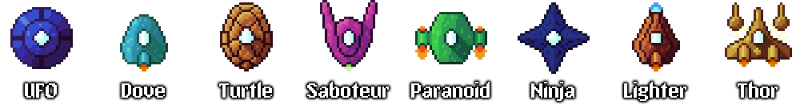 [원본](https://opengameart.org/content/animated-spaceships) | (B) Animated Spaceships / Jull, OpenGameArt | 픽셀아트, 탑뷰 | 5 | 5 | **"Dove"·"Turtle"은 달걀형 몸체 + 중앙 원형 창**으로 화이트보드 메인 스케치와 거의 같은 실루엣입니다. 작은 크기에서도 읽히는 최소 형태의 기준으로 삼을 만합니다. | CC0 1.0 |
| 2 |  [원본](https://commons.wikimedia.org/wiki/File:NotoSans_-_Rightwards_Rocket_-_1F66E.svg) | (C) NotoSans Rightwards Rocket (U+1F66E) / Google | 단색 실루엣, **수평 측면** | 5 | 5 | 처음부터 가로 방향이라 측면 스크롤에 바로 쓸 수 있습니다. 둥근 창 3개, 뒤로 젖힌 핀 2개, 노즐 1개만으로 정체성이 생깁니다. 다른 유저 우주선의 실루엣 템플릿으로도 좋습니다. | Apache 2.0 |
| 3 |  [원본](https://commons.wikimedia.org/wiki/File:Cartoon_space_rocket.png) | (C) Cartoon space rocket / Rygle (Purzen 원작 기반), Wikimedia | 카툰 플랫 벡터 | 4 | 5 | 흰 선체, 빨간 포인트, **큰 원형 창**, 화염 꼬리를 갖춘 "아이도 그리는 로켓"의 정석입니다. 출항 연출의 화염 형태를 참고하기 좋습니다. | CC0 |
| 4 | 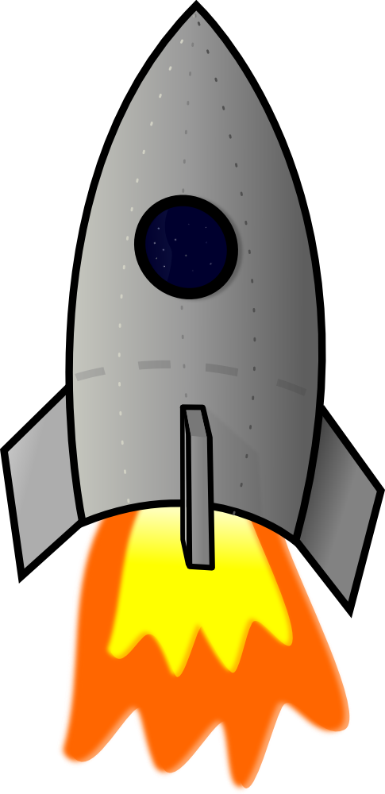 [원본](https://opengameart.org/content/rocket-0) | (B) Rocket / jagdos, OpenGameArt | 카툰 벡터(SVG 원본 제공) | 4 | 5 | 회색 선체에 **어두운 창**이 있어 내부에 조명을 넣으면 "안에서 공부 중" 연출이 됩니다. SVG라 색과 데칼을 바꿔 보기 쉽습니다. | CC0 1.0 |
| 5 | [페이지 보기](https://store.steampowered.com/app/2451100/Little_Rocket_Lab) | (D) Little Rocket Lab / Teenage Astronauts (Steam) | 아늑한 픽셀아트 | 4 | 5 | 귀엽고 직접 조립하는 로켓이 **"코지 + 꾸미기"** 조합의 직접적인 선례입니다. 차고에서 출항하는 정서도 이 앱의 "지구에서 출발" 흐름과 맞습니다. | 참고용(저작권 보호) |
| 6 | 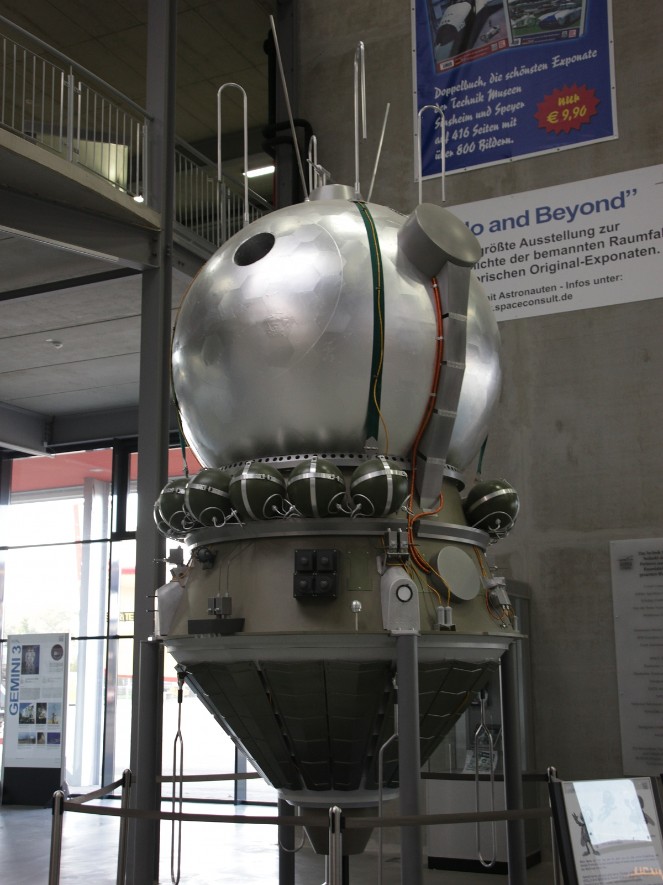 [원본](https://commons.wikimedia.org/wiki/File:Vostok_spacecraft_replica.jpg) | (A) 보스토크 우주선 복제품 / Pascal(Flickr), Wikimedia | 실사(박물관) | 3 | 5 | **구형 캡슐 + 원형 해치·창**이 실존 우주선 중 메인 스케치(달걀 + 원형 창)에 가장 가깝습니다. "1인 우주비행사" 서사에도 맞습니다. | CC0 |
| 7 | [페이지 보기](https://www.mobiusdigitalgames.com/outer-wilds.html) | (D) Outer Wilds / Mobius Digital | 스타일라이즈드 3D, 수공예 느낌 | 3 | 5 | 나무와 금속을 덧댄 **수제 탐사선**, 모닥불, 느린 탐험 정서가 "긴 항해 + 아늑함"에 가장 가까운 무드 레퍼런스입니다. | 참고용(저작권 보호) |
| 8 | 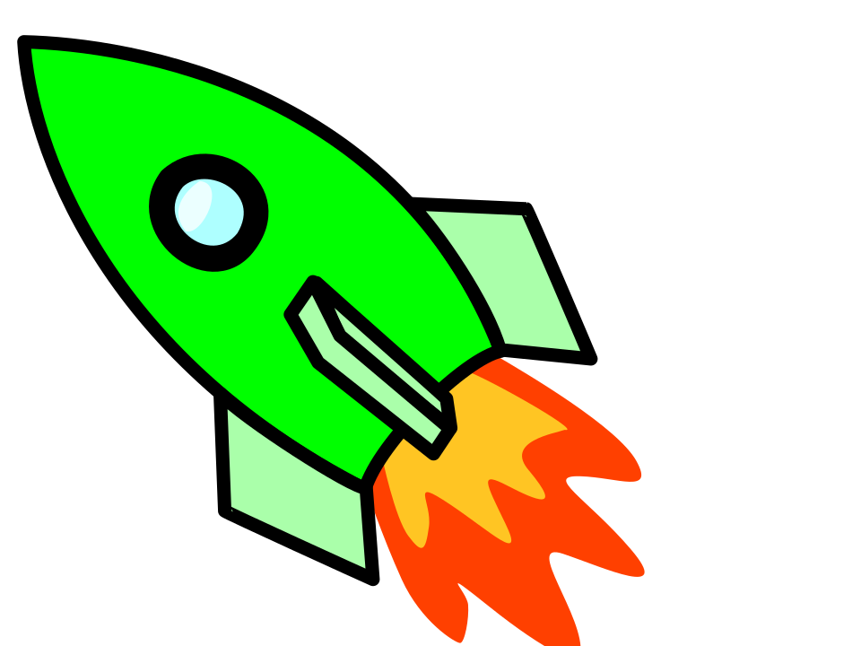 [원본](https://commons.wikimedia.org/wiki/File:Green_left-facing_rocket_ship.svg) | (C) Green left-facing rocket ship / Clker-Free-Vector-Images, Wikimedia | 굵은 외곽선 플랫 클립아트 | 5 | 4 | 대각선 비행 자세에 원형 창과 불꽃 꼬리가 있습니다. 굵은 외곽선이 작은 크기에서 잘 읽힌다는 점을 확인할 수 있습니다. | CC0 |
| 9 |  [원본](https://commons.wikimedia.org/wiki/File:Twemoji_1f680.svg) | (C) Twemoji 🚀 / Twitter | 플랫 이모지 | 5 | 4 | 외곽선 없이 면 분할만 쓴 플랫 스타일입니다. 앱 아이콘이나 작은 미니맵 마커 크기의 단순화 기준이 됩니다. | CC BY 4.0 |
| 10 |  [원본](https://commons.wikimedia.org/wiki/File:Fluent_Emoji_flat_1f680.svg) | (C) Fluent Emoji Flat 🚀 / Microsoft | 플랫 이모지(크림슨·화이트, 외곽선 없음) | 5 | 4 | 흰 선체 + 진한 크림슨 포인트 1색 + 회색 링 원형 창. 포인트색 1개 구성 예시 | MIT |
| 11 |  [원본](https://commons.wikimedia.org/wiki/File:Emoji_u1f680.svg) | (C) Noto Emoji 🚀 / Google | 플랫 이모지(그라데이션 없음) | 5 | 4 | 청회색 선체 + 주황 핀·노즈, 테두리 없는 흰 원형 창 3개. 2색 대비만으로 읽히는 단순 배색 참고 | Apache 2.0 |
| 12 |  [원본](https://commons.wikimedia.org/wiki/File:Space-ship-763493.svg) | (C) Space ship 아이콘 / Felix Brönnimann | 라인 아이콘 + 속도선 | 5 | 4 | **꼬리 쪽 속도선 3줄과 별**은 출항 스케치(가로 속도선)와 같은 문법입니다. 연기 대신 속도선으로 표현하는 미니멀 대안입니다. | CC BY 3.0 |
| 13 | 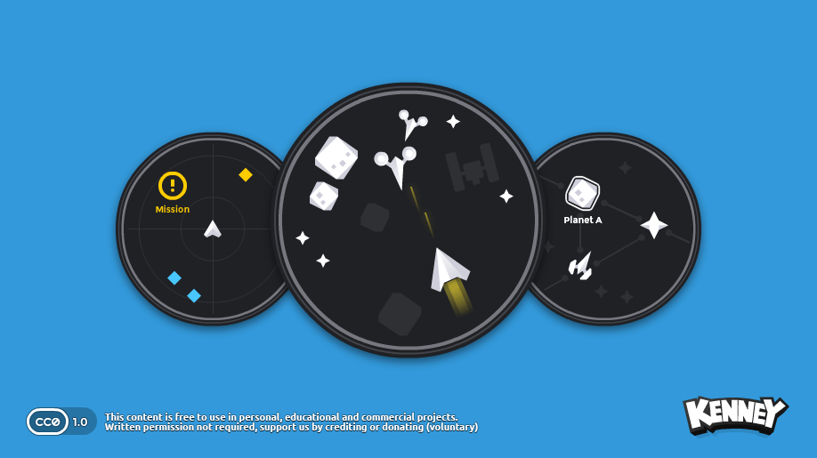 [원본](https://kenney.nl/assets/simple-space) | (B) Simple Space / Kenney | 미니멀 플랫(흰 기체 + 단색 트레일) | 5 | 4 | 어두운 원형 프레임 안의 **흰 종이비행기형 기체 + 노란 직선 트레일**입니다. 둥근 창 너머로 본 우주를 UI로 쓰는 구성과, 트레일 하나로 이동감을 내는 방식이 이 앱에 그대로 적용됩니다. | CC0 1.0 |
| 14 | 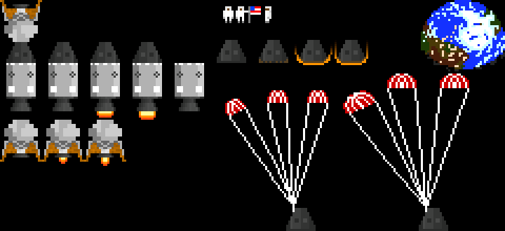 [원본](https://opengameart.org/content/apollo-moon-landing-sprites) | (B) Apollo Moon Landing Sprites / Dizzy Crow, OpenGameArt | 픽셀아트 | 5 | 4 | 캡슐, 엔진 화염 단계(꺼짐, 약함, 강함), 낙하산까지 **상태별 스프라이트**가 있습니다. 일시정지, 항해, 출항을 엔진 상태로 구분하는 데 참고할 수 있습니다. | CC0 1.0 |
| 15 | [페이지 보기](https://www.altosodyssey.com/) | (D) Alto's Odyssey / Team Alto | 미니멀 실루엣 + 그라데이션 | 5 | 4 | 로켓 게임은 아니지만 **"단순한 측면 실루엣 + 화려한 그라데이션 배경"** 조합의 대표 사례입니다. 실사 배경 위에 단순한 우주선을 올리는 방향의 근거가 됩니다. | 참고용(저작권 보호) |
| 16 | [페이지 보기](https://dribbble.com/shots/9076401-Flat-rocket-rotation) | (D) Flat rocket rotation / Iaroslav Kurianovich (PAPATON) | 플랫 2D 턴어라운드 | 5 | 4 | 같은 로켓의 여러 각도를 보여 줍니다. **측면 프로필**(메인·이륙의 정면 vs 출항의 측면)을 정할 때 참고하세요. | 참고용(저작권 보호) |
| 17 | [페이지 보기](https://dribbble.com/shots/2503356-Startup-rocket) | (D) Startup rocket / Kit8 | 플랫 벡터, 소프트 블루·크림·핑크 | 5 | 4 | 파스텔 저채도 배색이 "편안함" 톤에 맞습니다. 휴식(파랑) 테마 색을 정할 때 참고하세요. | 참고용(저작권 보호) |
| 18 | 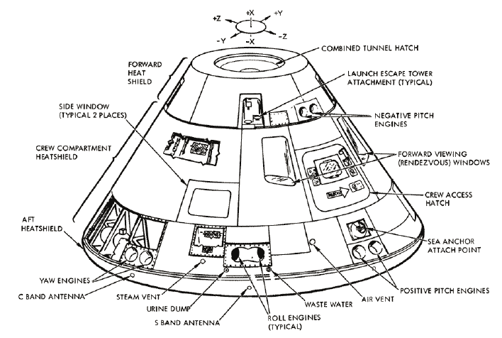 [원본](https://commons.wikimedia.org/wiki/File:Apollo_Command_Module_Block_II_diagram_en.png) | (A) Apollo Command Module Block II 도해 / NASA MSFC | 기술 도해(라인) | 4 | 4 | 원뿔형 사령선 실루엣과 창 위치가 나옵니다. "책상 앞 둥근 창" 실내 구도를 잡을 때 창 배치를 참고하세요. | Public domain (NASA) |
| 19 | 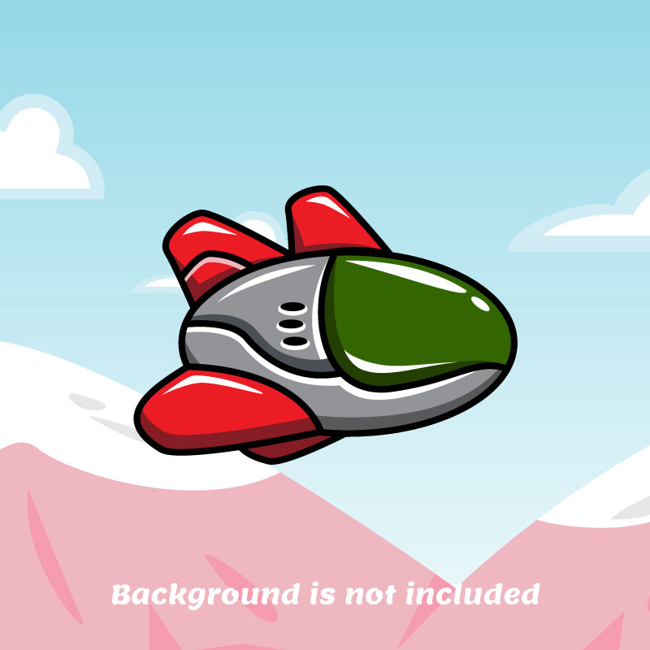 [원본](https://opengameart.org/content/dino-spaceship-flying-character) | (B) Dino Spaceship / bevouliin.com, OpenGameArt | 귀여운 카툰 벡터, 측면 | 4 | 4 | **측면 비행 자세**, 큰 캐노피, 짧은 둥근 핀의 귀여운 비례입니다. 캐노피 색을 바꾸는 식의 꾸미기 예시가 됩니다. | CC0 1.0 |
| 20 | [페이지 보기](https://store.steampowered.com/app/212680/FTL_Faster_Than_Light/) | (D) FTL: Faster Than Light / Subset Games | 픽셀아트 함선 단면도 | 4 | 4 | 선체 **단면 안에 승무원과 방이 보이는 구도**입니다. 이후 "공유 우주선 방" 화면을 설계할 때 참고하세요. | 참고용(저작권 보호) |
| 21 | [페이지 보기](https://dribbble.com/shots/9197614-Rocket-in-the-Space-Animation) | (D) Rocket in the Space – Animation / Mykola Dmytriv | 플랫 모션, 어두운 팔레트 + 밝은 포인트 | 4 | 4 | 어두운 배경에 밝은 포인트색 하나를 쓰고, 루프 애니메이션으로 **흔들림과 트레일**을 표현합니다. 메인 화면의 대기 중 흔들림(스케치의 `(( ))`)을 참고하세요. | 참고용(저작권 보호) |
| 22 | 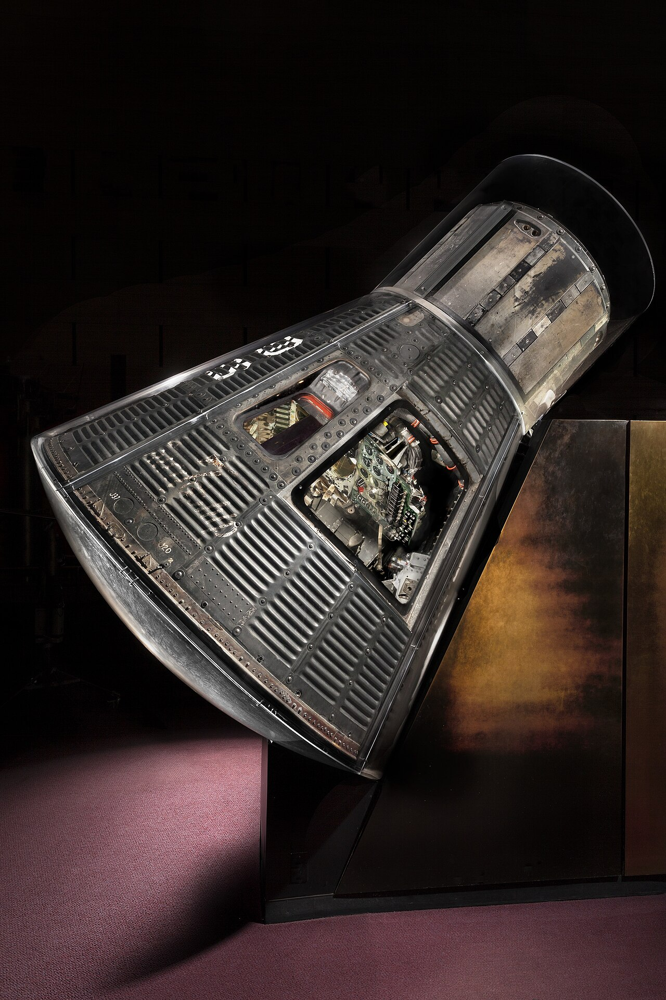 [원본](https://commons.wikimedia.org/wiki/File:Mercury,_MA-6,_Friendship_7_-_Seitenansicht.jpg) | (A) Mercury Friendship 7 측면 / Smithsonian | 실사(박물관) | 3 | 4 | **종(bell)형 1인 캡슐**과 작은 창입니다. 달걀형 실루엣의 실존 근거가 되고, 골판 패턴은 꾸미기 데칼 아이디어가 됩니다. | CC0 |
| 23 | 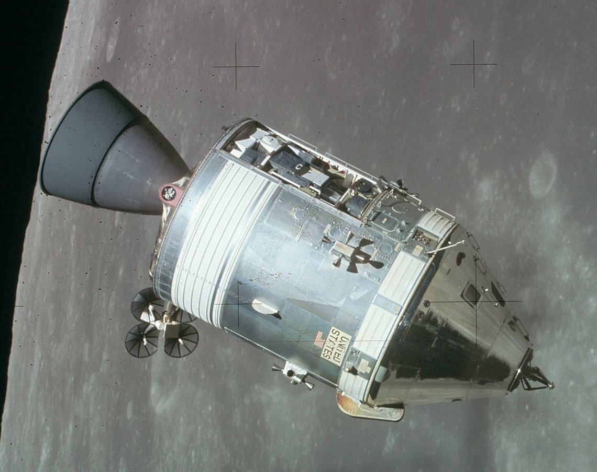 [원본](https://commons.wikimedia.org/wiki/File:Apollo_CSM_lunar_orbit.jpg) | (A) Apollo CSM 달 궤도 / NASA | 실사 | 3 | 4 | 원뿔 + 원통 + 노즐의 **3단 측면 실루엣**이 우주에 떠 있는 구도입니다. 측면 스크롤 시 기본 방향(노즐 왼쪽, 진행 오른쪽)의 근거가 됩니다. | Public domain (NASA) |
| 24 | 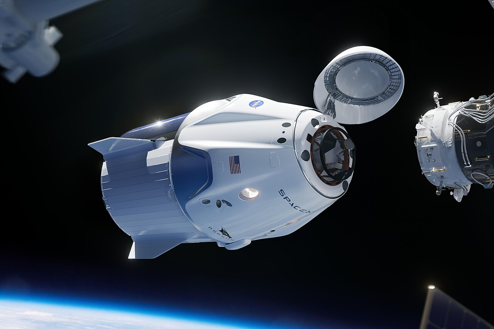 [원본](https://commons.wikimedia.org/wiki/File:SpaceX_Crew_Dragon_(More_cropped).jpg) | (A) SpaceX Crew Dragon / NASA·SpaceX | 3D 렌더(일러스트, NASA/SpaceX) | 3 | 4 | 매끈한 흰 캡슐 + 검은 띠 배색, 노즈콘이 열린 실루엣 | Public domain (NASA) |
| 25 | 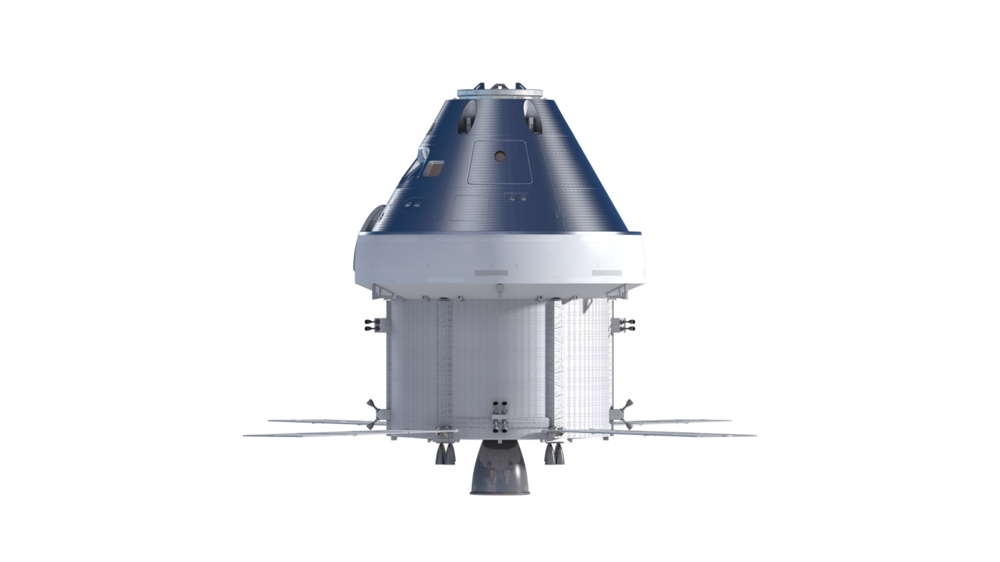 [원본](https://commons.wikimedia.org/wiki/File:Orthographic_view_of_Orion_spacecraft,_right_side_with_solar_panels_(22734679477).png) | (A) Orion 직교 측면도 (태양전지판 포함) / NASA | 3D 렌더(직교 측면, 투명 배경) | 3 | 4 | 원뿔형 캡슐 + 흰 원통 서비스모듈 + 노즐 + 가로로 뻗은 태양전지판의 **기체 전체 실루엣**입니다. 90° 돌리면 측면 스크롤 기본형(노즐 왼쪽, 진행 오른쪽)이 되고, 남색 캡슐 + 흰 띠 배색도 참고할 만합니다. | Public domain (NASA) |
| 26 | 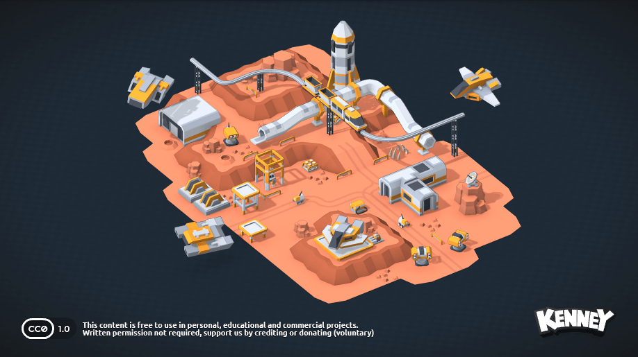 [원본](https://kenney.nl/assets/space-kit) | (B) Space Kit / Kenney | 로우폴리 3D | 3 | 4 | 흰색·회색·주황의 **로우폴리 로켓과 기지**입니다. 3D로 갈 경우 단순화 수준과 팔레트의 기준이 됩니다. | CC0 1.0 |
| 27 | [페이지 보기](https://www.behance.net/gallery/19704673/Cartoon-lowpoly-ROCKET) | (D) Cartoon lowpoly ROCKET / Mat Szulik | 로우폴리 카툰 3D | 3 | 4 | 로우폴리 카툰 로켓 모델로, 측면 프로필 렌더를 참고할 수 있습니다. | 참고용(저작권 보호) |
| 28 | [페이지 보기](https://www.behance.net/gallery/27652401/Space-bound-rocket-ship-Digital-Art) | (D) Space bound rocket ship / Ali Naguib | 몽환적 디지털 일러스트 | 3 | 4 | 밤하늘 무드의 일러스트입니다. 스프라이트보다는 **분위기와 색온도** 참고용입니다. | 참고용(저작권 보호) |
| 29 | 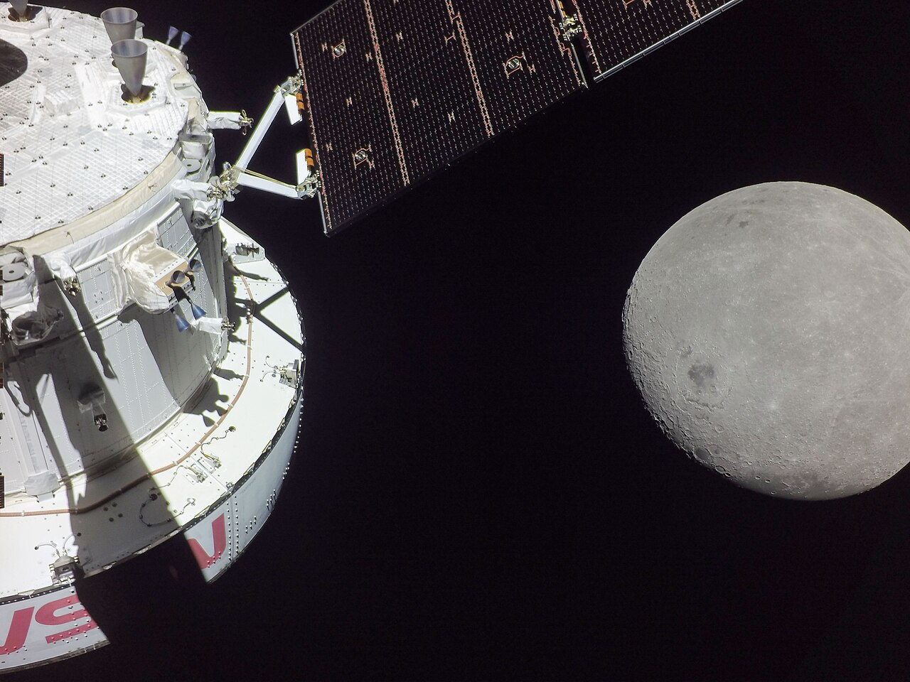 [원본](https://commons.wikimedia.org/wiki/File:Artemis_1_-_Orion_and_ESM_approach_Moon.jpg) | (A) Orion + ESM, Artemis I 달 접근 / NASA | 실사(셀피 카메라) | 2 | 4 | 우주선 일부와 달이 함께 보이는 **"창밖 풍경" 구도**입니다(캡슐 전체 실루엣은 보이지 않으므로 형태는 #25 직교 측면도를 보세요). 실사 배경 톤을 참고하기 좋습니다. | Public domain (NASA) |
| 30 | 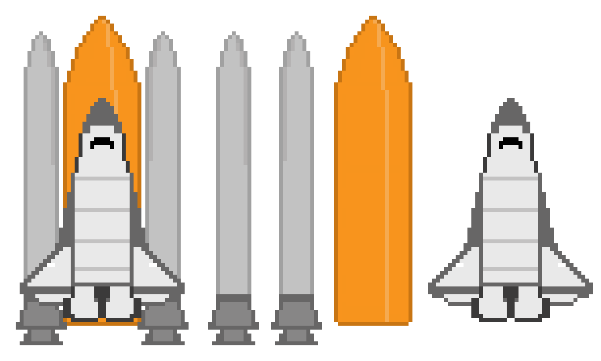 [원본](https://opengameart.org/content/8-bit-space-shuttle) | (B) 8-bit Space Shuttle / Battle Bite Games, OpenGameArt | 8비트 픽셀 | 5 | 3 | 셔틀과 부스터를 아주 적은 픽셀로 표현했습니다(원본 153x92를 8배 nearest-neighbor 확대). 단순화의 하한선을 보여 줍니다. | CC0 1.0 |
| 31 | 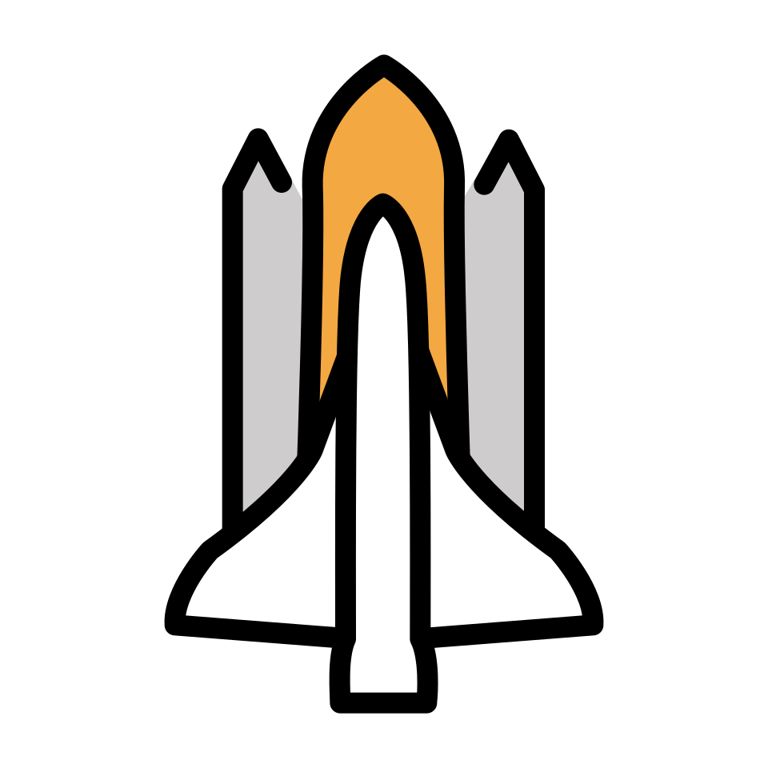 [원본](https://commons.wikimedia.org/wiki/File:OpenMoji-color_1F680.svg) | (C) OpenMoji 🚀 (color) / openmoji.org | 라인 + 플랫 이모지(우주왕복선 정면) | 5 | 3 | 일정한 두께의 검은 외곽선 + 플랫 채색. UI 아이콘 선 두께 기준용(원형 창 없음, 셔틀+부스터 형태) | CC BY-SA 4.0 |
| 32 | 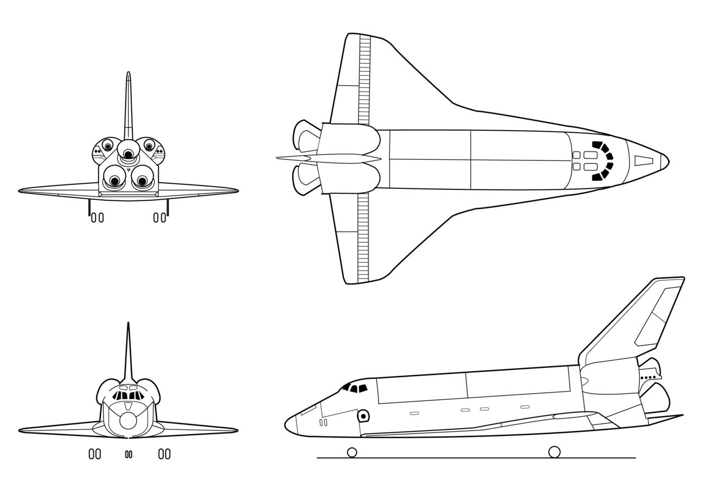 [원본](https://commons.wikimedia.org/wiki/File:STS_orbiter_4-view_diagram_(EG-0076-07).png) | (A) Space Shuttle 4면도 / NASA Dryden | 라인 도면 | 4 | 3 | **측면도**가 있어 날개 달린 실루엣을 측면 스크롤용으로 따라 그릴 수 있습니다. 다만 아늑한 정서와는 거리가 있습니다. | Public domain (NASA) |
| 33 | 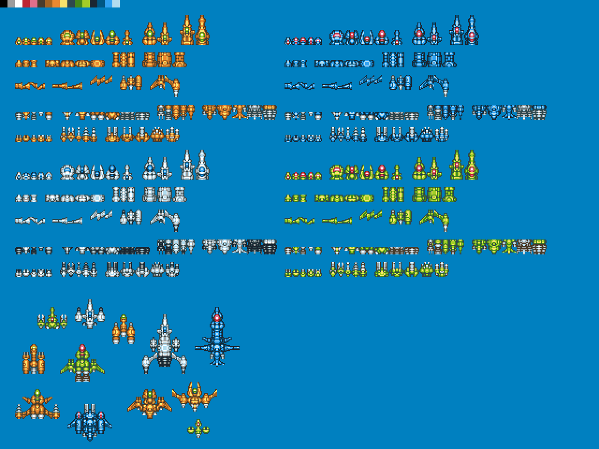 [원본](https://opengameart.org/content/modular-ships) | (B) Modular Ships / surt, OpenGameArt | 픽셀 모듈식 | 4 | 3 | 몸체, 날개, 엔진을 **부품 단위로 갈아끼우는** 구조로, 꾸미기 슬롯 설계의 참고가 됩니다(원본 시트 640x480을 2배 nearest-neighbor 확대). 슈팅 게임 톤이라 형태는 그대로 쓰지 않는 편이 좋습니다. | CC0 1.0 |
| 34 | [페이지 보기](https://dribbble.com/shots/271351-Rocket-game-concept) | (D) Rocket – game concept / Jozef Mak | 광택 카툰 | 4 | 3 | 구름 사이를 나는 빨간 카툰 로켓입니다. 이륙 장면(지구 대기권) 연출에 참고하세요. | 참고용(저작권 보호) |
| 35 | [페이지 보기](https://dribbble.com/shots/9873523-rocket) | (D) rocket / Manik Hossain | 플랫 모션(파랑·주황) | 4 | 3 | 파랑·주황 보색 대비의 로켓 애니메이션입니다. 집중(주황)과 휴식(파랑) 상태색 대비를 참고하세요. | 참고용(저작권 보호) |
| 36 | 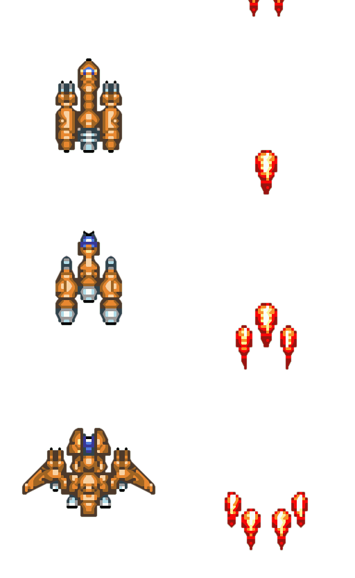 [원본](https://opengameart.org/content/2d-spaceship-sprites-with-engines) | (B) 2D Spaceship Sprites with Engines / morgan3d (원작: surt, Modular Ships), OpenGameArt (상단 일부 크롭) | 픽셀, 엔진 화염 분리 | 3 | 3 | **기체와 엔진 화염 스프라이트가 분리**되어 있어, 트레일과 화염을 별도 레이어로 애니메이션하는 구조를 참고할 수 있습니다. #33 Modular Ships의 파생작(화염 스프라이트 추가)입니다. | CC0 1.0 |
| 37 | 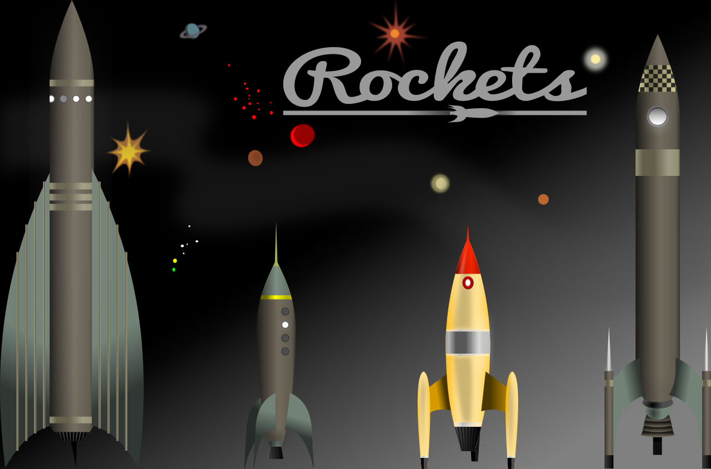 [원본](https://opengameart.org/content/rockets) | (B) Rockets / Conte Magnus (제출: qubodup), OpenGameArt | 레트로 SF 벡터 | 3 | 3 | 1950년대 레트로 퓨처 로켓 실루엣 4종(SVG 원본을 1280px로 래스터화)입니다. 꾸미기 테마("레트로 스킨") 후보로 볼 수 있습니다. | CC0 1.0 |
| 38 | [페이지 보기](https://store.steampowered.com/app/220200/Kerbal_Space_Program/) | (D) Kerbal Space Program / Squad | 모듈식 3D | 3 | 3 | 단, 핀, 노즐의 모듈 조합과 **발사 화염·연기 플룸**을 참고하세요. 귀여운 Kerbal 캐릭터 톤도 함께 볼 만합니다. | 참고용(저작권 보호) |
| 39 | [페이지 보기](https://www.behance.net/gallery/214876703/Launching-Rocket-Illustration) | (D) Launching Rocket Illustration / Abdulrasaq Adepoju | 벡터, 소용돌이 구름 | 3 | 3 | **소용돌이 연기 트레일** 표현 방식이 출항 순간의 연기 연출에 참고가 됩니다. | 참고용(저작권 보호) |
| 40 | [페이지 보기](https://www.artstation.com/artwork/5Wl6V8) | (D) The Righteous Rapmaster Rocketship (ToeJam & Earl) / Alexandre Marcati | 레트로 3D 오마주 | 3 | 3 | 90년대 픽셀 게임(ToeJam & Earl) 우주선을 3D로 재해석한 오마주. 픽셀 시절 형태 언어를 3D로 옮길 때 무엇을 남길지 참고 | 참고용(저작권 보호) |
| 41 | [페이지 보기](https://www.pinterest.com/pin/137078382397391105/) | (D) Rocket Low Poly / 작성자 미확인 (Pinterest) | 로우폴리 Blender + 파티클 | 3 | 3 | 로우폴리 로켓에 **애니메이션 파티클 연기**를 붙인 작업입니다. 원작자가 확인되지 않아 무드 참고로만 쓰세요. | 참고용(저작권 보호) |
| 42 | 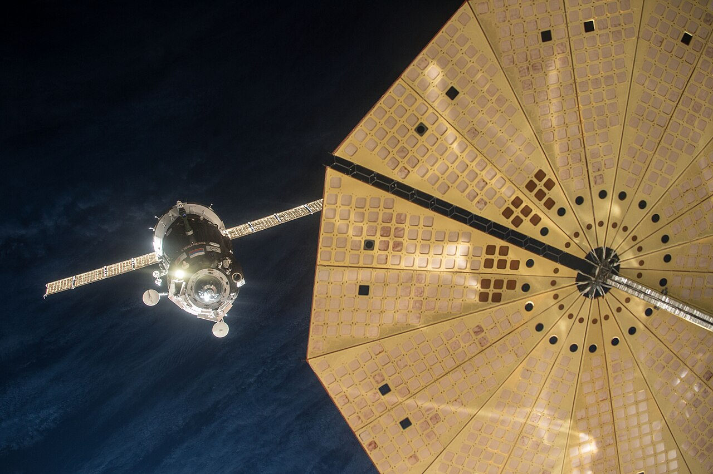 [원본](https://commons.wikimedia.org/wiki/File:Soyuz_TMA-19M_spacecraft_approaches_the_ISS_(1).jpg) | (A) Soyuz TMA-19M ISS 접근 / NASA | 실사 | 2 | 3 | 정면에서 본 소유즈 + 태양전지판 날개 실루엣(측면 3단 구성은 이 사진에서 보이지 않음). **구 + 날개** 조합 아이디어 정도로만 참고하세요. | Public domain (NASA) |
| 43 | 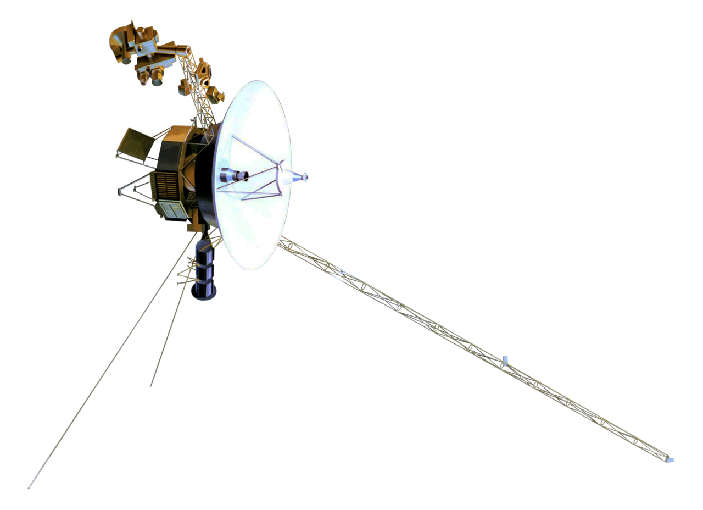 [원본](https://commons.wikimedia.org/wiki/File:Voyager_spacecraft_model.png) | (A) Voyager 모형 / NASA | 3D 렌더(투명 배경) | 2 | 3 | "가장 멀리 간 우주선"이라는 **긴 항해 서사**와 연결됩니다. 접시 안테나는 꾸미기 파츠(안테나 슬롯) 후보입니다. | Public domain (NASA) |
| 44 | 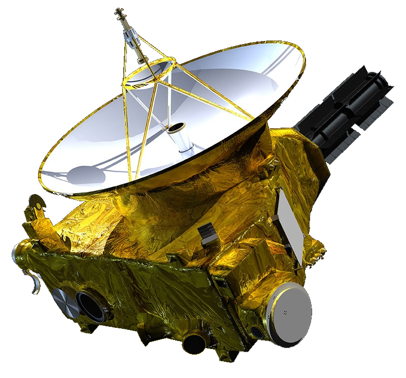 [원본](https://commons.wikimedia.org/wiki/File:New_Horizons_spacecraft_model_1.png) | (A) New Horizons 모형 / NASA·APL | 3D 렌더(투명 배경) | 2 | 3 | 명왕성, 카이퍼 벨트처럼 마일스톤(해왕성·헬리오포즈) 서사와 맞습니다. 금색 단열재는 프리미엄 스킨 색 아이디어가 됩니다. | Public domain (NASA) |
| 45 | 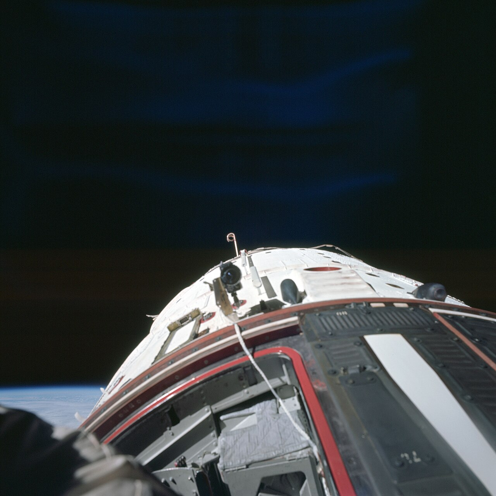 [원본](https://commons.wikimedia.org/wiki/File:Gemini_12_spacecraft_seen_during_EVA_(s66-62920).jpg) | (A) Gemini 12 (EVA 중 촬영) / NASA JSC | 실사 | 2 | 3 | 2인 캡슐의 창과 우주 배경입니다. 함께 비행(원정대) 단계의 "2인승 이상" 형태를 참고하세요. | Public domain (NASA) |
| 46 | 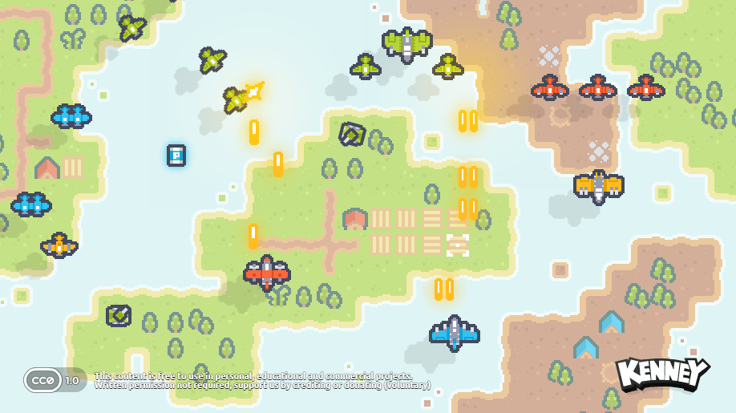 [원본](https://kenney.nl/assets/pixel-shmup) | (B) Pixel Shmup / Kenney | 픽셀 슈팅 | 5 | 2 | 작은 픽셀 기체의 가독성 참고용입니다. 전투 톤이라 컨셉 적합도는 낮습니다. | CC0 1.0 |
| 47 | 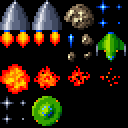 [원본](https://opengameart.org/content/i-are-spaceship-16x16-space-sprites) | (B) i are spaceship (16x16) / bart, OpenGameArt | 16px 픽셀 | 5 | 2 | 16px 극소 스프라이트입니다. 다른 유저 우주선을 점처럼 작게 지나치게 할 때 필요한 최소 크기를 가늠할 수 있습니다. | CC0 1.0 |
| 48 | 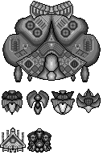 [원본](https://opengameart.org/content/spaceship-set-32x32px) | (B) Spaceship Set 32x32 / Scrittl, OpenGameArt | 32px 픽셀 | 5 | 2 | 32px 기체 세트로, 색만 바꾼 변형(꾸미기 색상 옵션)을 참고할 수 있습니다. | CC0 1.0 |
| 49 | 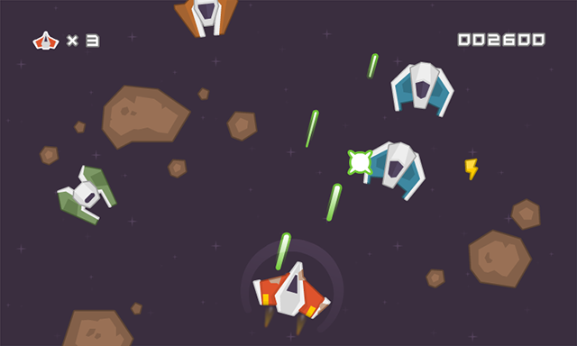 [원본](https://kenney.nl/assets/space-shooter-remastered) | (B) Space Shooter Remastered / Kenney | 플랫 슈팅 | 4 | 2 | 깔끔한 플랫 기체이지만 공격적인 전투기 형태입니다. 피해야 할 방향의 예시로 넣었습니다. | CC0 1.0 |

## 추천 방향

1. **형태 언어는 "달걀형 1인 캡슐 + 큰 원형 창 하나"로 갑니다.**
   화이트보드 메인 스케치의 달걀 + 원형 창 형태는 실존 우주선(#6 보스토크 구형 캡슐, #22 머큐리 종형 캡슐)과 게임 에셋(#1 Dove/Turtle)이 모두 뒷받침합니다. 측면 뷰는 #2 NotoSans 로켓처럼 둥근 몸체 하나, 뒤로 젖힌 작은 핀 2개, 노즐 1개만 남겨 **48px 이하에서도 실루엣이 읽히게** 합니다. 메인·이륙 화면은 정면에 가까운 3/4 뷰, 출항 화면은 측면 뷰로 같은 기체를 쓰고, 각도는 #16 턴어라운드를 참고해 정합니다. 슈팅 게임풍의 뾰족한 전투기 실루엣(#46, #49)은 피합니다.

2. **원형 창은 정체성이자 "사람이 안에 있다"는 신호로 씁니다.**
   창 안에 책상 램프의 따뜻한 노란 빛 한 점을 넣어, 집중 중 화면에서도 "우주비행사가 책상에서 공부 중"이라는 컨셉이 읽히게 합니다(#3, #4의 어두운 창에 조명을 넣는 방식). 창 테두리는 #3·#10처럼 회색 링 테두리로 처리하고, 이 링을 앱 UI의 원형 버튼과 진행 링에도 반복해 브랜드 모티프로 씁니다.

3. **팔레트는 크림색 선체 + 포인트색 1개 + 상태색으로 구성합니다.**
   FocusFlight처럼 어둡고 사실적인 배경(CONTEXT: 실사 배경 → 성운) 위에서는 **#13 Kenney Simple Space**처럼 밝은 단색 기체가 가장 잘 읽힙니다. 선체는 오프화이트나 크림색, 포인트는 코랄이나 주황 한 가지로 하고 #11 Noto(청회색 + 주황)와 #17 Kit8의 저채도 톤을 따릅니다. 집중 상태는 주황 트레일, 휴식(자동 항해)은 CONCEPT의 휴식 타이머와 같은 **파란 트레일**로 바꿔 상태를 색으로만 구분합니다(#35의 보색 대비). 실사 배경과 섞이도록 픽셀아트보다 **플랫 벡터(SVG/Lottie)**를 권장합니다(#15 Alto 방식).

4. **배기 트레일은 평소엔 조용하게, 출항 때만 강하게 냅니다.**
   CONCEPT의 소리 원칙("강한 효과음은 출항·도착에만")을 화면에도 똑같이 적용합니다.
   - **출항 순간:** #3 카툰 화염과 #39 소용돌이 연기로 짧고 크게 연출합니다.
   - **집중 중:** #13처럼 가늘고 긴 반투명 연기 입자나 #12 속도선 3줄로, 배경이 오른쪽에서 왼쪽으로 흐르는 움직임을 받칩니다.
   - **일시정지:** 트레일이 끊기고 노즐 불빛이 꺼집니다(#14의 엔진 꺼짐/약함/강함 상태 스프라이트 구조).
   - **구현:** 기체와 트레일을 별도 레이어로 나눕니다(#36).
   - **대기 중:** 메인 화면에서는 #21처럼 살짝 위아래로 흔들리는 루프를 둡니다.

5. **꾸미기 슬롯은 "실루엣 고정, 표면과 부착물만 교체"로 설계합니다.**
   출항 중 다른 유저 우주선을 지나치는 연출(CONTEXT)에서 "우주선"으로 바로 읽히도록 **기본 실루엣은 모두 같게** 두고, 아래만 바꿀 수 있게 합니다.
   - 선체 색과 줄무늬 데칼: CONCEPT의 백팩 색 줄무늬와 세트로 맞추고, #22 골판 패턴이나 #44 금박 같은 프리미엄 스킨을 둡니다.
   - 핀 모양: 둥근 핀, 레트로 핀(#37).
   - 창 프레임.
   - 트레일 색과 입자 모양.
   - 상단 부착물: 안테나(#43 접시), 깃발, 화분.

   부품 단위 교체 구조는 #33 Modular Ships와 #38 Kerbal을, 수공예풍 덧댄 판 같은 아늑한 표면 질감은 #7 Outer Wilds와 #5 Little Rocket Lab을 참고합니다.

## 출처/라이선스

다운로드한 이미지(34장, 모두 `images/`)의 출처와 라이선스입니다. 표의 D 항목(15건)은 저작권 보호 저작물이라 다운로드나 핫링크 없이 페이지 링크만 남겼습니다.

| 파일 | 크레딧 | 라이선스 | 출처 URL |
|---|---|---|---|
| images/apollo-csm-lunar-orbit.jpg | NASA | Public domain | https://commons.wikimedia.org/wiki/File:Apollo_CSM_lunar_orbit.jpg |
| images/apollo-command-module-diagram.png | NASA Marshall Space Flight Center | Public domain | https://commons.wikimedia.org/wiki/File:Apollo_Command_Module_Block_II_diagram_en.png |
| images/orion-artemis-1-moon.jpg | NASA | Public domain | https://commons.wikimedia.org/wiki/File:Artemis_1_-_Orion_and_ESM_approach_Moon.jpg |
| images/orion-side-orthographic.png | NASA (Flickr: nasaorion) | Public domain | https://commons.wikimedia.org/wiki/File:Orthographic_view_of_Orion_spacecraft,_right_side_with_solar_panels_(22734679477).png |
| images/soyuz-tma-19m-approach.jpg | NASA | Public domain | https://commons.wikimedia.org/wiki/File:Soyuz_TMA-19M_spacecraft_approaches_the_ISS_(1).jpg |
| images/crew-dragon.jpg | NASA/SpaceX (일러스트) | Public domain | https://commons.wikimedia.org/wiki/File:SpaceX_Crew_Dragon_(More_cropped).jpg |
| images/voyager-spacecraft-model.png | NASA | Public domain | https://commons.wikimedia.org/wiki/File:Voyager_spacecraft_model.png |
| images/new-horizons-model.png | NASA, Johns Hopkins APL | Public domain | https://commons.wikimedia.org/wiki/File:New_Horizons_spacecraft_model_1.png |
| images/space-shuttle-4-view.png | NASA/Dryden Flight Research Center | Public domain | https://commons.wikimedia.org/wiki/File:STS_orbiter_4-view_diagram_(EG-0076-07).png |
| images/mercury-friendship-7-side.jpg | Smithsonian Institution | CC0 | https://commons.wikimedia.org/wiki/File:Mercury,_MA-6,_Friendship_7_-_Seitenansicht.jpg |
| images/vostok-replica.jpg | Pascal (Flickr: pasukaru76) | CC0 | https://commons.wikimedia.org/wiki/File:Vostok_spacecraft_replica.jpg |
| images/gemini-12-eva.jpg | NASA Johnson Space Center | Public domain | https://commons.wikimedia.org/wiki/File:Gemini_12_spacecraft_seen_during_EVA_(s66-62920).jpg |
| images/twemoji-rocket.png | Twitter, Inc. (Twemoji) | CC BY 4.0 (저작자 표시 필요) | https://commons.wikimedia.org/wiki/File:Twemoji_1f680.svg |
| images/fluent-emoji-flat-rocket.png | Microsoft Corporation (Fluent Emoji) | MIT | https://commons.wikimedia.org/wiki/File:Fluent_Emoji_flat_1f680.svg |
| images/openmoji-color-rocket.png | OpenMoji (openmoji.org) | CC BY-SA 4.0 (저작자 표시 + 동일조건변경허락, 앱 에셋으로 쓸 때 주의) | https://commons.wikimedia.org/wiki/File:OpenMoji-color_1F680.svg |
| images/noto-emoji-rocket.png | Google (Noto Emoji) | Apache 2.0 | https://commons.wikimedia.org/wiki/File:Emoji_u1f680.svg |
| images/notosans-rightwards-rocket.png | Google (Noto Sans) | Apache 2.0 (Commons 표기 기준) | https://commons.wikimedia.org/wiki/File:NotoSans_-_Rightwards_Rocket_-_1F66E.svg |
| images/green-left-facing-rocket.png | Clker-Free-Vector-Images (Pixabay) | CC0 | https://commons.wikimedia.org/wiki/File:Green_left-facing_rocket_ship.svg |
| images/cartoon-space-rocket.png | Rygle, based on Purzen | CC0 | https://commons.wikimedia.org/wiki/File:Cartoon_space_rocket.png |
| images/space-ship-763493.png | Felix Brönnimann | CC BY 3.0 (저작자 표시 필요) | https://commons.wikimedia.org/wiki/File:Space-ship-763493.svg |
| images/kenney-simple-space.png | Kenney (kenney.nl) | CC0 1.0 | https://kenney.nl/assets/simple-space |
| images/kenney-space-kit.png | Kenney (kenney.nl) | CC0 1.0 | https://kenney.nl/assets/space-kit |
| images/kenney-space-shooter-remastered.png | Kenney (kenney.nl) | CC0 1.0 | https://kenney.nl/assets/space-shooter-remastered |
| images/kenney-pixel-shmup.png | Kenney (kenney.nl) | CC0 1.0 | https://kenney.nl/assets/pixel-shmup |
| images/oga-animated-spaceships.png | Jull | CC0 1.0 | https://opengameart.org/content/animated-spaceships |
| images/oga-pure-rocket.png | jagdos | CC0 1.0 | https://opengameart.org/content/rocket-0 |
| images/oga-dino-spaceship.jpg | bevouliin.com | CC0 1.0 | https://opengameart.org/content/dino-spaceship-flying-character |
| images/oga-apollo-lander-sprites.png | Dizzy Crow | CC0 1.0 | https://opengameart.org/content/apollo-moon-landing-sprites |
| images/oga-8bit-space-shuttle.png | Battle Bite Games (원본 153x92를 8배 nearest-neighbor 확대) | CC0 1.0 | https://opengameart.org/content/8-bit-space-shuttle |
| images/oga-modular-ships.png | surt (원본 시트 modular_ships.png 640x480을 2배 nearest-neighbor 확대) | CC0 1.0 | https://opengameart.org/content/modular-ships |
| images/oga-ships-with-engines.png | morgan3d (원작: surt, Modular Ships), 원본 512x3328에서 상단 832px 크롭 | CC0 1.0 | https://opengameart.org/content/2d-spaceship-sprites-with-engines |
| images/oga-rockets-razzi.png | Conte Magnus (제출: qubodup), SVG 원본(conte_magnus-cc0-Rockets.svg)을 1280px PNG로 래스터화 | CC0 1.0 | https://opengameart.org/content/rockets |
| images/oga-i-are-spaceship.png | bart | CC0 1.0 | https://opengameart.org/content/i-are-spaceship-16x16-space-sprites |
| images/oga-spaceship-set-32.png | Scrittl | CC0 1.0 | https://opengameart.org/content/spaceship-set-32x32px |

**링크만 남긴 항목(참고용, 저작권 보호):**

| 작품 | 저작자 | 링크 |
|---|---|---|
| Little Rocket Lab | Teenage Astronauts | https://store.steampowered.com/app/2451100/Little_Rocket_Lab |
| Outer Wilds | Mobius Digital | https://www.mobiusdigitalgames.com/outer-wilds.html |
| Alto's Odyssey | Team Alto | https://www.altosodyssey.com/ |
| FTL: Faster Than Light | Subset Games | https://store.steampowered.com/app/212680/FTL_Faster_Than_Light/ |
| Kerbal Space Program | Squad | https://store.steampowered.com/app/220200/Kerbal_Space_Program/ |
| Flat rocket rotation | Iaroslav Kurianovich (PAPATON) | https://dribbble.com/shots/9076401-Flat-rocket-rotation |
| Startup rocket | Kit8 | https://dribbble.com/shots/2503356-Startup-rocket |
| Rocket – game concept | Jozef Mak | https://dribbble.com/shots/271351-Rocket-game-concept |
| Rocket in the Space – Animation | Mykola Dmytriv | https://dribbble.com/shots/9197614-Rocket-in-the-Space-Animation |
| rocket | Manik Hossain | https://dribbble.com/shots/9873523-rocket |
| Cartoon lowpoly ROCKET | Mat Szulik | https://www.behance.net/gallery/19704673/Cartoon-lowpoly-ROCKET |
| Launching Rocket Illustration | Abdulrasaq Adepoju | https://www.behance.net/gallery/214876703/Launching-Rocket-Illustration |
| Space bound rocket ship – Digital Art | Ali Naguib | https://www.behance.net/gallery/27652401/Space-bound-rocket-ship-Digital-Art |
| The Righteous Rapmaster Rocketship (ToeJam & Earl) | Alexandre Marcati | https://www.artstation.com/artwork/5Wl6V8 |
| Rocket Low Poly | 미확인 (Pinterest 핀) | https://www.pinterest.com/pin/137078382397391105/ |

> 참고: Wikimedia Commons, Kenney, OpenGameArt의 라이선스는 2026-11-25 기준 각 페이지 표기(Commons는 API의 `LicenseShortName`)를 따랐습니다. 실제 앱 에셋으로 쓰기 전에는 원본 페이지를 다시 확인하세요. 특히 CC BY와 CC BY-SA 항목은 크레딧 표기가 필요하고, BY-SA는 파생물에도 같은 라이선스가 적용됩니다.
