# 우주 배경 레퍼런스 (space)

> **목적:** 우주선 창밖으로 오른쪽→왼쪽 흐르는 항해 배경에 쓸 실사 우주 이미지를, 평범한 별밭부터 웹 망원경급 성운까지 **화려함·복잡성 오름차순**으로 정리한다.
>
> - **크롤링 날짜:** 2026-11-25
> - **사용 도구**
>   - **aside CLI** (`aside exec --effort low`, 2회 실행): **검색·발견** 담당. ESA/Webb·ESA/Hubble·ESO 공개 갤러리에서 ① 은하수·암흑성운·발광/반사성운·웹/허블 대표 이미지 40건, ② "평범한 별밭" 8건의 이미지 페이지 URL을 찾아옴. 이후 ESA/Hubble·ESO 저작권 페이지에서 CC BY 4.0도 확인함.
>   - **Scrapling v0.5.1** (`Fetcher.get`): **수집·다운로드** 담당. 각 이미지 페이지에서 제목·Credit·원본 해상도(Size)·CDN 다운로드 링크(large / publicationjpg / screen)를 추출하고 JPEG 본문을 받음 (요청 사이 0.5초 대기). 45MB가 넘는 원본은 건너뛰고 더 작은 판을 받음.
>   - 보조: macOS `sips`로 가로 1600px 리사이즈(JPEG q82, 각 파일 2MB 미만), Pillow로 평균 휘도 계산(UI 오버레이에 적합한지 판단), `file`로 모든 파일이 실제 JPEG인지 검증.
> - **수록:** 48장 (`images/` 폴더, 합계 약 32MB). 전부 CC BY 4.0이며 **크레딧 표기가 필수**다. 저작권 보호 이미지(Pinterest, ArtStation 등)는 이번 목록에 없다.

## 앱 맥락

`docs/CONTEXT.md` 기준: 배경은 처음(지구)과 태양계에서는 평범하게 시작하고, 멀리 갈수록 점점 성운처럼 화려해진다. 배경은 **오른쪽에서 왼쪽으로 스크롤**된다.
`docs/CONCEPT.md`의 마일스톤(해왕성 → 헬리오포즈 → 오르트 구름 탈출 1.5광년 → 프록시마 센타우리 4.25광년 → 별과 별 사이 항로)에 맞춰 아래처럼 점수 구간을 항해 단계에 연결했다.

| 합계(화려함+복잡성) | 항해 단계 | 배경 성격 | 대표 이미지 |
| --- | --- | --- | --- |
| 3–6 | ① 지구 근처·태양계 | 검은 바탕 + 드문 별. UI가 가장 잘 보임 | M67 광시야, 은하수 360° 파노라마 (+ 지상에서 본 달과 은하수 아치는 점수상 ②지만 출발 화면용) |
| 7–10 | ② 태양계 외곽·오르트 구름 | 별 밀도 증가, 은하수 띠·암흑운 등장 | 바너드 68, 파이프 성운 광시야, **알파·프록시마 센타우리 하늘(첫 별 도착)** |
| 11–13 | ③ 성간 공간·첫 별 이후 단거리 항로 | 먼지띠·암흑성운, 작은 성운 등장 | 파이프 성운의 "물부리", Lupus 3, 말머리성운, M78, 남쪽 고리 성운, 파라날 별밭(로 오피우키) |
| 14–16 | ④ 성운 구간 (장거리 항로) | 분홍·청록 발광/반사성운이 화면 대부분 | 석호·삼렬·오메가·오리온·독수리 성운 |
| 17–19 | ⑤ 클라이맥스·이벤트 (마일스톤 보상, 공유 카드) | 웹 망원경급 초고화려 | 우주 절벽, 창조의 기둥, 타란툴라, 게성운 |

> 참고: 허블/웹 **딥필드**(7·8번)는 개념상 "가장 먼 우주"지만 화면은 어둡고 차분해서 점수가 낮다. 엔딩·업적 화면처럼 의미가 중요한 곳에 따로 쓰는 것을 추천한다.

## 채점 기준

- **화려함 (1–10):** 색의 수와 채도, 밝게 빛나는 가스 구조, 첫눈에 "와" 하는 정도.
  - 1 = 검은 바탕에 흰 점 / 3 = 별 색이 조금 보임, 은하수 띠 / 5 = 먼지·작은 성운이 보임 / 7 = 컬러 성운이 화면 주인공 / 10 = 여러 색 성운 + 극적인 입체 구조(웹 NIRCam급)
- **복잡성 (1–10):** 화면에 담긴 디테일의 밀도. 별의 개수, 필라멘트·먼지·기둥 같은 구조, 겹겹의 깊이감.
  - 1 = 별 몇 개 / 4 = 고른 별밭 / 6 = 촘촘한 별구름이나 큰 구조 1개 / 8 = 여러 구조가 겹침 / 10 = 화면 전체가 세밀한 구조로 꽉 참
- **정렬:** **화려함+복잡성 합계 오름차순**, 합계가 같으면 화려함이 낮은 것부터.
- **평균 휘도:** 1600px 저장본의 그레이스케일 평균값(0–255). 40 미만은 그대로 UI를 올려도 되고, 70 이상은 어둡게 보정해야 한다.
- **타일:** 은하수 360° 파노라마(4번)만 좌우가 실제로 이어진다. 나머지는 좌우 반전 반복(미러 타일)이나 두 장 크로스페이드로 이어 붙여야 한다. 가로로 긴 이미지(달과 은하수 아치 3.6:1 — 단 지상 풍경 크롭 필요, 안드로메다 3.1:1, 우주 절벽 합성 2.9:1, 용골 파노라마 2:1)가 가로 스크롤에 유리하다.

## 이미지 목록 (화려함·복잡성 오름차순)

| no | 이미지 | 이름 | 화려함 | 복잡성 | 배경 활용 메모 | 원본 해상도·링크 |
| --- | --- | --- | --- | --- | --- | --- |
| | | **① 지구 근처·태양계** | | | | |
| 1 | 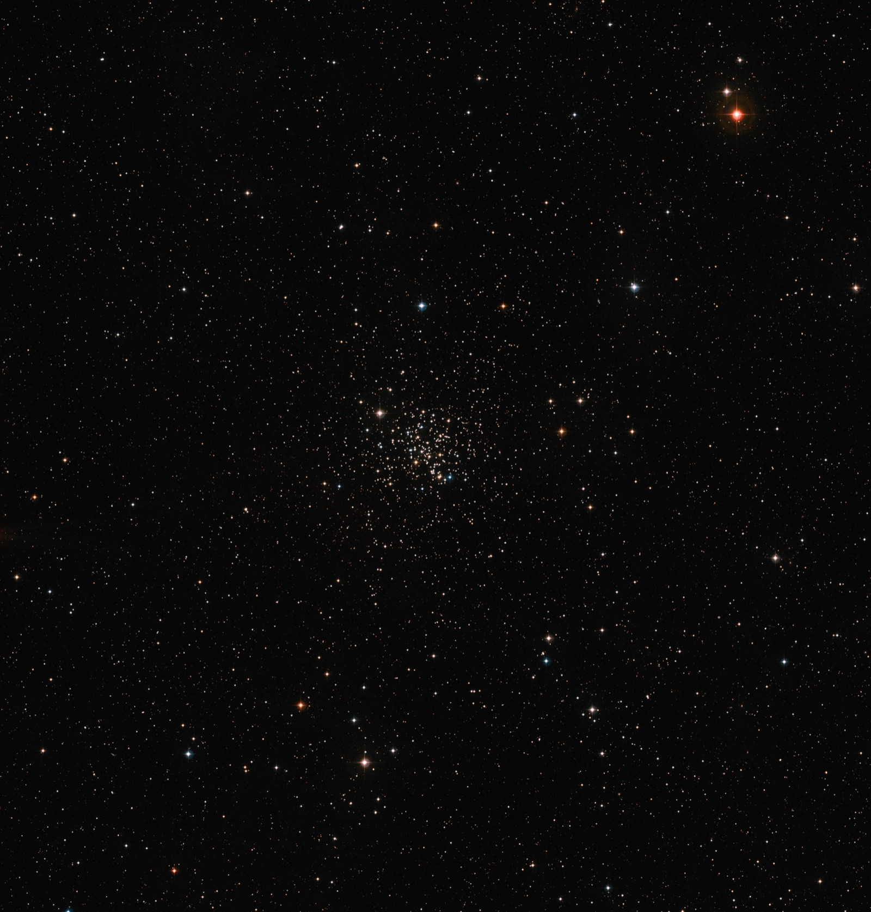 [원본 페이지](https://www.eso.org/public/images/eso1402c/) | M67 산개성단 주변 광시야 | 1 | 2 | 거의 검은 바탕에 별이 드문드문. 가장 "기본" 우주 배경 · 비율 0.96:1 · 타일 불가 → 미러 반복/크로스페이드 · 어두움(평균 휘도 10) → UI 오버레이 바로 OK · 추천: ① 지구 근처·태양계 | 6763x7079 px [ESO](https://www.eso.org/public/images/eso1402c/) 저장본 1600x1674 |
| 2 | 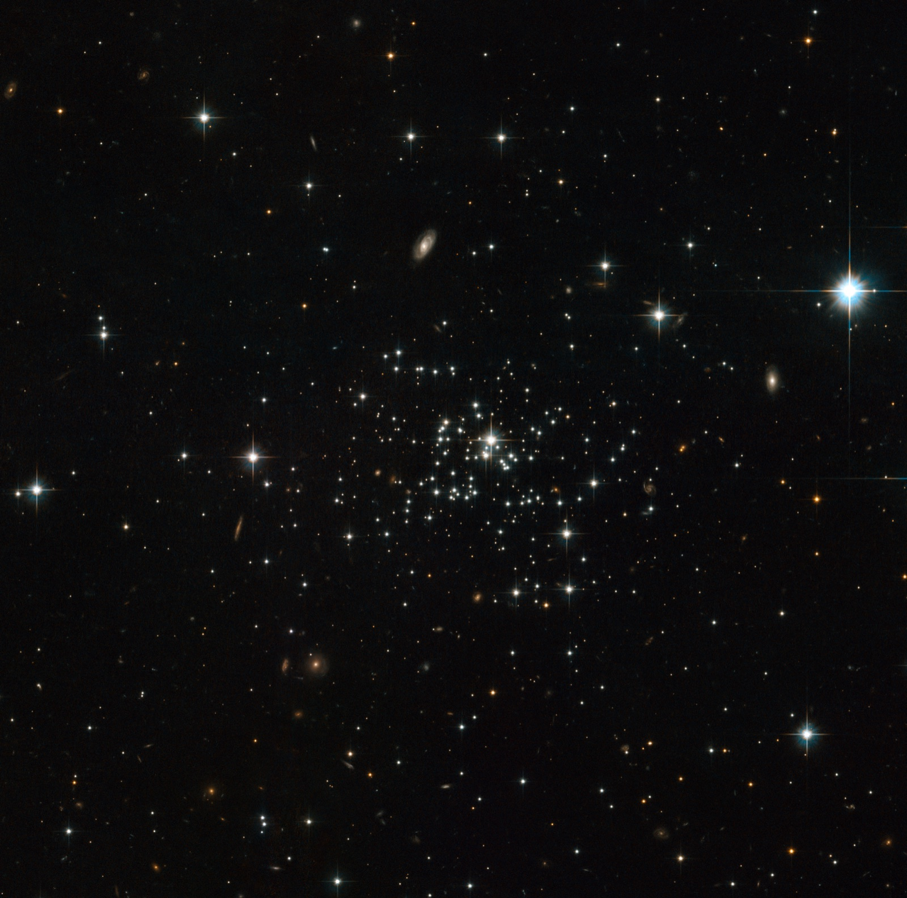 [원본 페이지](https://esahubble.org/images/potw1104a/) | 성단 주변의 빈 하늘(허블 "The secret of stellar youth") | 1 | 2 | 중앙에 작은 성단만 있고 대부분 빈 공간. 이음매 처리 쉬움 · 비율 1.01:1 · 타일 불가 → 미러 반복/크로스페이드 · 어두움(평균 휘도 13) → UI 오버레이 바로 OK · 추천: ① 지구 근처·태양계 | 3573x3538 px [ESA/Hubble](https://esahubble.org/images/potw1104a/) 저장본 1600x1584 |
| 3 | 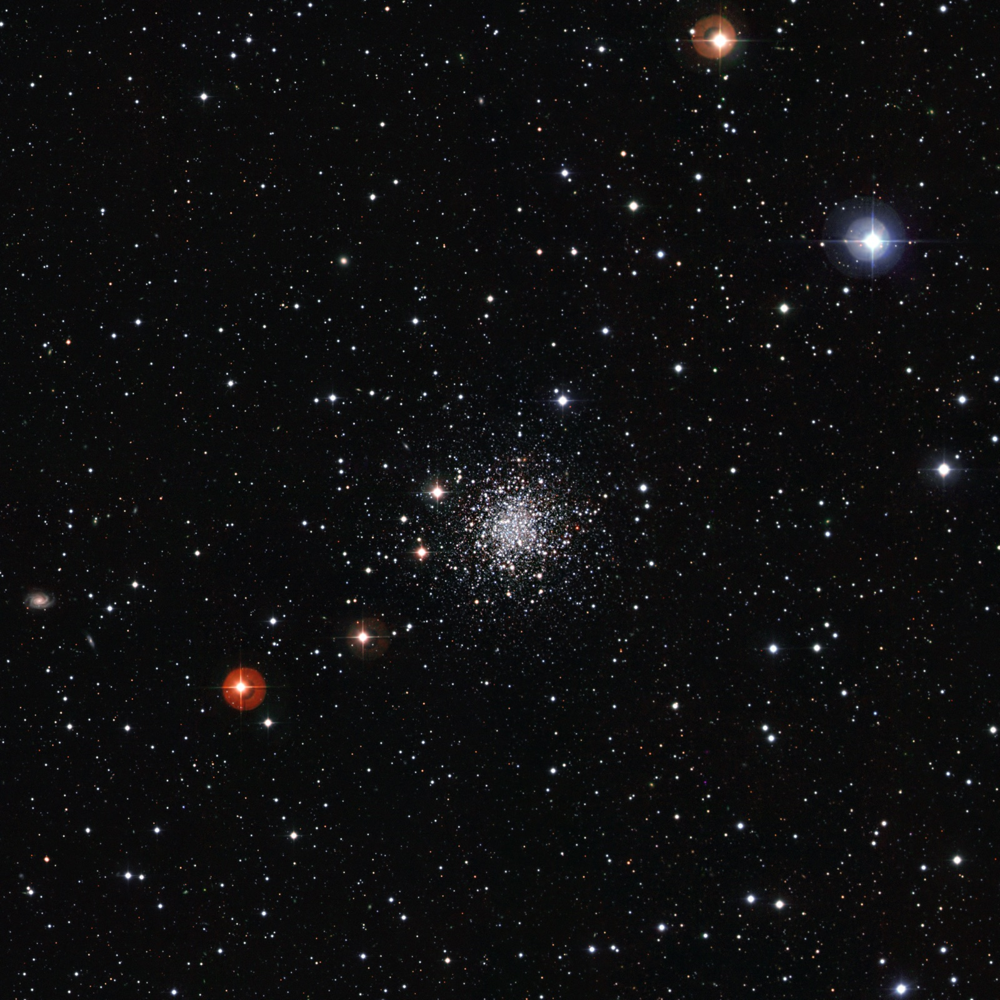 [원본 페이지](https://www.eso.org/public/images/potw1046a/) | 대마젤란은하 별밭 속 오래된 구상성단 NGC 2257 | 2 | 2 | 아주 어두움. 중앙 성단만 피하면 균일한 별밭 · 비율 1.00:1 · 타일 불가 → 미러 반복/크로스페이드 · 어두움(평균 휘도 16) → UI 오버레이 바로 OK · 추천: ① 지구 근처·태양계 | 4741x4741 px [ESO](https://www.eso.org/public/images/potw1046a/) 저장본 1600x1600 |
| 4 | 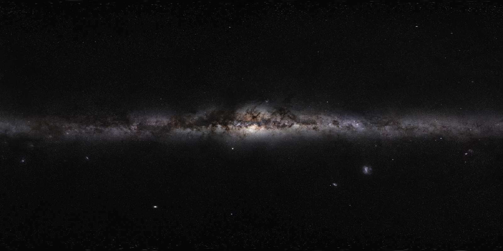 [원본 페이지](https://www.eso.org/public/images/eso0932a/) | 은하수 360° 파노라마 (GigaGalaxy Zoom) | 2 | 3 | **360° 등장방형 → 좌우 이음매 없이 무한 스크롤 가능(유일)**. 은하수 띠가 가로로 흐름 · 비율 2.00:1 · 360° 무한 타일 가능 · 어두움(평균 휘도 17) → UI 오버레이 바로 OK · 추천: ① 지구 근처·태양계 | 6000x3000 px [ESO](https://www.eso.org/public/images/eso0932a/) 저장본 1600x800 |
| 5 | 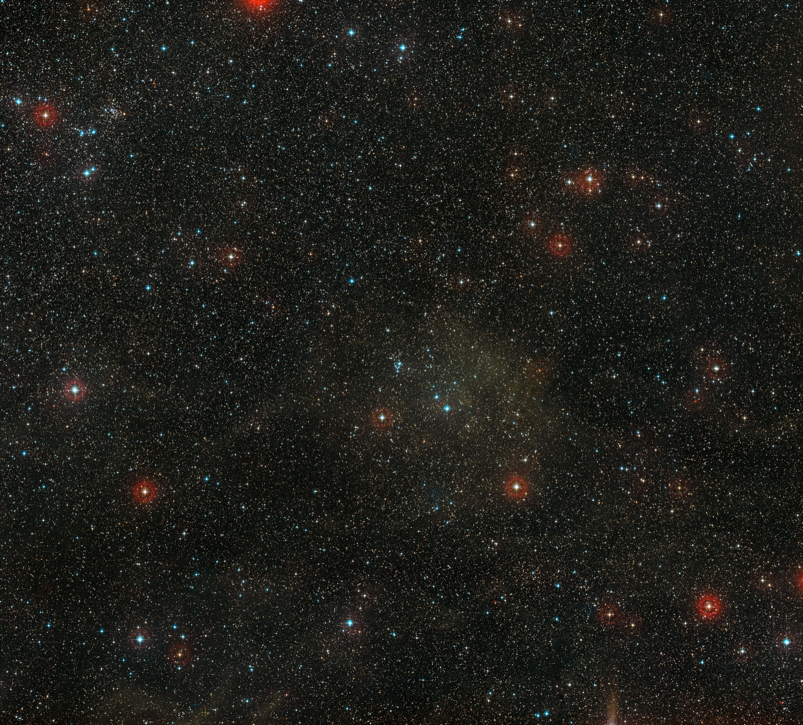 [원본 페이지](https://www.eso.org/public/images/eso1526c/) | NGC 2367 주변 하늘(DSS2) | 2 | 4 | 균일한 별밭 + 아주 옅은 붉은 성운기. 반복 타일용 소재로 적합 · 비율 1.11:1 · 타일 불가 → 미러 반복/크로스페이드 · 어두움(평균 휘도 31) → UI 오버레이 바로 OK · 추천: ① 지구 근처·태양계 | 10693x9658 px [ESO](https://www.eso.org/public/images/eso1526c/) 저장본 1600x1445 |
| | | **② 태양계 외곽·오르트 구름** | | | | |
| 6 | 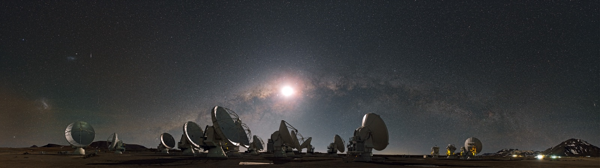 [원본 페이지](https://www.eso.org/public/images/potw1217a/) | 달과 은하수 아치(ALMA, 차이난토르 고원) | 3 | 4 | ⚠ 하단에 ALMA 안테나·지상 풍경 포함 → 상단만 크롭해서 사용. 3.6:1 초광각 · 비율 3.56:1 · 타일 불가 → 미러 반복/크로스페이드 · 중간(평균 휘도 52) → 30~50% 검은 스크림 권장 · 추천: ① 지구 근처(출발 화면 전용, 크롭 후) — 점수 합계(7)로는 ② 구간이지만 지상에서 본 하늘이라 의미상 지구 출발 화면에 맞음 | 8214x2305 px [ESO](https://www.eso.org/public/images/potw1217a/) 저장본 1600x449 |
| 7 | 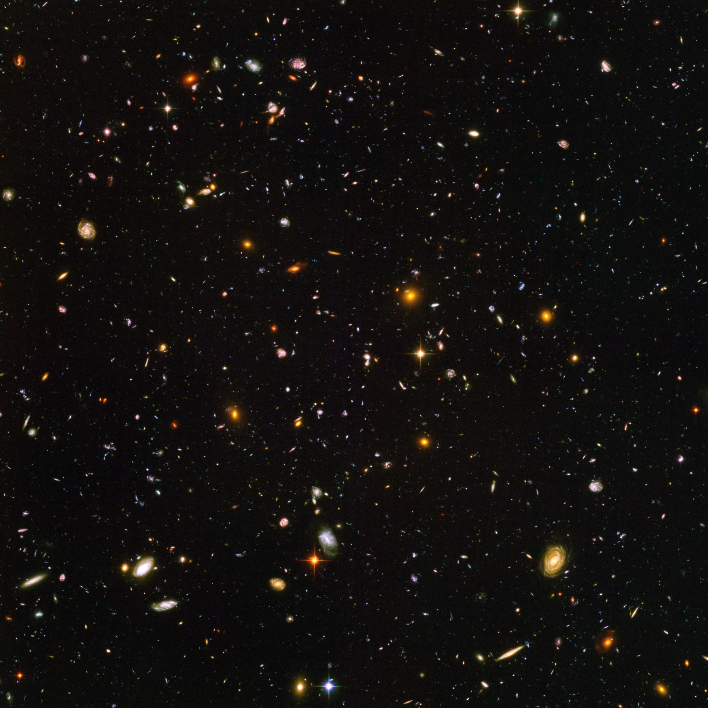 [원본 페이지](https://esahubble.org/images/heic0406a/) | 허블 울트라 딥 필드 | 3 | 4 | 어두운 바탕에 작은 은하 수천 개. 시각적으로는 차분하지만 "가장 먼 우주" 상징성 → 엔딩/업적 화면용 · 비율 1.00:1 · 타일 불가 → 미러 반복/크로스페이드 · 어두움(평균 휘도 17) → UI 오버레이 바로 OK · 추천: ② 태양계 외곽·오르트 구름 | 6200x6200 px [ESA/Hubble](https://esahubble.org/images/heic0406a/) 저장본 1600x1600 |
| 8 | 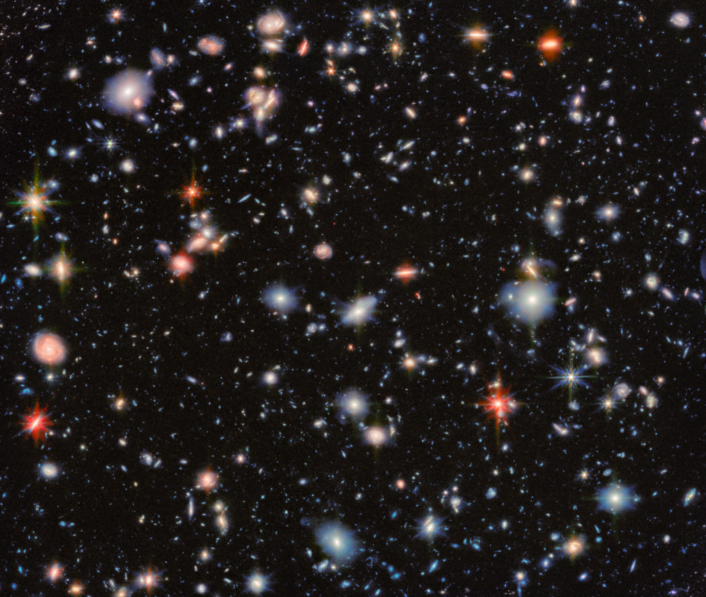 [원본 페이지](https://esawebb.org/images/potm2507a/) | 웹 망원경으로 본 고전 딥필드(HUDF) | 3 | 5 | 딥필드보다 별·은하가 더 선명. 어두워서 UI 오버레이 용이 · 비율 1.18:1 · 타일 불가 → 미러 반복/크로스페이드 · 어두움(평균 휘도 32) → UI 오버레이 바로 OK · 추천: ② 태양계 외곽·오르트 구름 | 2104x1781 px [ESA/Webb](https://esawebb.org/images/potm2507a/) 저장본 1600x1354 |
| 9 | 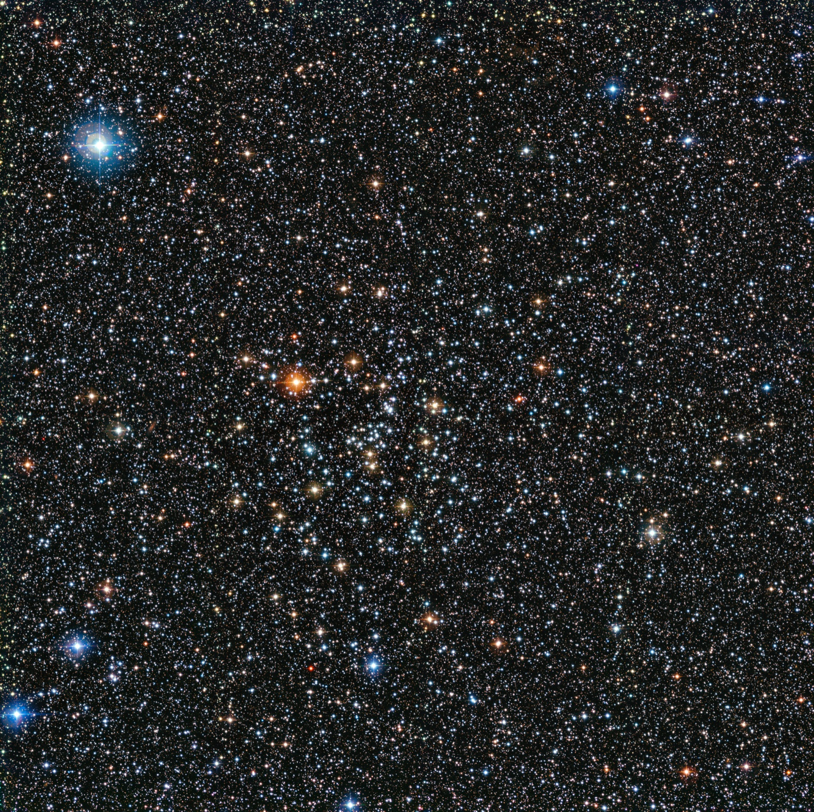 [원본 페이지](https://www.eso.org/public/images/eso1534a/) | 산개성단 IC 4651 | 3 | 6 | 촘촘한 별밭, 색은 단조. 은하면 근처 느낌 · 비율 1.00:1 · 타일 불가 → 미러 반복/크로스페이드 · 어두움(평균 휘도 39.9) → UI 오버레이 바로 OK · 추천: ② 태양계 외곽·오르트 구름 | 8474x8465 px [ESO](https://www.eso.org/public/images/eso1534a/) 저장본 1600x1598 |
| 10 | 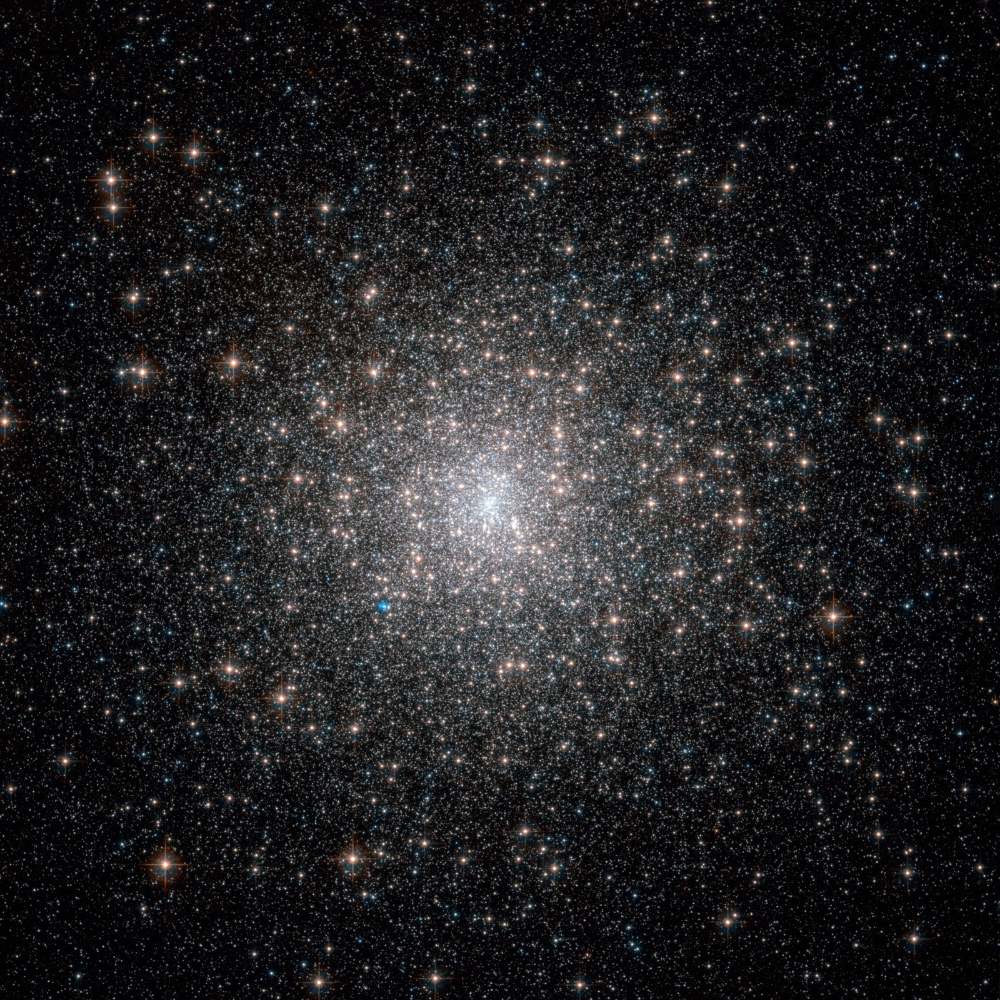 [원본 페이지](https://esahubble.org/images/potw1107a/) | 구상성단(허블 "Old stars with a youthful glow") | 3 | 6 | 중앙이 밝은 구상성단 → 배경보다는 "지나치는 천체" 오브젝트로 적합 · 비율 1.00:1 · 타일 불가 → 미러 반복/크로스페이드 · 어두움(평균 휘도 33) → UI 오버레이 바로 OK · 추천: ② 태양계 외곽·오르트 구름 | 4089x4089 px [ESA/Hubble](https://esahubble.org/images/potw1107a/) 저장본 1600x1600 |
| 11 | 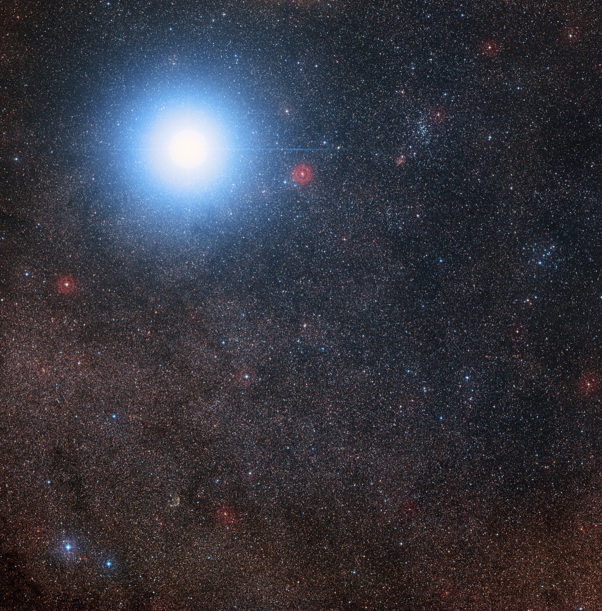 [원본 페이지](https://www.eso.org/public/images/eso1629i/) | 알파·프록시마 센타우리 주변 하늘 | 3 | 6 | **프록시마 센타우리 도착 장면 전용**: 실제 그 방향 하늘. 밝은 알파 센타우리가 포인트 · 비율 0.98:1 · 타일 불가 → 미러 반복/크로스페이드 · 중간(평균 휘도 56) → 30~50% 검은 스크림 권장 · 추천: ② 태양계 외곽·오르트 구름 | 11086x11256 px [ESO](https://www.eso.org/public/images/eso1629i/) 저장본 1600x1624 |
| 12 | 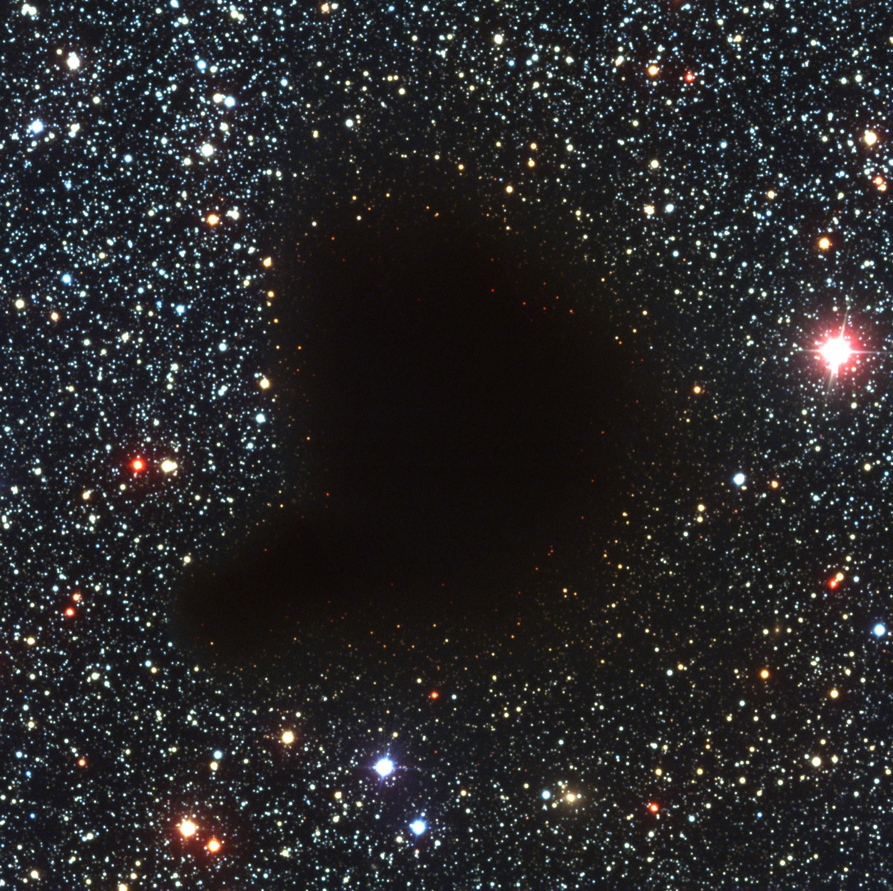 [원본 페이지](https://www.eso.org/public/images/eso9924a/) | 암흑성운 바너드 68 | 3 | 6 | 별밭 한가운데 검은 구멍. "성간 공간 진입" 신비감 연출 · 비율 1.00:1 · 타일 불가 → 미러 반복/크로스페이드 · 중간(평균 휘도 41) → 30~50% 검은 스크림 권장 · 추천: ② 태양계 외곽·오르트 구름 | 1955x1953 px [ESO](https://www.eso.org/public/images/eso9924a/) 저장본 1600x1598 |
| 13 | 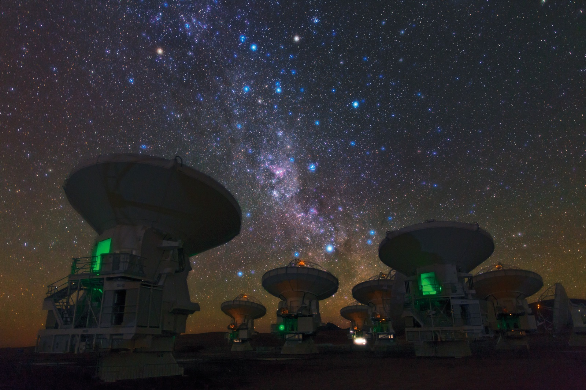 [원본 페이지](https://www.eso.org/public/images/potw1222a/) | ALMA 위의 남반구 은하수 | 4 | 5 | ⚠ 안테나·지상 포함 → 상단 크롭 필요. 출항 전 "지구에서 올려다본 하늘" 연출용으로는 오히려 적합 · 비율 1.50:1 · 타일 불가 → 미러 반복/크로스페이드 · 중간(평균 휘도 44) → 30~50% 검은 스크림 권장 · 추천: ② 태양계 외곽·오르트 구름 | 5315x3544 px [ESO](https://www.eso.org/public/images/potw1222a/) 저장본 1600x1067 |
| 14 | 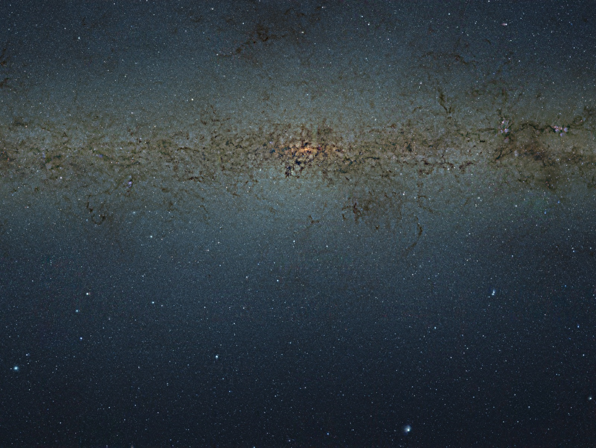 [원본 페이지](https://www.eso.org/public/images/eso1242a/) | VISTA 은하 중심부 기가픽셀 모자이크 | 3 | 7 | 적외선이라 회색·황토 톤, 별이 매우 촘촘. 차분한 고밀도 별밭 · 비율 1.33:1 · 타일 불가 → 미러 반복/크로스페이드 · 중간(평균 휘도 58) → 30~50% 검은 스크림 권장 · 추천: ② 태양계 외곽·오르트 구름 | 108199x81503 px [ESO](https://www.eso.org/public/images/eso1242a/) 저장본 1600x1205 |
| 15 | 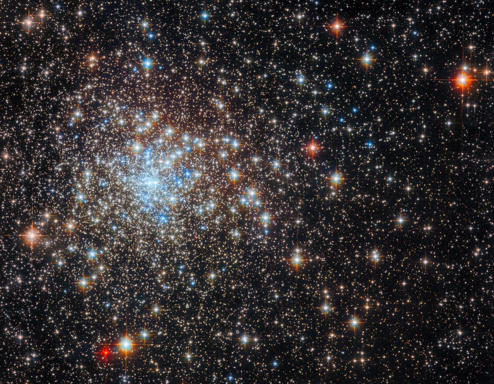 [원본 페이지](https://esahubble.org/images/potw2320a/) | 별이 가득한 성단(허블) | 4 | 6 | 빨강·파랑 별 색 대비가 생김. 중간 밀도 · 비율 1.28:1 · 타일 불가 → 미러 반복/크로스페이드 · 중간(평균 휘도 50) → 30~50% 검은 스크림 권장 · 추천: ② 태양계 외곽·오르트 구름 | 4094x3192 px [ESA/Hubble](https://esahubble.org/images/potw2320a/) 저장본 1600x1247 |
| 16 | 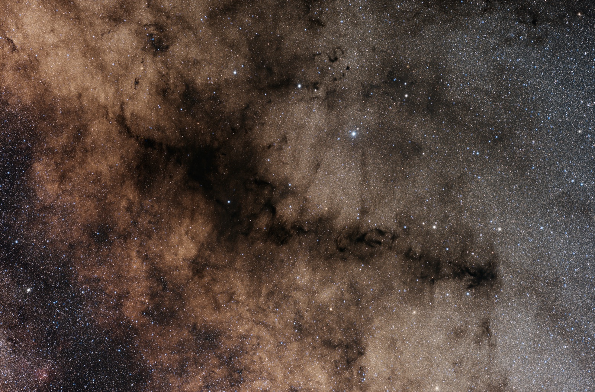 [원본 페이지](https://www.eso.org/public/images/yb/) | 파이프 성운(광시야) | 4 | 6 | 은하수 별구름 위를 지나는 검은 먼지띠. 가로 1.5:1 · 비율 1.51:1 · 타일 불가 → 미러 반복/크로스페이드 · 밝음(평균 휘도 74) → 60%+ 어둡게 보정 필요 · 추천: ② 태양계 외곽·오르트 구름 | 3000x1983 px [ESO](https://www.eso.org/public/images/yb/) 저장본 1600x1057 |
| | | **③ 성간 공간·첫 별 이후** | | | | |
| 17 | 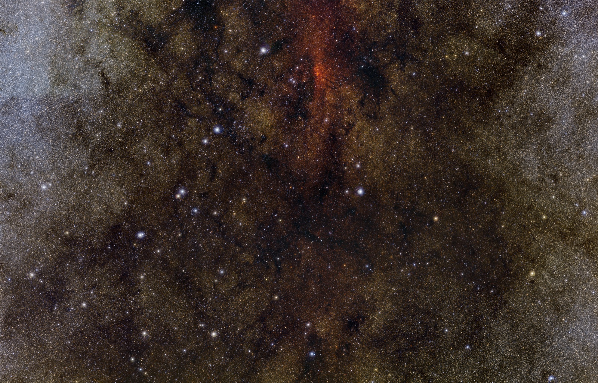 [원본 페이지](https://www.eso.org/public/images/eso0949b/) | 백만 개의 별 — 은하수 중심 방향 | 4 | 7 | 황토빛 별구름 + 먼지띠. 가로 1.56:1로 스크롤에 유리 · 비율 1.56:1 · 타일 불가 → 미러 반복/크로스페이드 · 중간(평균 휘도 52) → 30~50% 검은 스크림 권장 · 추천: ③ 성간 공간·첫 별 이후 | 24245x15566 px [ESO](https://www.eso.org/public/images/eso0949b/) 저장본 1600x1027 |
| 18 | 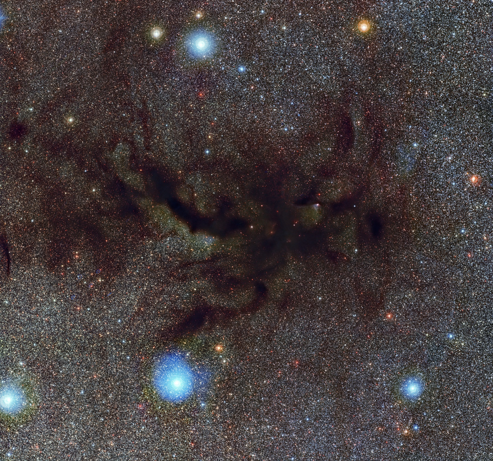 [원본 페이지](https://www.eso.org/public/images/eso1233a/) | 파이프 성운의 "물부리"(Barnard 59) | 4 | 7 | 검은 먼지 덩굴이 별밭을 가림. 다소 어수선 · 비율 1.07:1 · 타일 불가 → 미러 반복/크로스페이드 · 중간(평균 휘도 64) → 30~50% 검은 스크림 권장 · 추천: ③ 성간 공간·첫 별 이후 | 15848x14827 px [ESO](https://www.eso.org/public/images/eso1233a/) 저장본 1600x1497 |
| 19 | 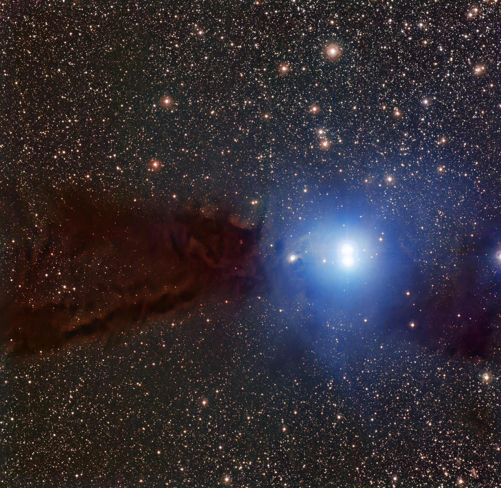 [원본 페이지](https://www.eso.org/public/images/eso1303a/) | 이리자리 Lupus 3 암흑성운 | 5 | 6 | 갈색 암흑운 + 밝은 청백색 젊은 별 2개 · 비율 1.03:1 · 타일 불가 → 미러 반복/크로스페이드 · 중간(평균 휘도 48) → 30~50% 검은 스크림 권장 · 추천: ③ 성간 공간·첫 별 이후 | 8828x8607 px [ESO](https://www.eso.org/public/images/eso1303a/) 저장본 1600x1560 |
| 20 | 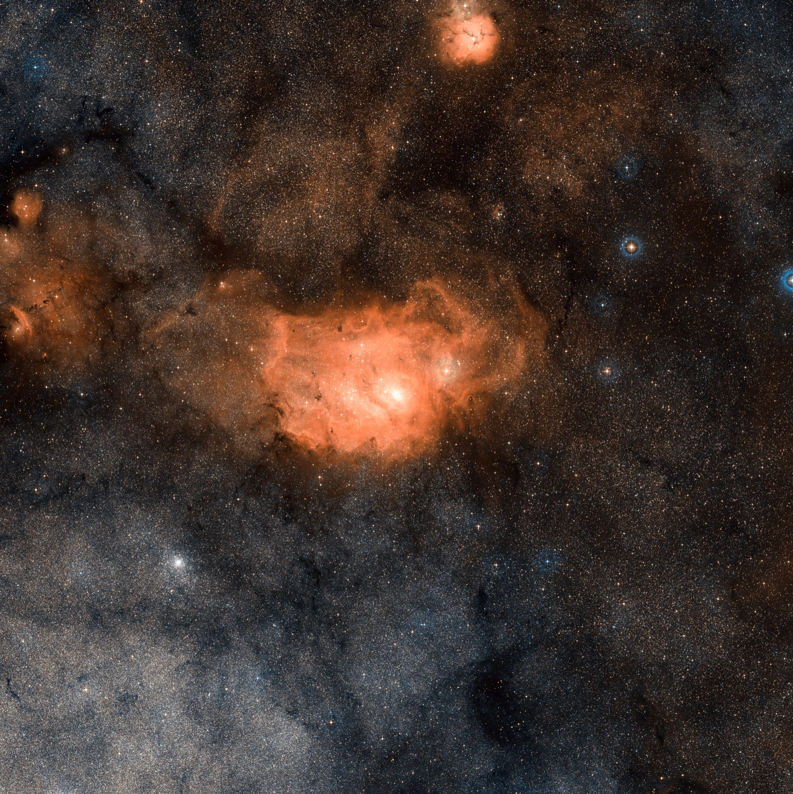 [원본 페이지](https://www.eso.org/public/images/eso1403c/) | 석호성운 주변 광시야(DSS2) | 5 | 6 | 작은 분홍 성운 + 넓은 먼지·별구름. 성운 구간 진입 직전 전환용 · 비율 1.00:1 · 타일 불가 → 미러 반복/크로스페이드 · 중간(평균 휘도 55) → 30~50% 검은 스크림 권장 · 추천: ③ 성간 공간·첫 별 이후 | 10683x10704 px [ESO](https://www.eso.org/public/images/eso1403c/) 저장본 1600x1603 |
| 21 | 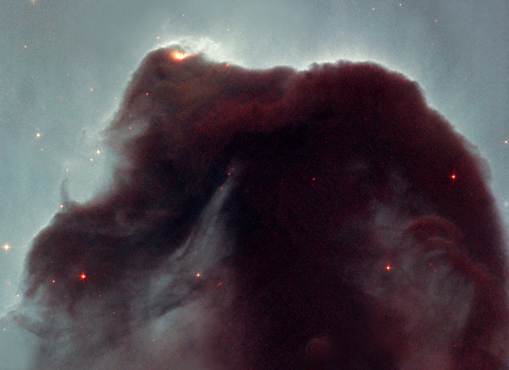 [원본 페이지](https://esahubble.org/images/heic0105a/) | 말머리성운(허블) | 6 | 5 | 거대한 실루엣 한 덩어리 → 배경보다 "랜드마크" 컷. 밝은 편 · 비율 1.37:1 · 타일 불가 → 미러 반복/크로스페이드 · 밝음(평균 휘도 76) → 60%+ 어둡게 보정 필요 · 추천: ③ 성간 공간·첫 별 이후 | 2839x2065 px [ESA/Hubble](https://esahubble.org/images/heic0105a/) 저장본 1600x1163 |
| 22 | 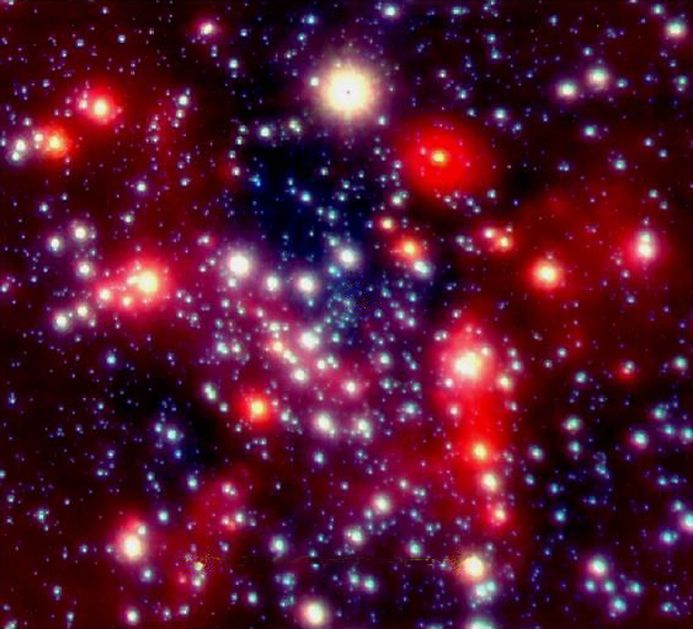 [원본 페이지](https://www.eso.org/public/images/eso0226a/) | 은하 중심부 별무리(ESO, 2002) | 6 | 6 | 빨강·흰 별이 빽빽, 성운 없음. 강렬한 색감 · 비율 1.10:1 · 타일 불가 → 미러 반복/크로스페이드 · 중간(평균 휘도 43) → 30~50% 검은 스크림 권장 · 추천: ③ 성간 공간·첫 별 이후 | 2598x2362 px [ESO](https://www.eso.org/public/images/eso0226a/) 저장본 1600x1454 |
| 23 | 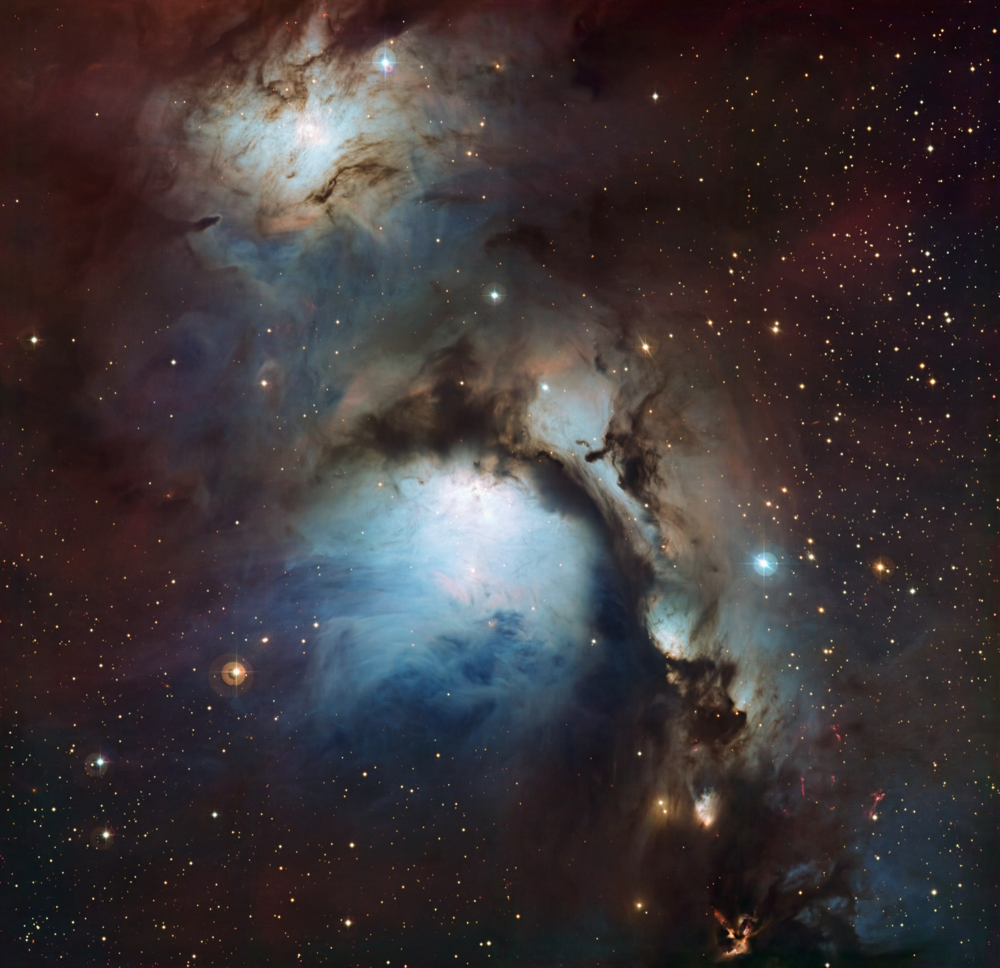 [원본 페이지](https://www.eso.org/public/images/eso1105a/) | 반사성운 M78(오리온자리) | 6 | 6 | 푸른 반사성운 + 갈색 먼지. 어두운 여백이 많아 UI와 궁합 좋음 · 비율 1.03:1 · 타일 불가 → 미러 반복/크로스페이드 · 중간(평균 휘도 56) → 30~50% 검은 스크림 권장 · 추천: ③ 성간 공간·첫 별 이후 | 8679x8411 px [ESO](https://www.eso.org/public/images/eso1105a/) 저장본 1600x1550 |
| 24 | 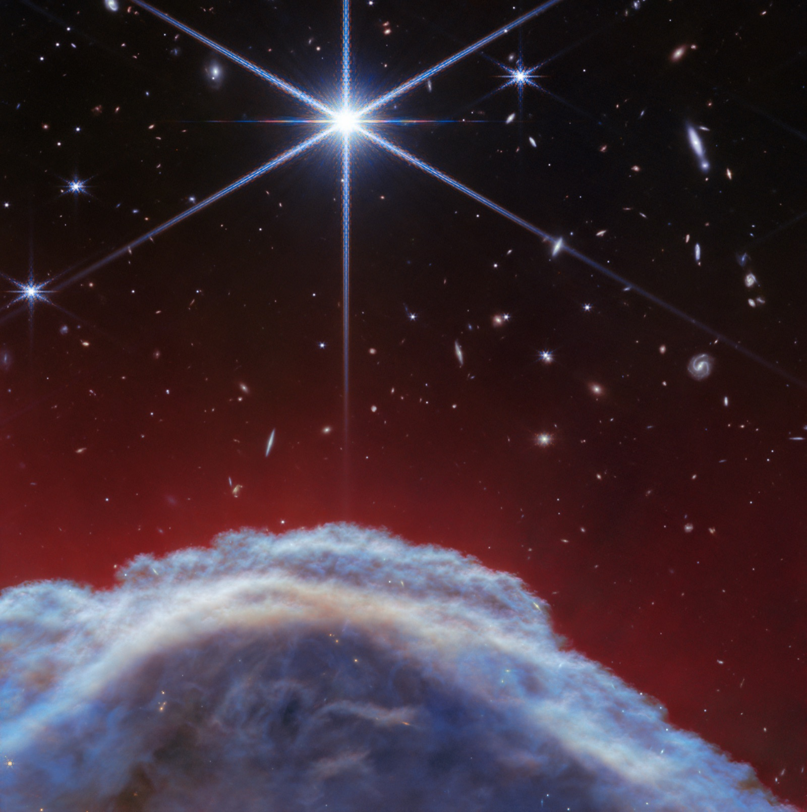 [원본 페이지](https://esawebb.org/images/weic2411a/) | 말머리성운 갈기(웹 NIRCam) | 6 | 6 | 하단에 성운 가장자리, 상단은 어두운 우주 → 아래쪽 랜드마크 구도 · 비율 0.99:1 · 타일 불가 → 미러 반복/크로스페이드 · 중간(평균 휘도 52) → 30~50% 검은 스크림 권장 · 추천: ③ 성간 공간·첫 별 이후 | 4159x4187 px [ESA/Webb](https://esawebb.org/images/weic2411a/) 저장본 1600x1610 |
| 25 | 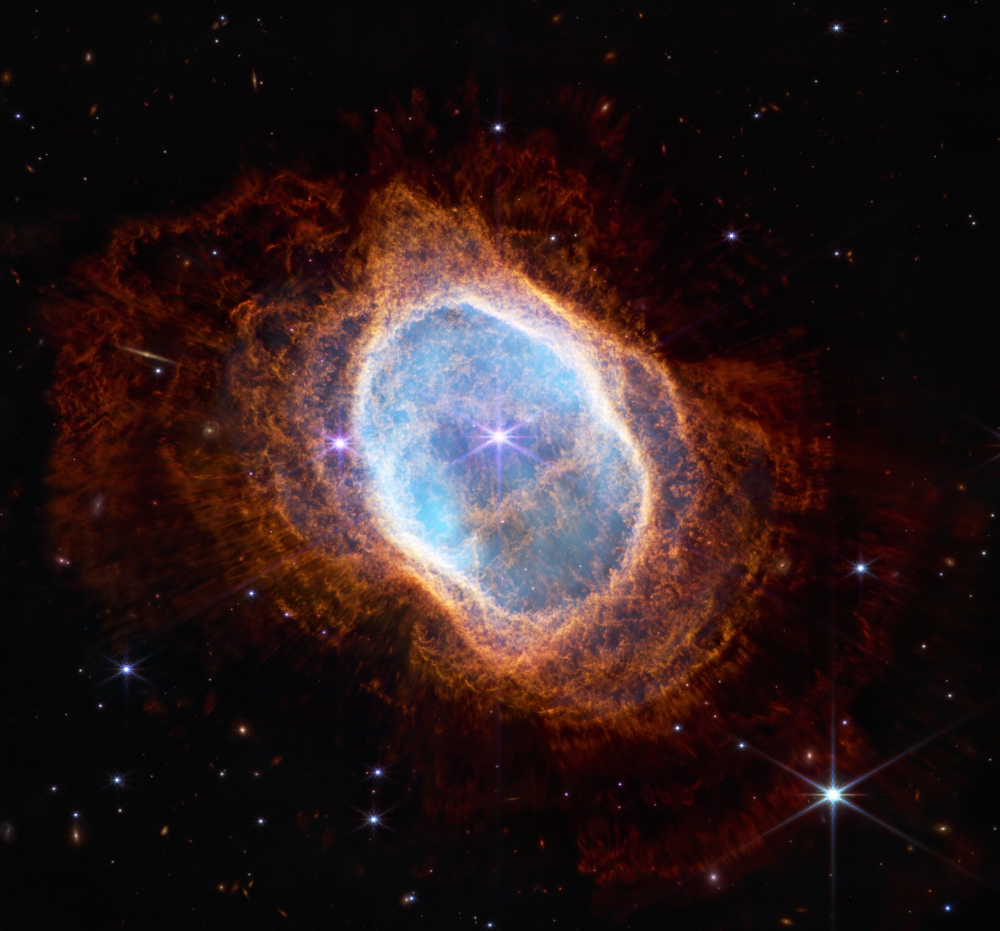 [원본 페이지](https://esawebb.org/images/weic2207b/) | 남쪽 고리 성운(웹 NIRCam) | 7 | 5 | 중앙에 고리 하나, 주변은 어두움. 행성상성운 "지나치기" 연출용 · 비율 1.07:1 · 타일 불가 → 미러 반복/크로스페이드 · 어두움(평균 휘도 33) → UI 오버레이 바로 OK · 추천: ③ 성간 공간·첫 별 이후 | 4833x4501 px [ESA/Webb](https://esawebb.org/images/weic2207b/) 저장본 1600x1490 |
| 26 | 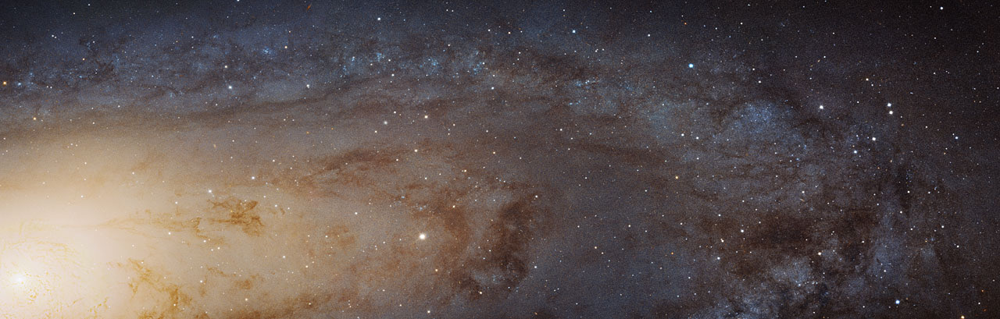 [원본 페이지](https://esahubble.org/images/heic1502a/) | 안드로메다 은하 원반(허블 PHAT) | 5 | 8 | 원본 6.9만×2.2만 px 초광폭(3.1:1) → 가로 스크롤 최적. 이 파일은 1280px 화면판(대용량 원본 제외) · 비율 3.13:1 · 타일 불가 → 미러 반복/크로스페이드 · 밝음(평균 휘도 86) → 60%+ 어둡게 보정 필요 · 추천: ③ 성간 공간·첫 별 이후 | 69536x22230 px [ESA/Hubble](https://esahubble.org/images/heic1502a/) 저장본 1280x409 |
| 27 | 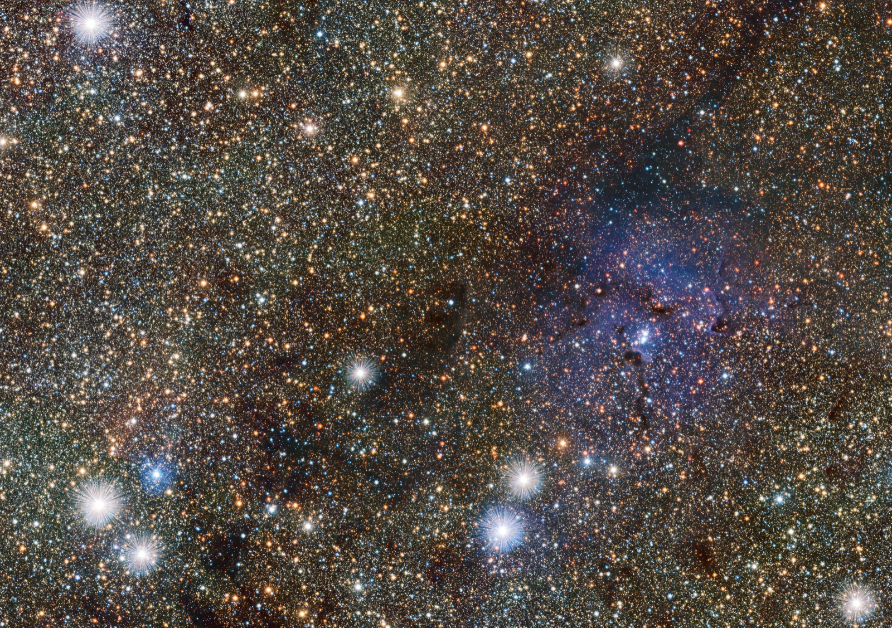 [원본 페이지](https://www.eso.org/public/images/eso1504a/) | 삼렬성운(VISTA 적외선) | 5 | 8 | 별이 매우 빽빽하고 성운은 은은. 고밀도 별밭 · 비율 1.42:1 · 타일 불가 → 미러 반복/크로스페이드 · 밝음(평균 휘도 77) → 60%+ 어둡게 보정 필요 · 추천: ③ 성간 공간·첫 별 이후 | 5103x3596 px [ESO](https://www.eso.org/public/images/eso1504a/) 저장본 1600x1127 |
| 28 | 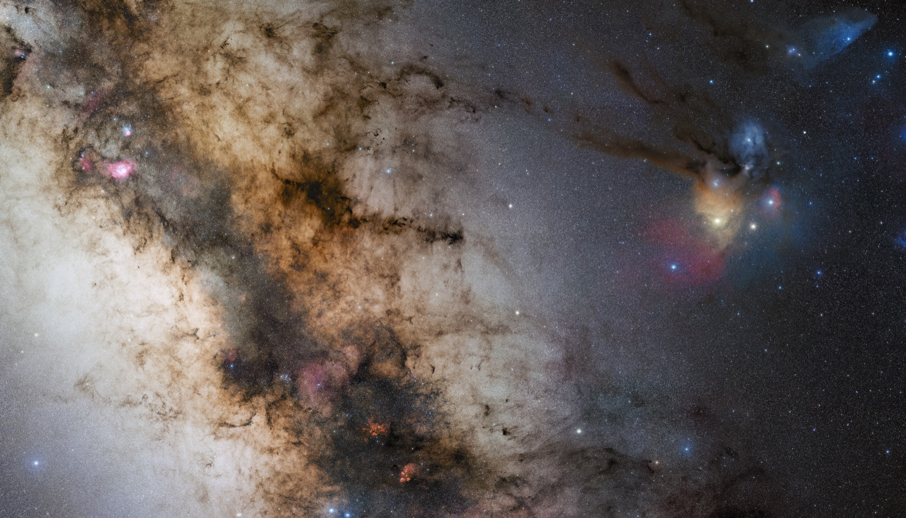 [원본 페이지](https://www.eso.org/public/images/eso0934a/) | 파라날 3억4천만 화소 별밭 | 6 | 7 | 은하수 띠 + 로 오피우키(청·황·적) + 석호·삼렬 성운 포함, 짙은 암흑 먼지띠. 가로 1.75:1 · 비율 1.75:1 · 타일 불가 → 미러 반복/크로스페이드 · 밝음(평균 휘도 93.1) → 60%+ 어둡게 보정 필요 · 추천: ③ 성간 공간·첫 별 이후 | 4331x2480 px [ESO](https://www.eso.org/public/images/eso0934a/) 저장본 1600x916 |
| | | **④ 성운 구간** | | | | |
| 29 | 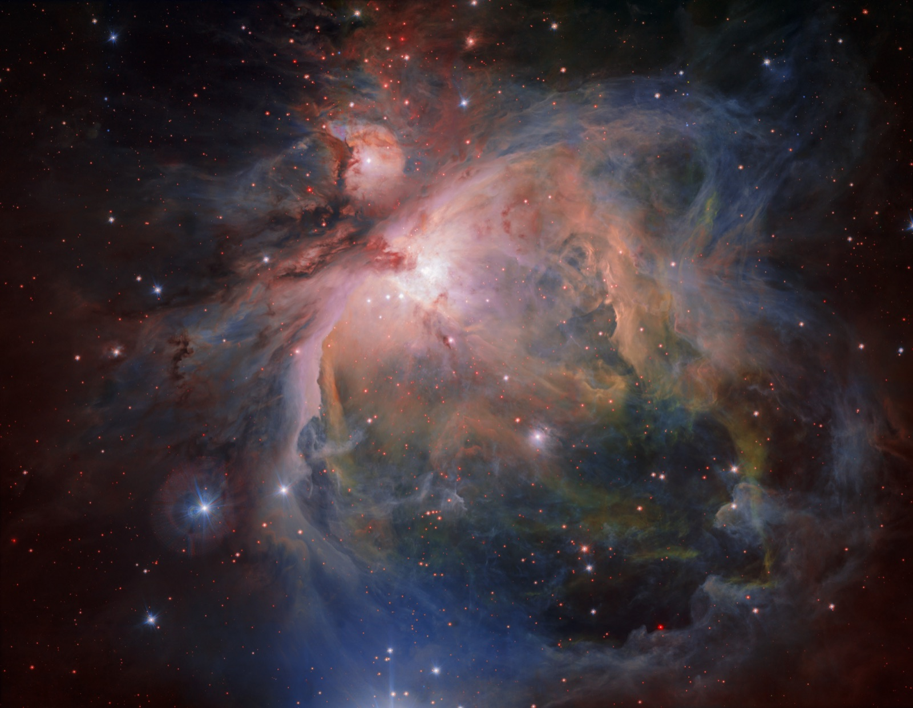 [원본 페이지](https://www.eso.org/public/images/eso1723a/) | 오리온 대성운과 성단(VST) | 7 | 7 | 중앙 밝은 성운 + 넓은 어두운 먼지 → 화면 일부에 성운이 걸리는 구도 · 비율 1.29:1 · 타일 불가 → 미러 반복/크로스페이드 · 중간(평균 휘도 56) → 30~50% 검은 스크림 권장 · 추천: ④ 성운 구간 | 16877x13107 px [ESO](https://www.eso.org/public/images/eso1723a/) 저장본 1600x1242 |
| 30 | 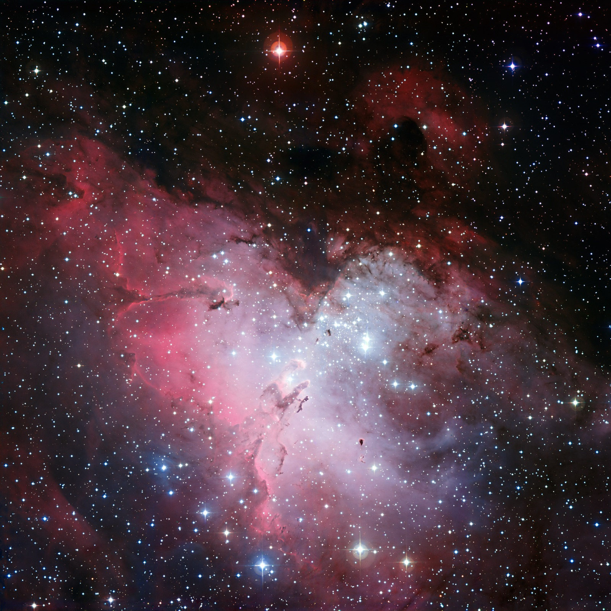 [원본 페이지](https://www.eso.org/public/images/eso0926a/) | 독수리 성운 M16(ESO) | 7 | 7 | 분홍 성운 + 창조의 기둥 실루엣(작게). 정사각 · 비율 1.00:1 · 타일 불가 → 미러 반복/크로스페이드 · 중간(평균 휘도 60) → 30~50% 검은 스크림 권장 · 추천: ④ 성운 구간 | 8084x8084 px [ESO](https://www.eso.org/public/images/eso0926a/) 저장본 1600x1600 |
| 31 | 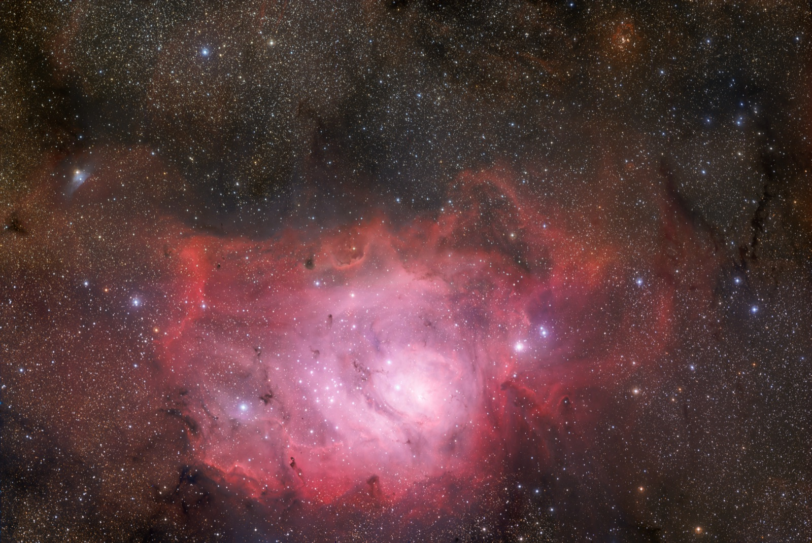 [원본 페이지](https://www.eso.org/public/images/eso0936a/) | 석호성운 3억7천만 화소 | 7 | 7 | 분홍 성운이 화면 중앙을 가로지름. 가로 1.5:1 · 비율 1.49:1 · 타일 불가 → 미러 반복/크로스페이드 · 중간(평균 휘도 68) → 30~50% 검은 스크림 권장 · 추천: ④ 성운 구간 | 23569x15784 px [ESO](https://www.eso.org/public/images/eso0936a/) 저장본 1600x1071 |
| 32 | 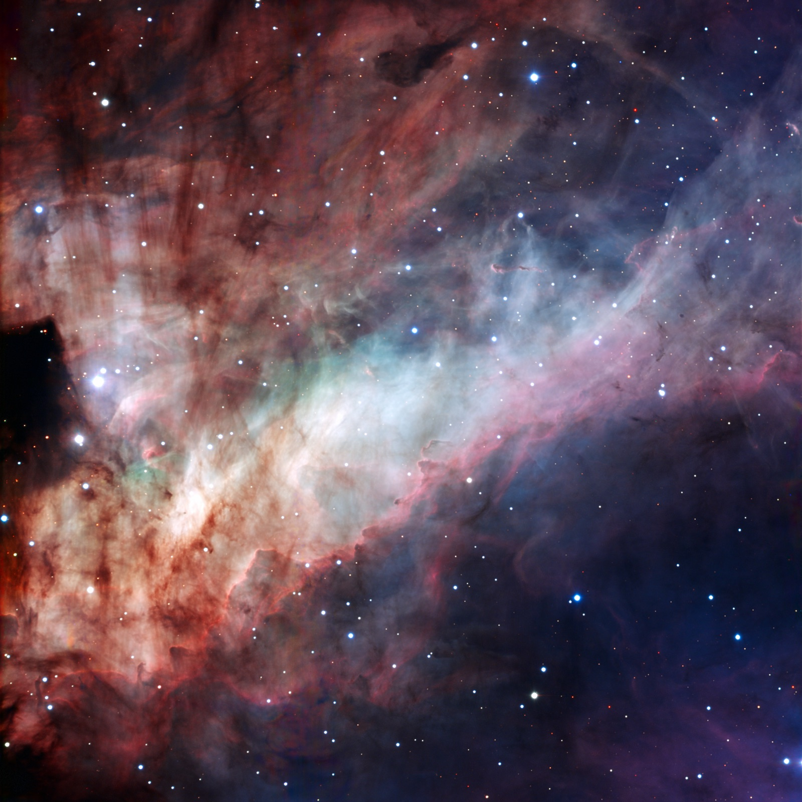 [원본 페이지](https://www.eso.org/public/images/eso0925a/) | 오메가 성운 M17 | 7 | 7 | 분홍·청록 가스가 화면 대부분. 밝은 편(어둡게 보정 권장) · 비율 1.00:1 · 타일 불가 → 미러 반복/크로스페이드 · 밝음(평균 휘도 81) → 60%+ 어둡게 보정 필요 · 추천: ④ 성운 구간 | 3069x3069 px [ESO](https://www.eso.org/public/images/eso0925a/) 저장본 1600x1600 |
| 33 | 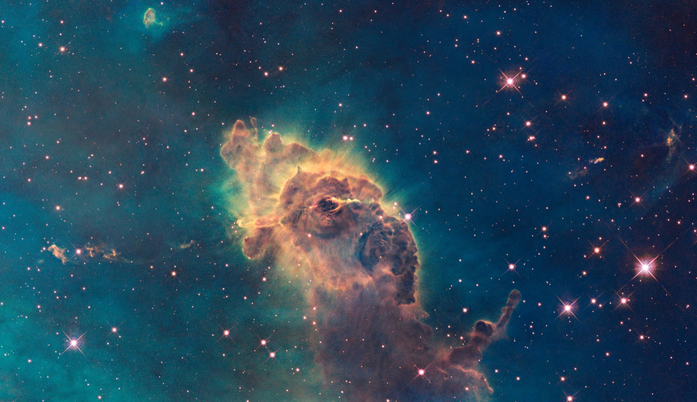 [원본 페이지](https://esahubble.org/images/heic0910e/) | 용골자리 성운 기둥(허블 WFC3) | 7 | 7 | 청록 바탕의 먼지 기둥 하나. 16:9에 가까움 · 비율 1.73:1 · 타일 불가 → 미러 반복/크로스페이드 · 중간(평균 휘도 63) → 30~50% 검은 스크림 권장 · 추천: ④ 성운 구간 | 4533x2618 px [ESA/Hubble](https://esahubble.org/images/heic0910e/) 저장본 1600x924 |
| 34 | 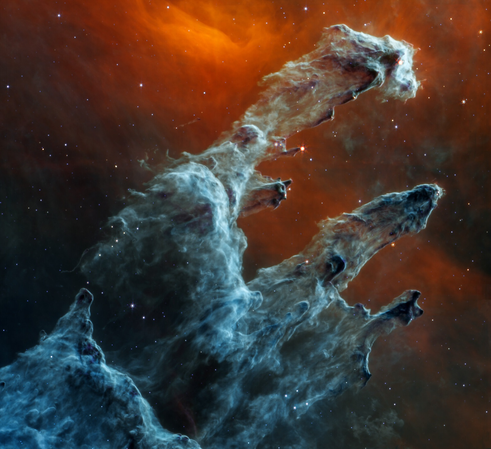 [원본 페이지](https://esawebb.org/images/weic2218a/) | 창조의 기둥(웹 MIRI 중적외선) | 7 | 7 | 회청색 유령 같은 기둥, 별이 거의 없음 → 몽환적 · 비율 1.09:1 · 타일 불가 → 미러 반복/크로스페이드 · 중간(평균 휘도 59) → 30~50% 검은 스크림 권장 · 추천: ④ 성운 구간 | 1987x1817 px [ESA/Webb](https://esawebb.org/images/weic2218a/) 저장본 1600x1463 |
| 35 | 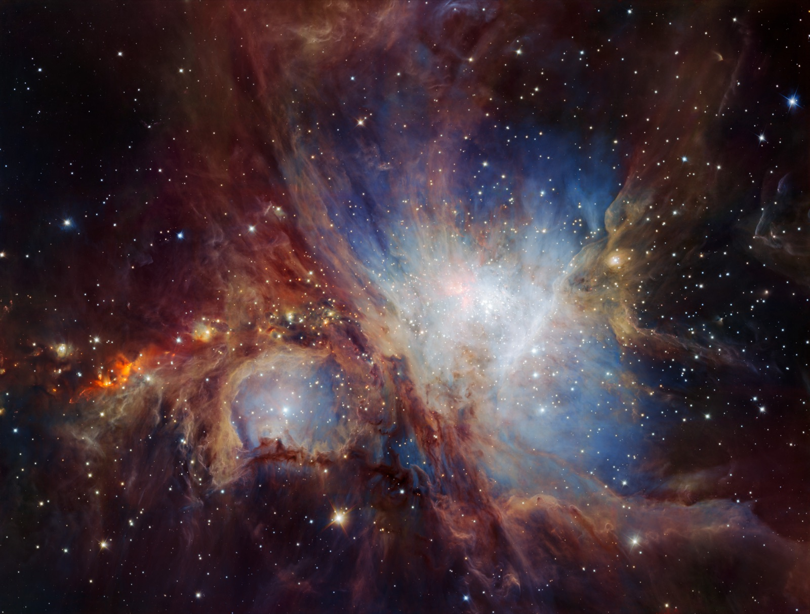 [원본 페이지](https://www.eso.org/public/images/eso1625a/) | 오리온 성운 심층 적외선(HAWK-I) | 7 | 8 | 푸른 중심 + 붉은 필라멘트가 사방으로. 화려하지만 어두운 편 · 비율 1.32:1 · 타일 불가 → 미러 반복/크로스페이드 · 중간(평균 휘도 56) → 30~50% 검은 스크림 권장 · 추천: ④ 성운 구간 | 16373x12412 px [ESO](https://www.eso.org/public/images/eso1625a/) 저장본 1600x1213 |
| 36 | 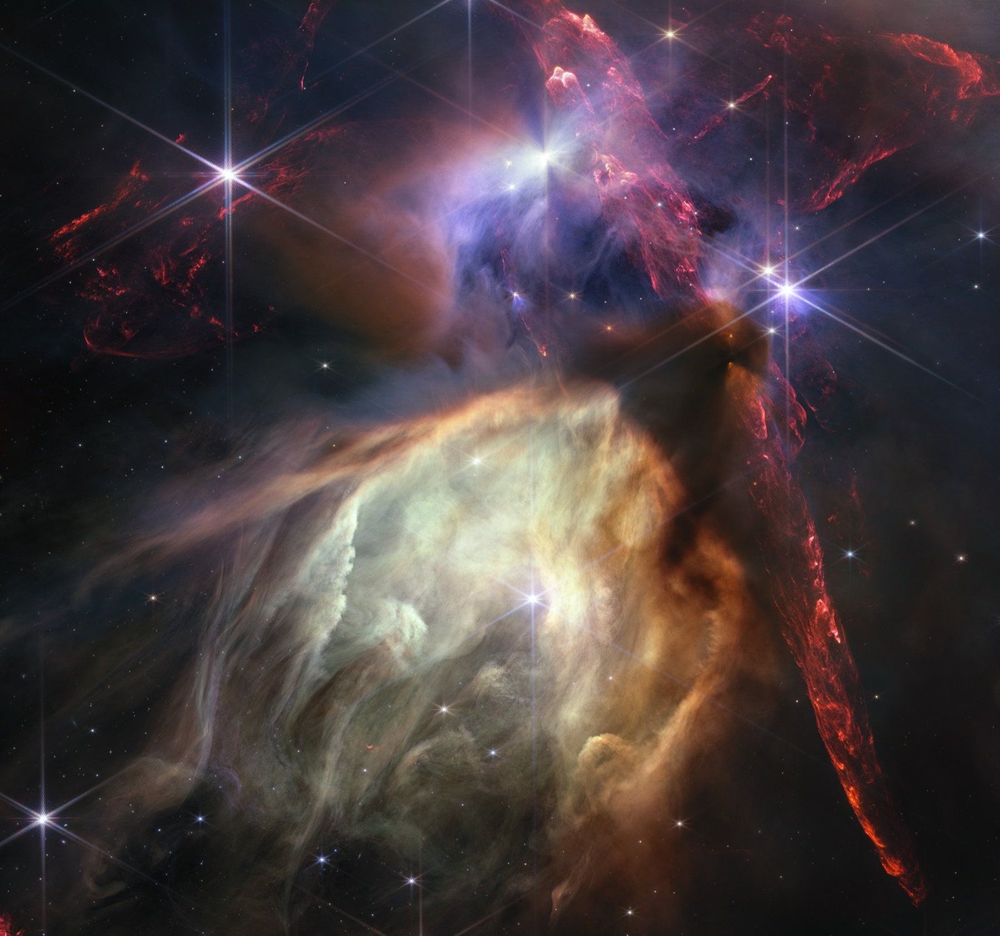 [원본 페이지](https://esawebb.org/images/weic2316a/) | 뱀주인자리 로 분자운(웹) | 7 | 8 | 제트·먼지 동굴·푸른 반사광. 웹 1주년 이미지 · 비율 1.07:1 · 타일 불가 → 미러 반복/크로스페이드 · 중간(평균 휘도 64) → 30~50% 검은 스크림 권장 · 추천: ④ 성운 구간 | 12778x11968 px [ESA/Webb](https://esawebb.org/images/weic2316a/) 저장본 1600x1498 |
| 37 | 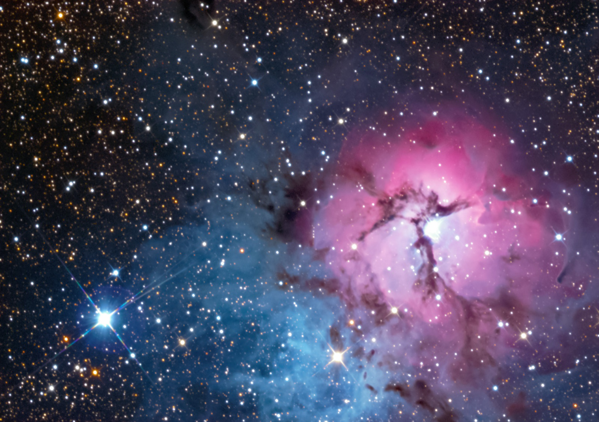 [원본 페이지](https://www.eso.org/public/images/eso1504g/) | 삼렬성운 가시광 | 8 | 7 | 분홍+파랑 2색 성운이 선명. 가로 1.4:1 · 비율 1.42:1 · 타일 불가 → 미러 반복/크로스페이드 · 밝음(평균 휘도 73) → 60%+ 어둡게 보정 필요 · 추천: ④ 성운 구간 | 3840x2708 px [ESO](https://www.eso.org/public/images/eso1504g/) 저장본 1600x1128 |
| 38 | 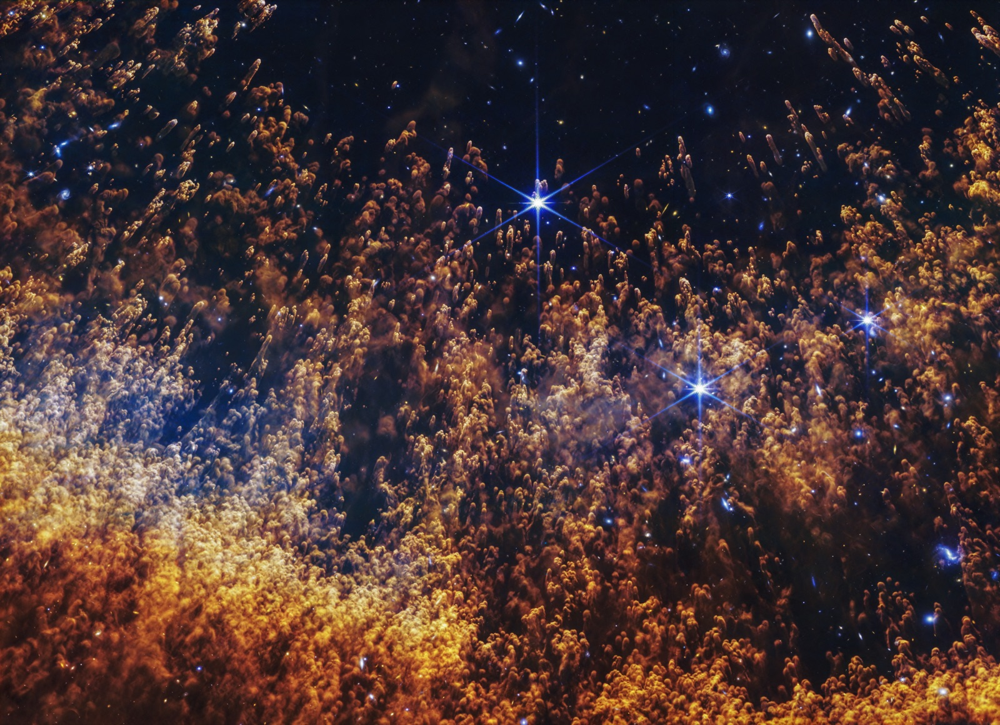 [원본 페이지](https://esawebb.org/images/weic2601a/) | 나선성운 가장자리(웹 NIRCam) | 7 | 9 | 주황 혜성형 매듭이 수천 개 → 질감이 매우 촘촘. 어두운 상단 여백 · 비율 1.38:1 · 타일 불가 → 미러 반복/크로스페이드 · 중간(평균 휘도 58) → 30~50% 검은 스크림 권장 · 추천: ④ 성운 구간 | 11124x8064 px [ESA/Webb](https://esawebb.org/images/weic2601a/) 저장본 1600x1160 |
| 39 | 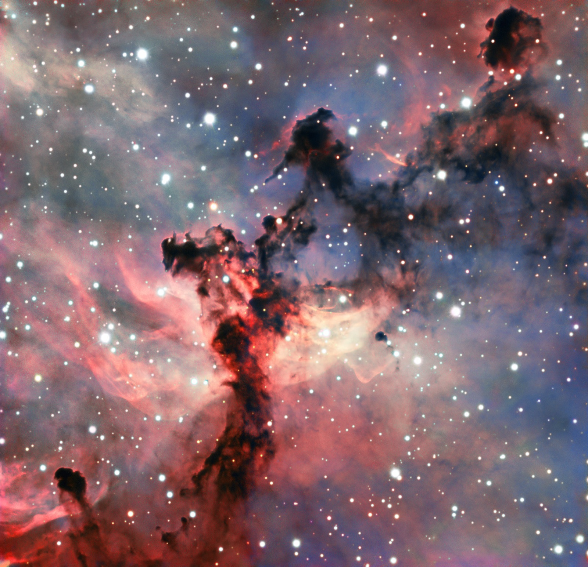 [원본 페이지](https://www.eso.org/public/images/potw1847a/) | 장미성운 일부(VLT) | 8 | 8 | ⚠ 평균 밝기 가장 높음(붉은 화면 전체) → UI 위에는 강한 어둡게 처리 필요 · 비율 1.04:1 · 타일 불가 → 미러 반복/크로스페이드 · 밝음(평균 휘도 110) → 60%+ 어둡게 보정 필요 · 추천: ④ 성운 구간 | 1770x1710 px [ESO](https://www.eso.org/public/images/potw1847a/) 저장본 1600x1545 |
| 40 | 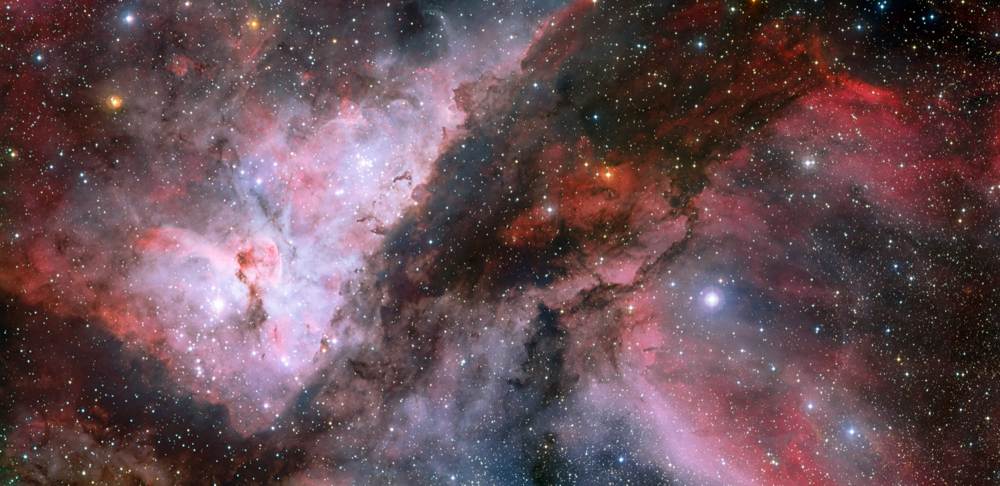 [원본 페이지](https://www.eso.org/public/images/eso1031b/) | 용골자리 성운 파노라마(WR 22·에타 카리나이) | 8 | 8 | 가로 2:1 파노라마 → 가로 스크롤에 유리. 밝은 편 · 비율 2.05:1 · 타일 불가 → 미러 반복/크로스페이드 · 밝음(평균 휘도 85) → 60%+ 어둡게 보정 필요 · 추천: ④ 성운 구간 | 14576x7100 px [ESO](https://www.eso.org/public/images/eso1031b/) 저장본 1600x779 |
| | | **⑤ 클라이맥스·이벤트** | | | | |
| 41 | 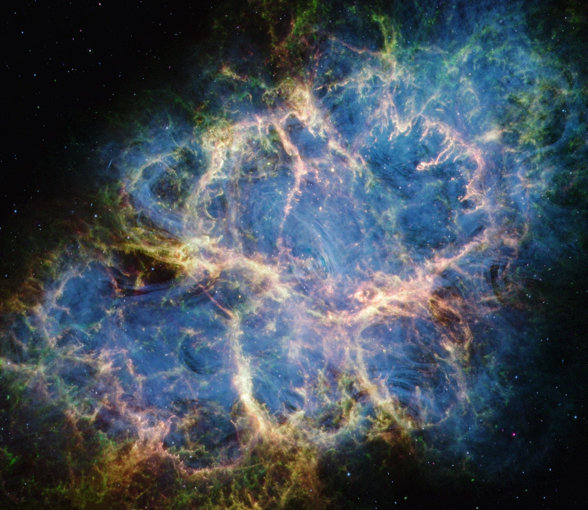 [원본 페이지](https://esawebb.org/images/weic2417a/) | 게성운(웹 MIRI+NIRCam) | 8 | 9 | 초신성 잔해 그물 구조가 화면을 꽉 채움 → 배경보다 이벤트 컷 · 비율 1.15:1 · 타일 불가 → 미러 반복/크로스페이드 · 밝음(평균 휘도 76) → 60%+ 어둡게 보정 필요 · 추천: ⑤ 클라이맥스·이벤트 | 2958x2569 px [ESA/Webb](https://esawebb.org/images/weic2417a/) 저장본 1600x1389 |
| 42 | 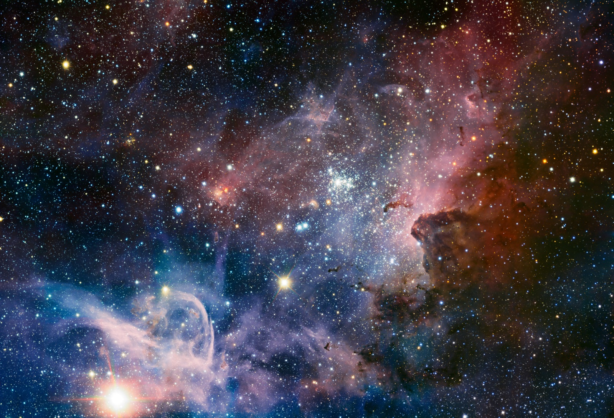 [원본 페이지](https://www.eso.org/public/images/eso1208a/) | 용골자리 성운 적외선(VLT HAWK-I) | 8 | 9 | 수많은 별 + 주황 먼지. 가로 1.47:1 · 비율 1.47:1 · 타일 불가 → 미러 반복/크로스페이드 · 중간(평균 휘도 63) → 30~50% 검은 스크림 권장 · 추천: ⑤ 클라이맥스·이벤트 | 13092x8926 px [ESO](https://www.eso.org/public/images/eso1208a/) 저장본 1600x1091 |
| 43 | 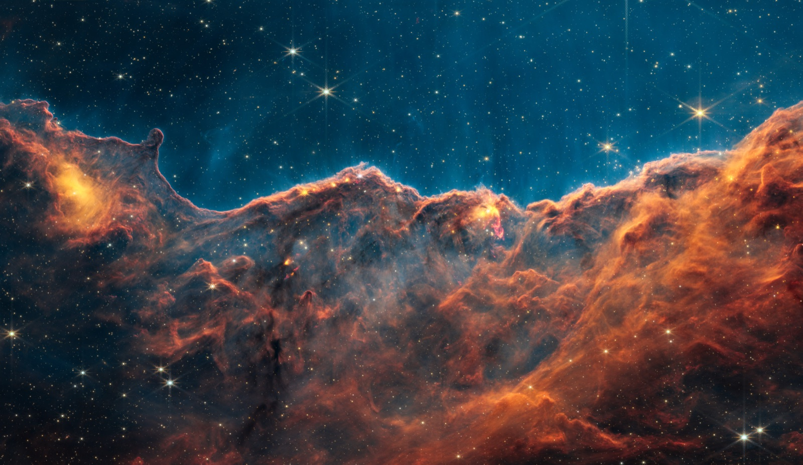 [원본 페이지](https://esawebb.org/images/carinanebula3/) | 용골자리 성운 제트(웹 협대역) | 8 | 9 | "우주 절벽" 다른 버전. 16:9에 가까움 · 비율 1.72:1 · 타일 불가 → 미러 반복/크로스페이드 · 중간(평균 휘도 64) → 30~50% 검은 스크림 권장 · 추천: ⑤ 클라이맥스·이벤트 | 14570x8452 px [ESA/Webb](https://esawebb.org/images/carinanebula3/) 저장본 1600x928 |
| 44 | 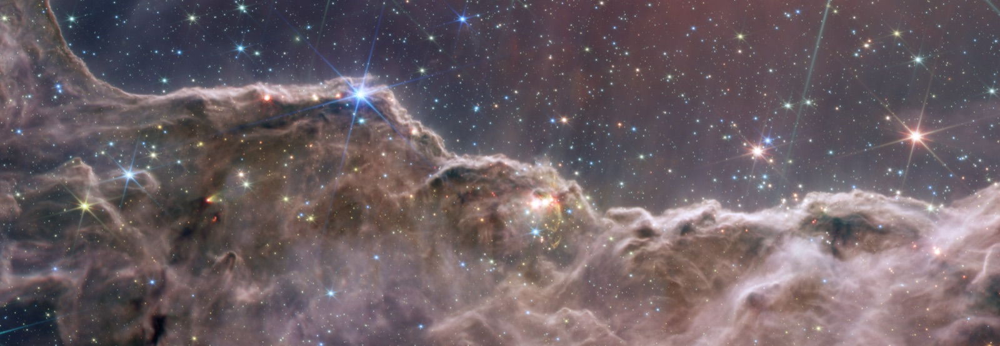 [원본 페이지](https://esawebb.org/images/weic2205b/) | 용골자리 "우주 절벽"(웹 NIRCam+MIRI 합성) | 8 | 9 | **2.9:1 초광폭** → 가로 스크롤 클라이맥스에 최적. 밝은 편. MIRI 합성으로 채도가 낮은 회갈색 톤이라 NIRCam판(마지막 행)보다 화려함 한 단계 낮음 · 비율 2.89:1 · 타일 불가 → 미러 반복/크로스페이드 · 밝음(평균 휘도 100) → 60%+ 어둡게 보정 필요 · 추천: ⑤ 클라이맥스·이벤트 | 11264x3904 px [ESA/Webb](https://esawebb.org/images/weic2205b/) 저장본 1600x554 |
| 45 | 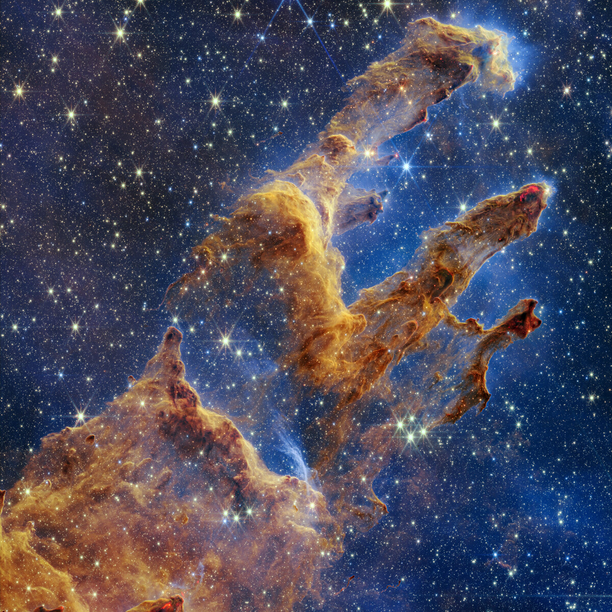 [원본 페이지](https://esawebb.org/images/weic2216a/) | 창조의 기둥(웹 NIRCam) | 9 | 8 | 가장 유명한 웹 이미지. 이 페이지 원본은 1200px 크롭판 → **Full View 원본: https://esawebb.org/images/weic2216b/ (8423x14589 px, CC BY 4.0, 동일 크레딧)** · 비율 1.00:1 · 타일 불가 → 미러 반복/크로스페이드 · 밝음(평균 휘도 77) → 60%+ 어둡게 보정 필요 · 추천: ⑤ 클라이맥스·이벤트 | 1200x1200 px [ESA/Webb](https://esawebb.org/images/weic2216a/) Full View 8423x14589 px: [weic2216b](https://esawebb.org/images/weic2216b/) 저장본 1200x1200 |
| 46 | 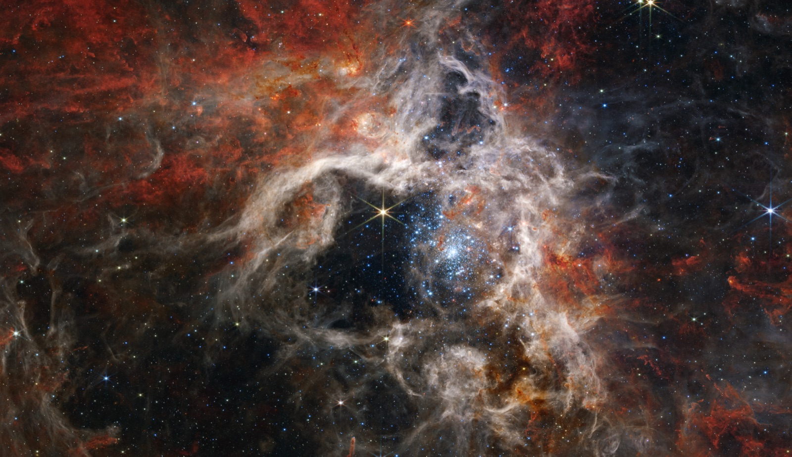 [원본 페이지](https://esawebb.org/images/weic2212a/) | 타란툴라 성운(웹 NIRCam) | 9 | 9 | 중앙 공동 + 사방 필라멘트. 16:9에 가까워 가로 배경으로 바로 사용 · 비율 1.73:1 · 타일 불가 → 미러 반복/크로스페이드 · 중간(평균 휘도 63) → 30~50% 검은 스크림 권장 · 추천: ⑤ 클라이맥스·이벤트 | 14557x8418 px [ESA/Webb](https://esawebb.org/images/weic2212a/) 저장본 1600x925 |
| 47 | 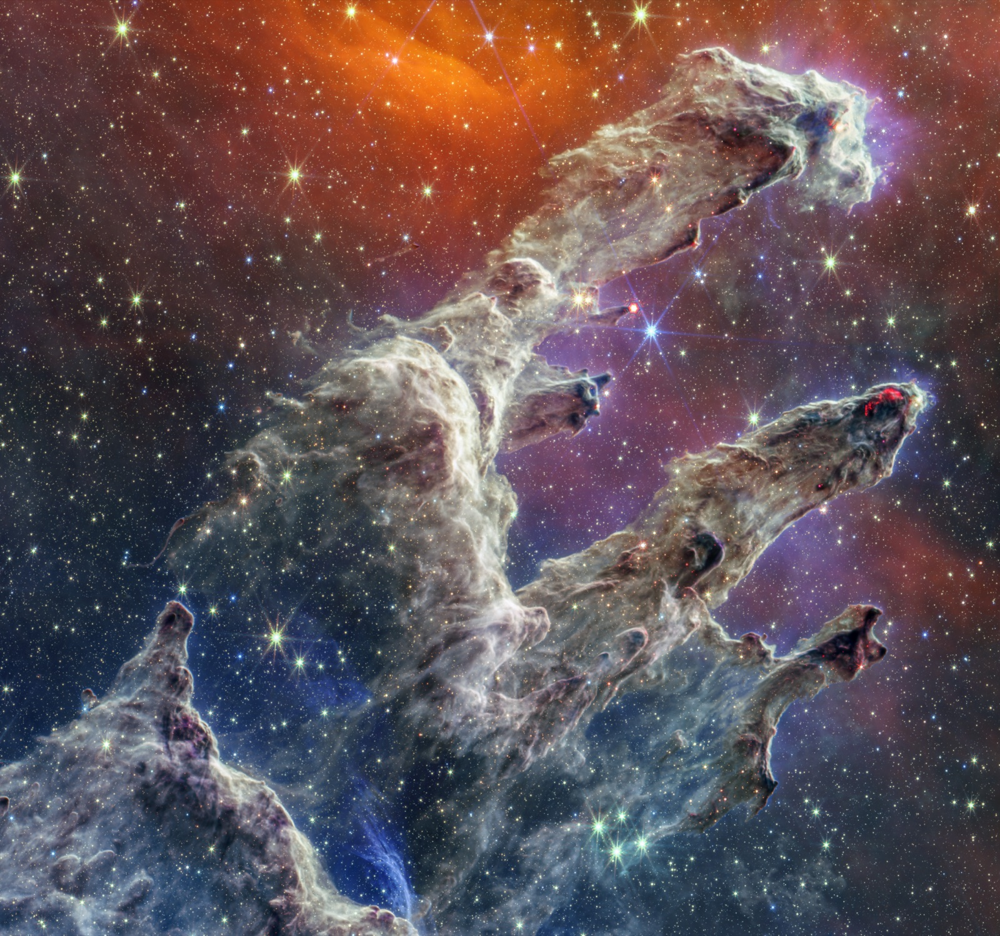 [원본 페이지](https://esawebb.org/images/pillarsofcreation_composite/) | 창조의 기둥(웹 NIRCam+MIRI 합성) | 9 | 9 | 주황 기둥 + 푸른 바탕 + 별. 밝은 편 · 비율 1.07:1 · 타일 불가 → 미러 반복/크로스페이드 · 밝음(평균 휘도 87) → 60%+ 어둡게 보정 필요 · 추천: ⑤ 클라이맥스·이벤트 | 7130x6675 px [ESA/Webb](https://esawebb.org/images/pillarsofcreation_composite/) 저장본 1600x1498 |
| 48 | 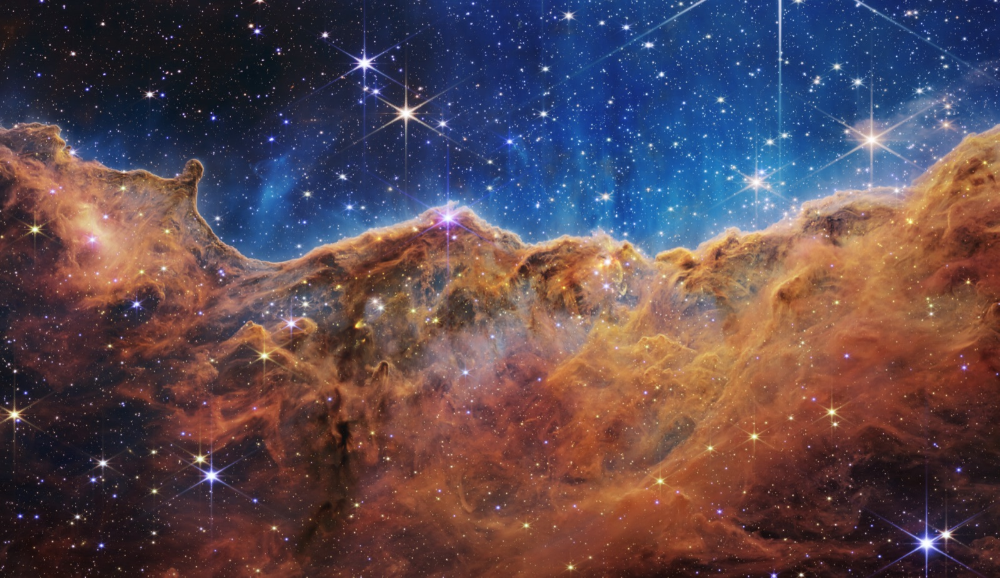 [원본 페이지](https://esawebb.org/images/weic2205a/) | 용골자리 "우주 절벽"(웹 NIRCam) | 10 | 9 | 웹 첫 공개 이미지 세트(2022-07-12) 중 하나. 주황 절벽 + 푸른 하늘 → 최고 화려함. 1.73:1 · 비율 1.73:1 · 타일 불가 → 미러 반복/크로스페이드 · 밝음(평균 휘도 79) → 60%+ 어둡게 보정 필요 · 추천: ⑤ 클라이맥스·이벤트 | 14575x8441 px [ESA/Webb](https://esawebb.org/images/weic2205a/) 저장본 1600x926 |

## 활용 팁

1. **기본 루프:** ①단계는 4번(360° 파노라마)을 가로로 무한 스크롤하고, 1–3번을 옅게 겹쳐 시차(parallax) 레이어로 쓰면 "평범하지만 살아있는" 별밭이 된다.
2. **단계 전환:** 단계가 바뀔 때 다음 단계 이미지를 3–5초 크로스페이드한다. 전환 지점은 CONCEPT의 마일스톤(헬리오포즈, 오르트 구름 탈출, 프록시마 도착)에 맞춘다.
3. **프록시마 도착:** 11번(알파·프록시마 센타우리 주변 실제 하늘)을 도착 카드 배경으로 쓰면 이야기와 그림이 맞는다.
4. **UI 가독성:** 평균 휘도 70 이상(로제트·우주 절벽 합성·창조의 기둥 합성 등)은 타이머 카드 뒤에 검은 그라데이션 스크림을 깔아야 한다.
5. **해상도:** 저장본은 레퍼런스용 1600px이다. 실제 앱에 넣을 때는 원본 페이지에서 large/original을 다시 받는다(대부분 4K 이상). 단 26번(안드로메다)과 45번(창조의 기둥 크롭판, 원본도 1200px → weic2216b 사용)은 예외다. 26번은 원본이 1.5기가픽셀이라 이번에는 1280px 화면판만 받았고, 45번은 페이지 원본 자체가 1200px이므로 Full View(https://esawebb.org/images/weic2216b/, 8423x14589 px)를 받아야 한다.

## 출처/라이선스

- **ESO** (eso.org): CC BY 4.0. 크레딧은 "ESO/…" 형식. https://www.eso.org/public/copyright/
- **ESA/Hubble** (esahubble.org): CC BY 4.0. https://esahubble.org/copyright/
- **ESA/Webb** (esawebb.org): CC BY 4.0. https://esawebb.org/copyright/ (NASA/STScI 공동 이미지 포함)
- 아래 "발견" 열은 해당 이미지 페이지를 어떤 도구가 찾았는지 나타낸다(aside 또는 직접 지정). 메타데이터 추출과 다운로드는 **모두 Scrapling**이 했다.

| no | 파일 | 원제 | 크레딧 | 라이선스 | 이미지 페이지 | 다운로드 원본 URL | 발견 |
| --- | --- | --- | --- | --- | --- | --- | --- |
| 1 | `images/messier-67-wide-field-eso1402c.jpg` | Wide-field view of the open star cluster Messier 67 | ESO/Digitized Sky Survey 2 Acknowledgement: Davide De Martin | CC BY 4.0 (ESO 게시) — DSS2 기반 데이터, 상용 전 DSS 이용조건 재확인 권장 | https://www.eso.org/public/images/eso1402c/ | https://cdn.eso.org/images/large/eso1402c.jpg | aside |
| 2 | `images/secret-of-stellar-youth-potw1104a.jpg` | The secret of stellar youth | ESA/Hubble & NASA | CC BY 4.0 | https://esahubble.org/images/potw1104a/ | https://cdn.esahubble.org/archives/images/large/potw1104a.jpg | aside |
| 3 | `images/ancient-cluster-stunning-background-potw1046a.jpg` | An ancient cluster of stars against a stunning background | ESO | CC BY 4.0 | https://www.eso.org/public/images/potw1046a/ | https://cdn.eso.org/images/large/potw1046a.jpg | aside |
| 4 | `images/milky-way-panorama-eso0932a.jpg` | The Milky Way panorama | ESO/S. Brunier | CC BY 4.0 | https://www.eso.org/public/images/eso0932a/ | https://cdn.eso.org/images/large/eso0932a.jpg | aside |
| 5 | `images/sky-around-ngc-2367-eso1526c.jpg` | Wide-field view of the sky around the bright star cluster NGC 2367 | ESO/Digitized Sky Survey 2. Acknowledgement: Davide De Martin | CC BY 4.0 (ESO 게시) — DSS2 기반 데이터, 상용 전 DSS 이용조건 재확인 권장 | https://www.eso.org/public/images/eso1526c/ | https://cdn.eso.org/images/large/eso1526c.jpg | aside |
| 6 | `images/moon-milky-way-arc-potw1217a.jpg` | The moon and the arc of the Milky Way | ESO/S. Guisard ( www.eso.org/~sguisard ) | CC BY 4.0 | https://www.eso.org/public/images/potw1217a/ | https://cdn.eso.org/images/large/potw1217a.jpg | aside |
| 7 | `images/hubble-ultra-deep-field-heic0406a.jpg` | Hubble sees galaxies galore | NASA , ESA , and S. Beckwith ( STScI ) and the HUDF Team | CC BY 4.0 | https://esahubble.org/images/heic0406a/ | https://cdn.esahubble.org/archives/images/large/heic0406a.jpg | 직접 지정(aside는 heic0611b 제안) |
| 8 | `images/webb-classic-deep-field-potm2507a.jpg` | A fresh look at a classic deep field | ESA/Webb, NASA & CSA, G. Östlin, P. G. Perez-Gonzalez, J. Melinder, the JADES Collaboration, the MIDIS collaboration, M. Zamani (ESA/Webb) | CC BY 4.0 | https://esawebb.org/images/potm2507a/ | https://cdn.esawebb.org/archives/images/large/potm2507a.jpg | aside |
| 9 | `images/star-cluster-ic-4651-eso1534a.jpg` | The rich star cluster IC 4651 | ESO | CC BY 4.0 | https://www.eso.org/public/images/eso1534a/ | https://cdn.eso.org/images/large/eso1534a.jpg | aside |
| 10 | `images/old-stars-youthful-glow-potw1107a.jpg` | Old stars with a youthful glow | ESA/Hubble & NASA | CC BY 4.0 | https://esahubble.org/images/potw1107a/ | https://cdn.esahubble.org/archives/images/large/potw1107a.jpg | aside |
| 11 | `images/sky-around-alpha-proxima-centauri-eso1629i.jpg` | The sky around Alpha Centauri and Proxima Centauri | Digitized Sky Survey 2 Acknowledgement: Davide De Martin/ Mahdi Zamani | CC BY 4.0 (ESO 게시) — DSS2 기반 데이터, 상용 전 DSS 이용조건 재확인 권장 | https://www.eso.org/public/images/eso1629i/ | https://cdn.eso.org/images/publicationjpg/eso1629i.jpg | aside |
| 12 | `images/barnard-68-dark-cloud-eso9924a.jpg` | B68, the black cloud | ESO | CC BY 4.0 | https://www.eso.org/public/images/eso9924a/ | https://cdn.eso.org/images/large/eso9924a.jpg | aside |
| 13 | `images/southern-milky-way-alma-potw1222a.jpg` | The southern Milky Way above ALMA | ESO/B. Tafreshi ( twanight.org ) | CC BY 4.0 | https://www.eso.org/public/images/potw1222a/ | https://cdn.eso.org/images/large/potw1222a.jpg | aside |
| 14 | `images/vista-milky-way-centre-gigapixel-eso1242a.jpg` | VISTA gigapixel mosaic of the central parts of the Milky Way | ESO/VVV Survey/D. Minniti Acknowledgement: Ignacio Toledo, Martin Kornmesser | CC BY 4.0 | https://www.eso.org/public/images/eso1242a/ | https://cdn.eso.org/images/publicationjpg/eso1242a.jpg | aside |
| 15 | `images/star-studded-cluster-potw2320a.jpg` | Scrutinising a star-studded cluster | ESA/Hubble & NASA, E. Noyola, R. Cohen | CC BY 4.0 | https://esahubble.org/images/potw2320a/ | https://cdn.esahubble.org/archives/images/large/potw2320a.jpg | aside |
| 16 | `images/pipe-nebula-eso-yb.jpg` | The Pipe Nebula | ESO/ Y. Beletsky | CC BY 4.0 | https://www.eso.org/public/images/yb/ | https://cdn.eso.org/images/large/yb.jpg | aside |
| 17 | `images/one-million-stars-milky-way-heart-eso0949b.jpg` | One million stars — towards the dark heart of the Milky Way* | ESO/VISTA. Acknowledgment: Cambridge Astronomical Survey Unit | CC BY 4.0 | https://www.eso.org/public/images/eso0949b/ | https://cdn.eso.org/images/publicationjpg/eso0949b.jpg | aside |
| 18 | `images/pipe-nebula-mouthpiece-eso1233a.jpg` | The mouthpiece of the Pipe Nebula | ESO | CC BY 4.0 | https://www.eso.org/public/images/eso1233a/ | https://cdn.eso.org/images/publicationjpg/eso1233a.jpg | aside |
| 19 | `images/lupus-3-dark-cloud-eso1303a.jpg` | The Lupus 3 dark cloud and associated hot young stars | ESO/F. Comeron | CC BY 4.0 | https://www.eso.org/public/images/eso1303a/ | https://cdn.eso.org/images/publicationjpg/eso1303a.jpg | aside |
| 20 | `images/lagoon-nebula-wide-field-eso1403c.jpg` | Wide-field view of the Lagoon Nebula | ESO/Digitized Sky Survey 2 Acknowledgement: Davide De Martin. | CC BY 4.0 (ESO 게시) — DSS2 기반 데이터, 상용 전 DSS 이용조건 재확인 권장 | https://www.eso.org/public/images/eso1403c/ | https://cdn.eso.org/images/publicationjpg/eso1403c.jpg | aside |
| 21 | `images/horsehead-nebula-hubble-heic0105a.jpg` | Eleven years in orbit: Hubble observes the popular Horsehead nebula | NASA , NOAO, ESA and The Hubble Heritage Team ( STScI / AURA ) | CC BY 4.0 | https://esahubble.org/images/heic0105a/ | https://cdn.esahubble.org/archives/images/large/heic0105a.jpg | aside |
| 22 | `images/milky-way-centre-eso0226a.jpg` | The centre of the Milky Way | ESO | CC BY 4.0 | https://www.eso.org/public/images/eso0226a/ | https://cdn.eso.org/images/large/eso0226a.jpg | aside |
| 23 | `images/messier-78-reflection-nebula-eso1105a.jpg` | Messier 78: a reflection nebula in Orion | ESO/Igor Chekalin | CC BY 4.0 | https://www.eso.org/public/images/eso1105a/ | https://cdn.eso.org/images/large/eso1105a.jpg | aside |
| 24 | `images/horsehead-nebula-webb-weic2411a.jpg` | Horsehead Nebula (NIRCam image) | ESA/Webb, NASA, CSA, K. Misselt (University of Arizona) and A. Abergel (IAS/University Paris-Saclay, CNRS) | CC BY 4.0 | https://esawebb.org/images/weic2411a/ | https://cdn.esawebb.org/archives/images/large/weic2411a.jpg | aside |
| 25 | `images/southern-ring-nebula-webb-weic2207b.jpg` | Southern Ring Nebula (NIRCam Image) | NASA, ESA, CSA, STScI, and the Webb ERO Production Team | CC BY 4.0 | https://esawebb.org/images/weic2207b/ | https://cdn.esawebb.org/archives/images/large/weic2207b.jpg | aside |
| 26 | `images/andromeda-galaxy-hubble-heic1502a.jpg` | Sharpest ever view of the Andromeda Galaxy | NASA , ESA , J. Dalcanton (University of Washington, USA), B. F. Williams (University of Washington, USA), L. C. Johnson (University of Washington, USA), the PHAT team, and R. Gendler. | CC BY 4.0 | https://esahubble.org/images/heic1502a/ | https://cdn.esahubble.org/archives/images/screen/heic1502a.jpg | aside |
| 27 | `images/trifid-nebula-vista-eso1504a.jpg` | VISTA views the Trifid Nebula and reveals hidden variable stars | ESO/VVV consortium/D. Minniti | CC BY 4.0 | https://www.eso.org/public/images/eso1504a/ | https://cdn.eso.org/images/large/eso1504a.jpg | aside |
| 28 | `images/paranal-starscape-eso0934a.jpg` | A 340-million pixel starscape from Paranal | ESO/S. Guisard ( www.eso.org/~sguisard ) | CC BY 4.0 | https://www.eso.org/public/images/eso0934a/ | https://cdn.eso.org/images/large/eso0934a.jpg | aside |
| 29 | `images/orion-nebula-vst-eso1723a.jpg` | The Orion Nebula and cluster from the VLT Survey Telescope | ESO/G. Beccari | CC BY 4.0 | https://www.eso.org/public/images/eso1723a/ | https://cdn.eso.org/images/publicationjpg/eso1723a.jpg | aside |
| 30 | `images/eagle-nebula-eso0926a.jpg` | The Eagle Nebula | ESO | CC BY 4.0 | https://www.eso.org/public/images/eso0926a/ | https://cdn.eso.org/images/large/eso0926a.jpg | aside |
| 31 | `images/lagoon-nebula-eso0936a.jpg` | 370-million-pixel starscape of the Lagoon Nebula | ESO | CC BY 4.0 | https://www.eso.org/public/images/eso0936a/ | https://cdn.eso.org/images/publicationjpg/eso0936a.jpg | aside |
| 32 | `images/omega-nebula-eso0925a.jpg` | The Omega Nebula | ESO | CC BY 4.0 | https://www.eso.org/public/images/eso0925a/ | https://cdn.eso.org/images/large/eso0925a.jpg | 직접 지정 |
| 33 | `images/carina-nebula-hubble-wfc3-heic0910e.jpg` | WFC3 visible image of the Carina Nebula | NASA, ESA and the Hubble SM4 ERO Team | CC BY 4.0 | https://esahubble.org/images/heic0910e/ | https://cdn.esahubble.org/archives/images/large/heic0910e.jpg | aside |
| 34 | `images/pillars-of-creation-webb-miri-weic2218a.jpg` | Pillars of Creation (MIRI Image) | NASA, ESA, CSA, STScI, J. DePasquale (STScI), A. Pagan (STScI) | CC BY 4.0 | https://esawebb.org/images/weic2218a/ | https://cdn.esawebb.org/archives/images/large/weic2218a.jpg | aside |
| 35 | `images/orion-nebula-hawki-eso1625a.jpg` | A deep infrared view of the Orion Nebula from HAWK-I | ESO/H. Drass et al. | CC BY 4.0 | https://www.eso.org/public/images/eso1625a/ | https://cdn.eso.org/images/publicationjpg/eso1625a.jpg | aside |
| 36 | `images/rho-ophiuchi-webb-weic2316a.jpg` | Rho Ophiuchi cloud complex | NASA, ESA, CSA, STScI, K. Pontoppidan (STScI), A. Pagan (STScI) | CC BY 4.0 | https://esawebb.org/images/weic2316a/ | https://cdn.esawebb.org/archives/images/large/weic2316a.jpg | aside |
| 37 | `images/trifid-nebula-visible-eso1504g.jpg` | Trifid Nebula in visible light | ESO/ Gábor Tóth | CC BY 4.0 | https://www.eso.org/public/images/eso1504g/ | https://cdn.eso.org/images/large/eso1504g.jpg | aside |
| 38 | `images/helix-nebula-webb-weic2601a.jpg` | Helix Nebula (NIRCam image) | NASA, ESA, CSA, STScI, A. Pagan (STScI) | CC BY 4.0 | https://esawebb.org/images/weic2601a/ | https://cdn.esawebb.org/archives/images/large/weic2601a.jpg | aside |
| 39 | `images/rosette-nebula-vlt-potw1847a.jpg` | A rosette for the VLT | ESO | CC BY 4.0 | https://www.eso.org/public/images/potw1847a/ | https://cdn.eso.org/images/large/potw1847a.jpg | aside |
| 40 | `images/carina-nebula-panorama-eso1031b.jpg` | Panoramic view of the WR 22 and Eta Carinae regions of the Carina Nebula* | ESO | CC BY 4.0 | https://www.eso.org/public/images/eso1031b/ | https://cdn.eso.org/images/large/eso1031b.jpg | aside |
| 41 | `images/crab-nebula-webb-weic2417a.jpg` | Crab Nebula (MIRI and NIRCam image) | NASA, ESA, CSA, STScI, T. Temim (Princeton University) | CC BY 4.0 | https://esawebb.org/images/weic2417a/ | https://cdn.esawebb.org/archives/images/large/weic2417a.jpg | aside |
| 42 | `images/carina-nebula-infrared-vlt-eso1208a.jpg` | ESO’s VLT reveals the Carina Nebula's hidden secrets | ESO/T. Preibisch | CC BY 4.0 | https://www.eso.org/public/images/eso1208a/ | https://cdn.eso.org/images/large/eso1208a.jpg | aside |
| 43 | `images/carina-nebula-jets-webb.jpg` | Carina Nebula Jets (NIRCam Narrowband Filters) | NASA, ESA, CSA, and STScI, J. DePasquale (STScI) | CC BY 4.0 | https://esawebb.org/images/carinanebula3/ | https://cdn.esawebb.org/archives/images/large/carinanebula3.jpg | aside |
| 44 | `images/carina-cosmic-cliffs-webb-composite-weic2205b.jpg` | Combined NIRCam and MIRI Image of the “Cosmic Cliffs” in Carina | NASA, ESA, CSA, and STScI | CC BY 4.0 | https://esawebb.org/images/weic2205b/ | https://cdn.esawebb.org/archives/images/large/weic2205b.jpg | aside |
| 45 | `images/pillars-of-creation-webb-nircam-weic2216a.jpg` | Webb Takes a Stunning, Star-Filled Portrait of the Pillars of Creation (Cropped) | NASA, ESA, CSA, STScI; J. DePasquale, A. Koekemoer, A. Pagan (STScI). | CC BY 4.0 | https://esawebb.org/images/weic2216a/ (Full View 원본: https://esawebb.org/images/weic2216b/ , 8423x14589 px, CC BY 4.0, 동일 크레딧) | https://cdn.esawebb.org/archives/images/large/weic2216a.jpg | 직접 지정 |
| 46 | `images/tarantula-nebula-webb-weic2212a.jpg` | Tarantula Nebula (NIRCam Image) | NASA, ESA, CSA, and STScI | CC BY 4.0 | https://esawebb.org/images/weic2212a/ | https://cdn.esawebb.org/archives/images/large/weic2212a.jpg | aside |
| 47 | `images/pillars-of-creation-webb-composite.jpg` | Pillars of Creation (NIRCam and MIRI Composite Image) | NASA, ESA, CSA, STScI, J. DePasquale (STScI), A. Pagan (STScI), A. M. Koekemoer (STScI) | CC BY 4.0 | https://esawebb.org/images/pillarsofcreation_composite/ | https://cdn.esawebb.org/archives/images/large/pillarsofcreation_composite.jpg | aside |
| 48 | `images/carina-cosmic-cliffs-webb-nircam-weic2205a.jpg` | NIRCam Image of the “Cosmic Cliffs” in Carina | NASA, ESA, CSA, and STScI | CC BY 4.0 | https://esawebb.org/images/weic2205a/ | https://cdn.esawebb.org/archives/images/large/weic2205a.jpg | aside |